This guide takes you step by step through the use of the Shapeoko 3 CNC machine. It is mainly used for milling, a manufacturing process where the machine **removes material from a block (such as wood, metal or plastic) by rotating a cutting bit very quickly**. This makes it possible to create precise engravings and cuts in the material.

## Personal security
- Safety is paramount when using a CNC machine. Always follow these rules:
  - Never start the CNC machine with the protective cover open
  - Wear protective glasses
  - Wear hearing protection if necessary
  - Ensure that the ventilation system is functional
  - Never leave the machine unattended while it is operating
  - Always **switch off the router** (**Toupie** switch) and wait for the bit to stop completely before touching the bit

## Hardware reference

- CNC machine model used: <a href="/pdf/shapeoko3_assembly_guide.pdf" target="_blank" rel="noopener noreferrer">Shapeoko 3</a>
- Industrial compact router used: **DEWALT DWP611** (<a href="/pdf/dwp611.pdf" target="_blank" rel="noopener noreferrer">User manual</a>)
    - Collars available: **0,25" (6,35 mm)**
    - Several types of bits are available and can be installed on the router

    

    - See below an example of the different bits available to insert into the collar

    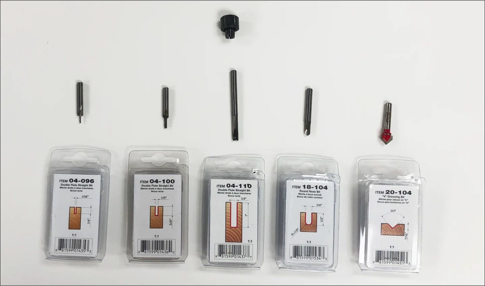

    - See below the **process of installing a bit into the collar**

    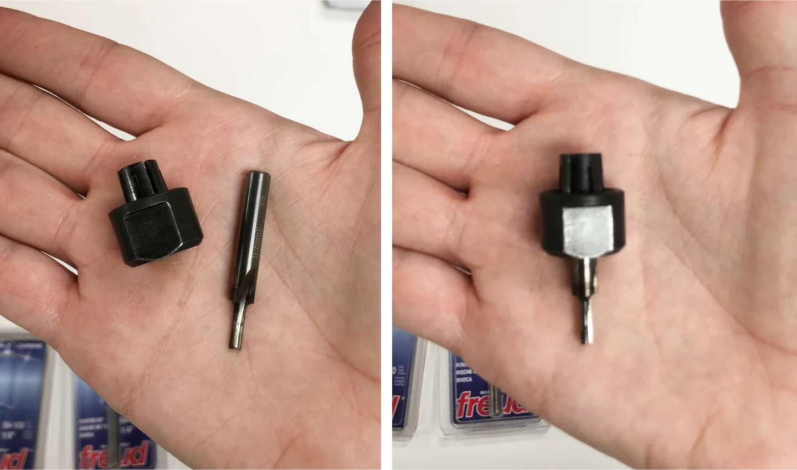

- **BitSetter** module: a sensor that automatically measures the length of the bit, so that you can **use several bits in a single job** (see the [BitSetter module](#bitsetter-module-changing-bits) section)

- **Advanced users**: Update the firmware of the CNC machine periodically by connecting the CNC machine to your computer using a USB cable and using the Arduino IDE to upload the program
    - Firmware update: GRBL 1.1h (updated from version 1.1f) <a href="https://github.com/gnea/grbl/releases/tag/v1.1h.20190825" target="_blank" rel="noopener noreferrer">Firmware link</a>

## Work area

- The work surface is **about 30" (width) x 27" (length) (i.e. 76.20 cm x 68.58 cm)**

    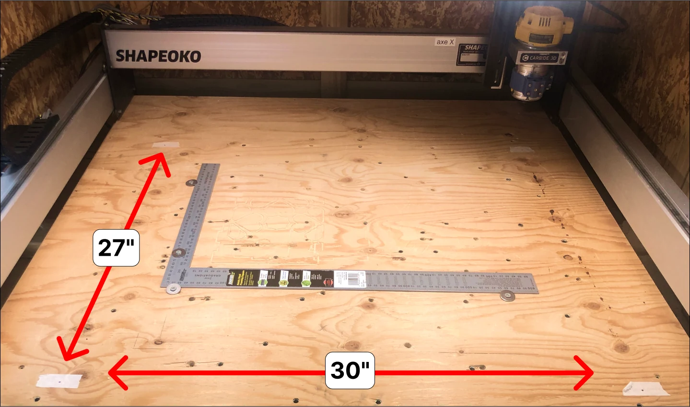

## Machinable materials

- Wood: All types of wood
    - Possible material cutting thickness: **1 inch (25.4 mm) and less**. It depends on the bits you use (**inspect the bits and their boxes**)
- Plastic
    - **Non-machinable** (We do not have a ventilation system to expel the fumes given off by the plastic)
- Metal
    - **Non-machinable**
- Copper plates
    - Copper plates (FR1 type) for creating printed circuits

## Software to use

Carbide 3D provides a **suite of 2 software** designed for its CNC machines (software available only in English):

1. **Carbide Create**
   - To define the cutting parameters and generate the G-code file (the list of instructions that the CNC machine will have to follow)
2. **Carbide Motion**
   - To control the CNC machine and run the G-code file generated in Carbide Create

:::note[Note]
This guide explains how to operate the CNC machine to make a cut from an existing design, but it **does not cover creating vector designs**.
:::

## BitSetter module (changing bits)

The machine is fitted with a **BitSetter**: a small sensor attached to the front right of the machine that **automatically measures the length of the bit** installed in the router.

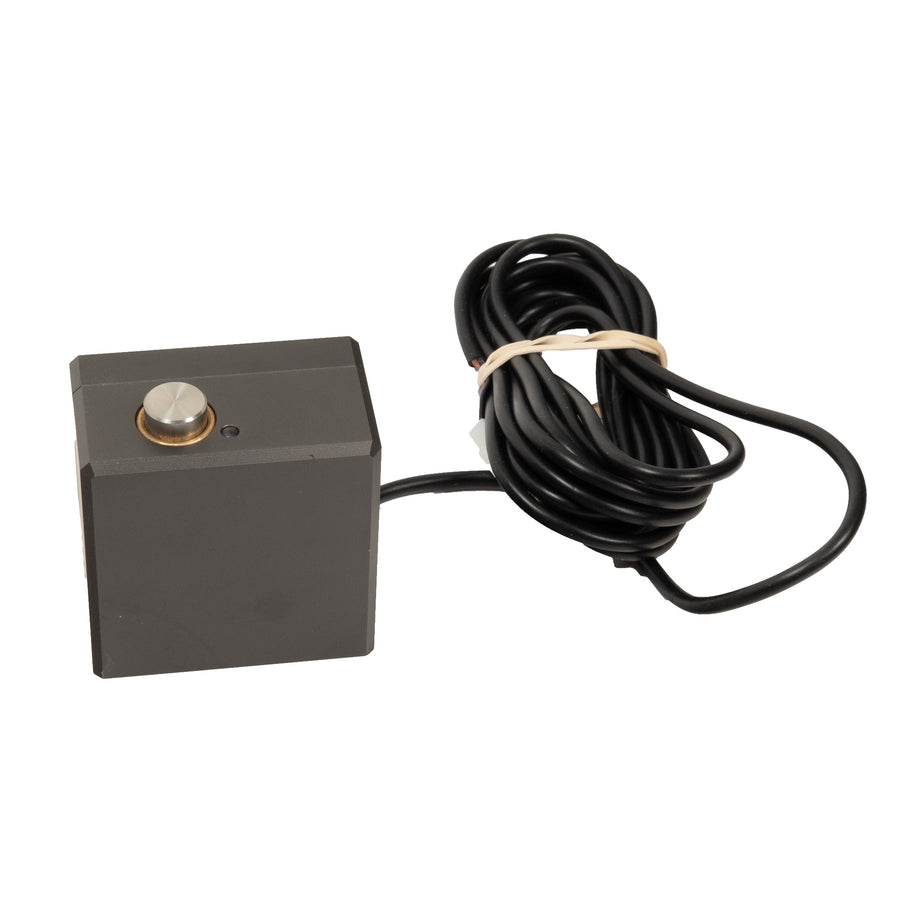

*Photo: Carbide 3D*

### What is the BitSetter for?

- It lets you **use several bits in a single machining file** (for example a bigger bit to quickly remove material, then a thin bit to engrave a smaller drawing).
- At each bit change, Carbide Motion measures the new bit, compares it with the previous one and **automatically recalculates the Z-axis zero**.
- Before the BitSetter, you had to export a separate file for each bit and set the Z zero again at each change.

### Where is it?

- It is attached to the **front plate of the machine, about 114 mm (4.5 inches) from the right edge**.

  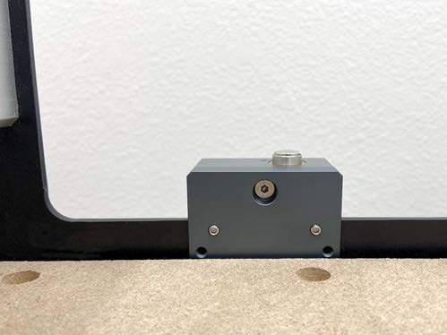

  *Photo: Carbide 3D (BitSetter installation guide)*

- To measure a bit, the machine places the router just above the BitSetter button, then **slowly lowers it until the bit touches the button**.

  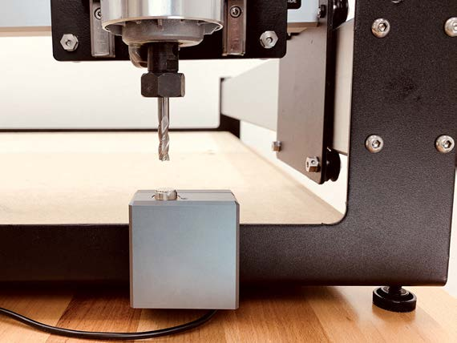

  *Photo: Carbide 3D (BitSetter installation guide)*

### The process at a glance

The diagram below shows the whole machining process with the BitSetter. Each step is explained in detail in the [4. Using Carbide Motion software](#4-using-carbide-motion-software) section.

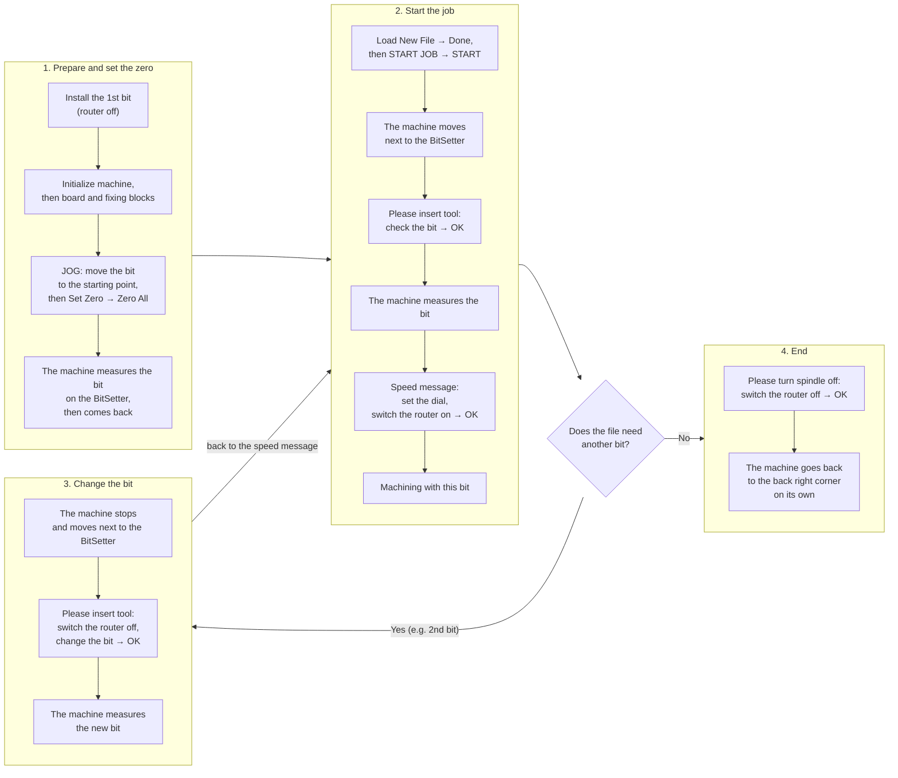

The colours of the diagram:
- **Blue**: what you do
- **Orange**: Carbide Motion shows a message and waits for you
- **Red**: the machine moves on its own (hands out of the machine!)
- **Green**: machining is in progress (router on, cover closed)

With **a single bit**, you go straight from machining to "No", then to the end. With **two bits** (for example a big bit to remove material, then a thin one to engrave), you go once through the "Yes" loop: bit change, measurement of the new bit, speed setting, then machining resumes.

### When does the machine move on its own?

With the BitSetter, the machine **moves on its own to the BitSetter** at several moments:
- when you set the **Z-axis zero** (**"Zero All"** or **"Zero Z"** buttons);
- when you start the job (**"START"** button);
- at each **bit change** requested by the file;
- sometimes also when you bring the router back to the zero point (**"Rapid Position"** or **"Quick Actions"**).

:::danger[Warning: watch out for the machine's movements]
Carbide 3D puts it this way: **when you touch the Z zero, assume the machine could start moving**. Before each of these actions:
- take your hands out of the machine;
- check that **nothing** (clamps, tools, cables, vacuum hose) is in the router's path or around the BitSetter;
- check that the **router is switched off**.
:::

### BitSetter golden rules

:::caution[Follow these at every job]
1. **Router off during every measurement**: the bit must never spin when it touches the BitSetter (it would damage the sensor and the bit).
2. **Only change bits when Carbide Motion asks you to** (**"Please insert tool"** message). If you change the bit at any other time, the machine does not know its length: it may **plunge into the board** or cut in the air. If this happens, set the Z-axis zero again (**"Set Zero"** then **"Zero Z"**): the new bit will be measured.
3. **Bit long enough**: it must stick out of the collet by **at least 12.7 mm (0.5 inch)** to reach the BitSetter button.
4. **Clean button**: a chip on the button distorts the measurement, and so the cutting depth. Nothing must be on the BitSetter button before you start.
5. **Do not move the BitSetter**: its position is saved in Carbide Motion.
:::

### Versions installed at the FabLab

| Item | Version used |
|---|---|
| Machine | Shapeoko 3 XXL, belt-drive Z axis |
| Controller board | Carbide Motion **v2.4e** |
| Firmware | GRBL **1.1** |
| Carbide Motion | **V6**, build **667** (updated on 2 November 2026) |
| Carbide Create | **V7**, build **778** |

:::note[Note]
Carbide 3D changed the way the BitSetter is used **starting with Carbide Motion build 623** (2024): the bit is now measured when you set the Z zero and when you start the job. This guide describes that workflow (build 667). After a Carbide Motion update, check that the steps are still the same.
:::

### Documentation

- <a href="https://my.carbide3d.com/pdf/bitsetter-v2.pdf" target="_blank" rel="noopener noreferrer">Official BitSetter installation and setup guide</a> (Carbide 3D PDF)
- <a href="https://carbide3d.com/blog/bitsetter-changes-carbide-motion" target="_blank" rel="noopener noreferrer">Carbide 3D article on the new BitSetter workflow</a>
- <a href="https://my.carbide3d.com/gettingstarted/shapeoko3/" target="_blank" rel="noopener noreferrer">Getting started with the Shapeoko</a> and the <a href="https://carbide3d.com/hub/courses/getting-started-cnc/" target="_blank" rel="noopener noreferrer">Getting Started with CNC</a> course (Carbide 3D)
- <a href="https://carbide3d.com/downloads/" target="_blank" rel="noopener noreferrer">Download or update Carbide Create and Carbide Motion</a>

## 1. Powering on the machine

Switches and buttons to start the machine are available on the left side:

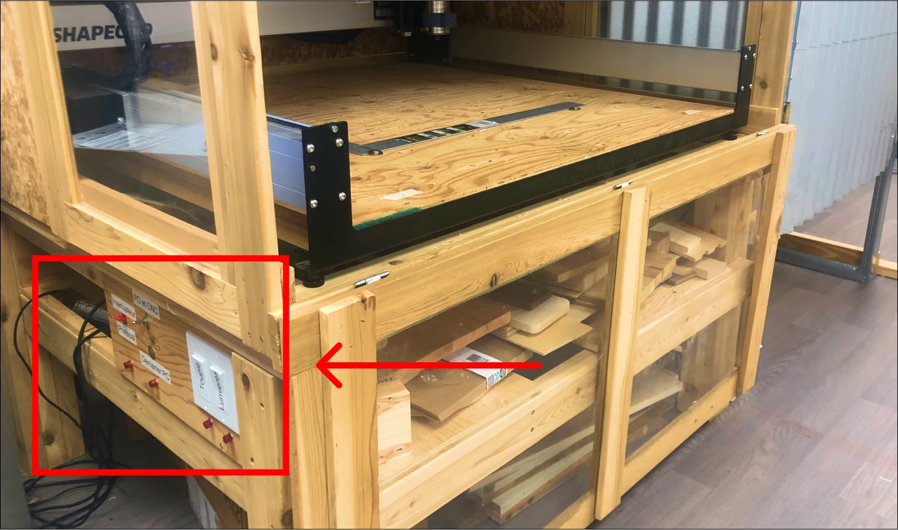

1. Activate the switch **Interrupteur Principal**
2. Activate the switch **PC et CNC**
3. Press the button **Démarrer PC**
4. Activate the switch **Lumières**
5. **Do not touch** at the switch **Toupie** For now

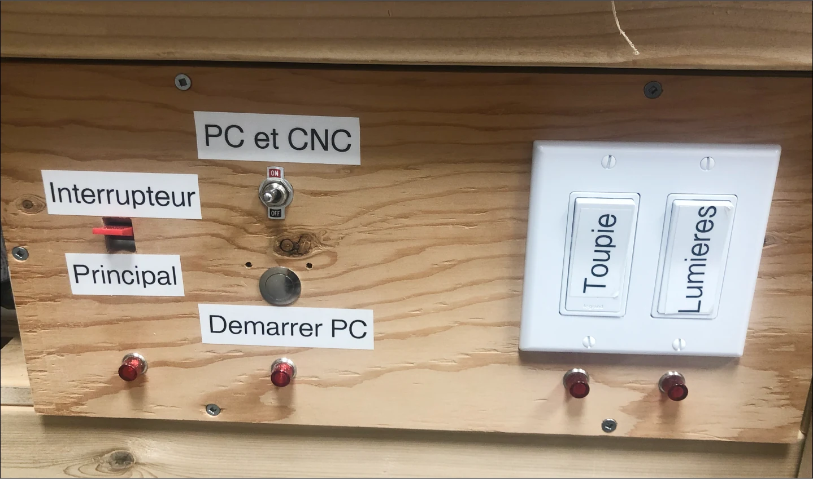

## 2. Preparing the cutting board
- Measure the cutting board (width, length and thickness) using a tape measure **WITHOUT placing it on the work area for the moment**. This step will take place later.

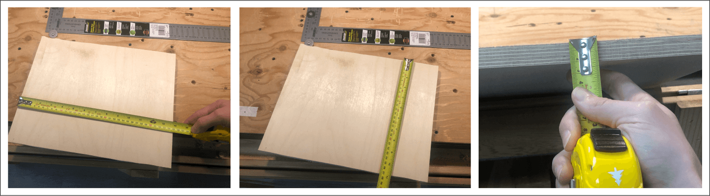

## 3. Using Carbide Create software
- Open the software

  

- Enter the dimensions of the board into the software
  - In the left menu, in the section **"Setup"** of the tab **"Design"**, click on the nut-shaped icon. A dialog box will open.

  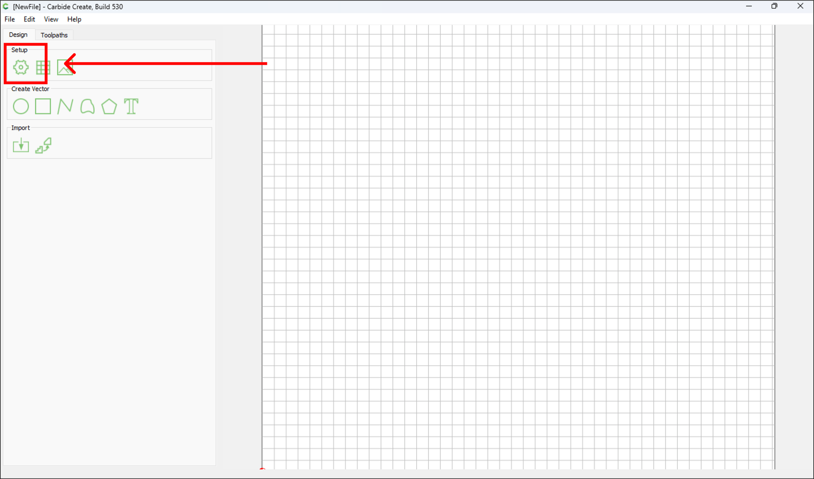

  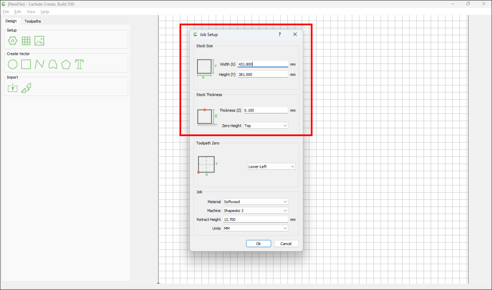

  - In this window, enter the width, length **«Stock Size»** and the thickness of your material **«Stock Thickness»** to be machined in millimeters. It is possible to change the unit of measurement in this window by clicking on the drop-down menu to the right of **«Units»** and selecting **«Inch»**.
    <!-- - (you can also use a unit converter if necessary such as <a href="https://www.wolframalpha.com/input?i=inch+mm" target="_blank" rel=" noopener noreferrer">wolframalpha.com</a>) -->
  - Do not touch the variable **«Zero Height»** who must stay on **«Top»** nor the section **«Toolpath Zero»** which corresponds to the initial position of the machine (the red zero point which corresponds to the place where the machine will begin its work). Usually it's the bottom left corner **«Lower Left»**.
  - Click on **«Ok»** to save the entered information. By clicking on **«Ok»**, the window will close and the work area will update to present a frame **representing the dimensions of your material** (shown in dotted lines below)

    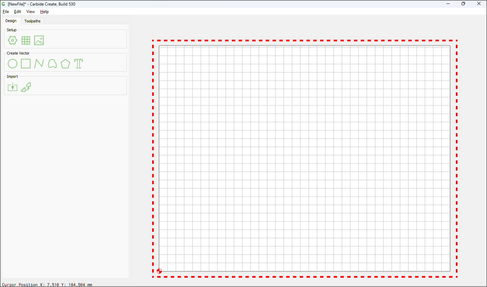

- Import the drawing to be machined
    - Then import your drawing to be machined to **vector format (.svg type file)** by clicking on the button **"Import"** of the section **"Import"**.
      - When you click, a dialog box will open and ask you to select the file to import. **Select file** and click on the button **"Open"**

    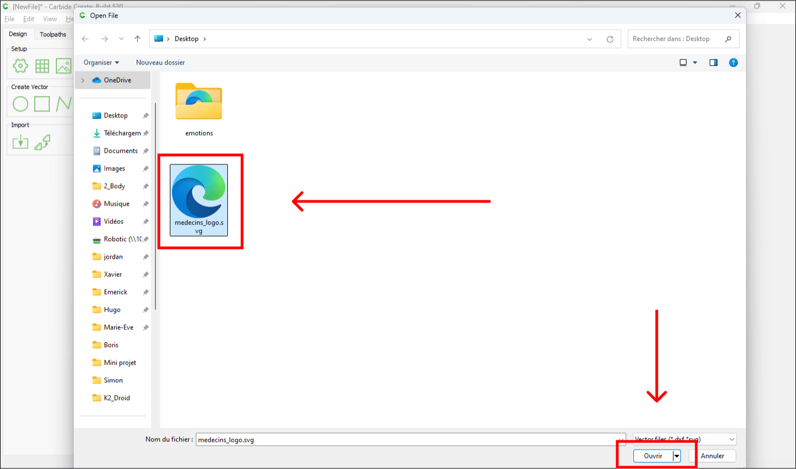

    - You can now **check the dimensions of the imported design against the dimensions of your board**. If necessary, scale the drawing with the tool **"Scale"** in the section **"Transform"** and then position your drawing at the location on your board where you wish to carry out the machining

      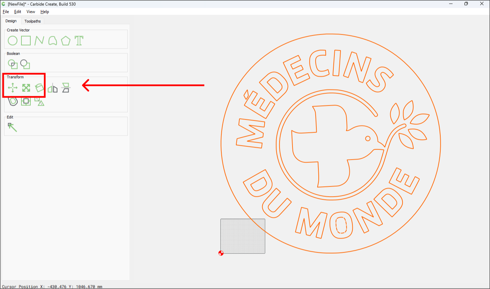

      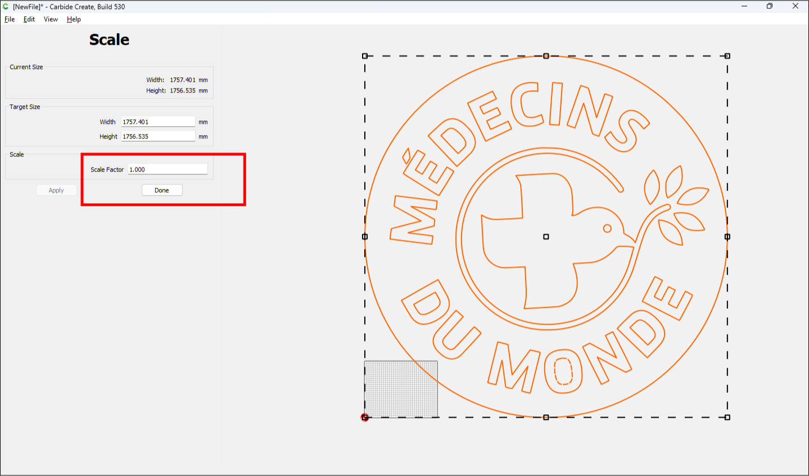

    - Click on **"Apply"** then on **"Done"**

- Now, configure the machining to be done on the chosen drawing
  - Select the different element(s) of the drawing. The drawing is displayed in orange when selected

    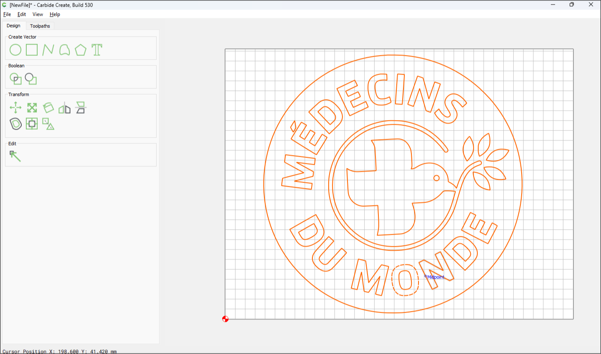

  - Then click on the tab **"Toolpath"** to the right of the tab **"Design"**
    - Several engraving options are available in the "2D Toolpath" section:

        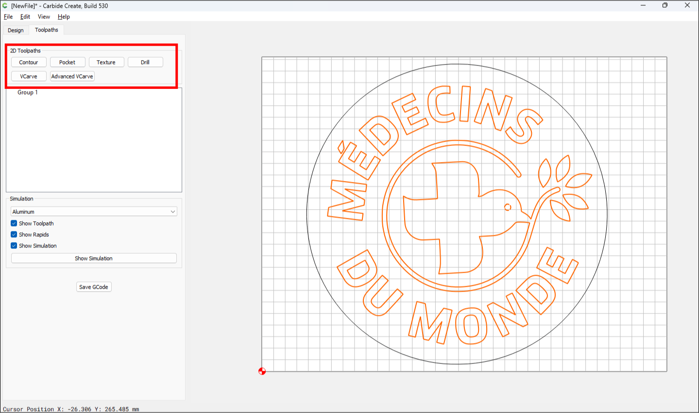

        - Select **«Contour»** to engrave the contours of the object
        - Select **«Pocket»** to hollow out the entire interior of the object evenly
        - Select **«Texture»** to dig inside an object to create a raised texture
        - Select **«Drill»** to make a hole in an object
        - Select **«VCarve»** to engrave the inside of an object producing angled sides (this option is mainly used for surface text)

    - Now that you have selected an engraving option for your project, all that remains is to select the choice of bit to use in the subsection **«Tool»** from submenu **«Contour Toolpaths»**

        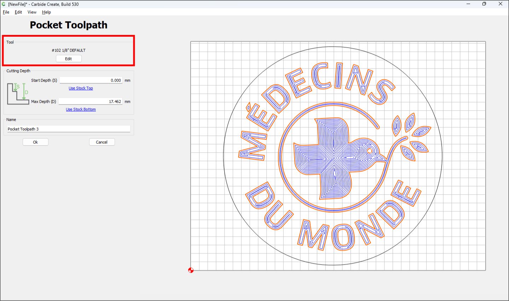

        - Click on **«Edit»** and a dialog box will open
        - Click on **«Select Tool»** allows access to the bits selection module available in the software

        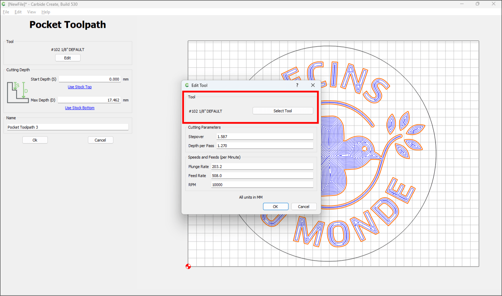

        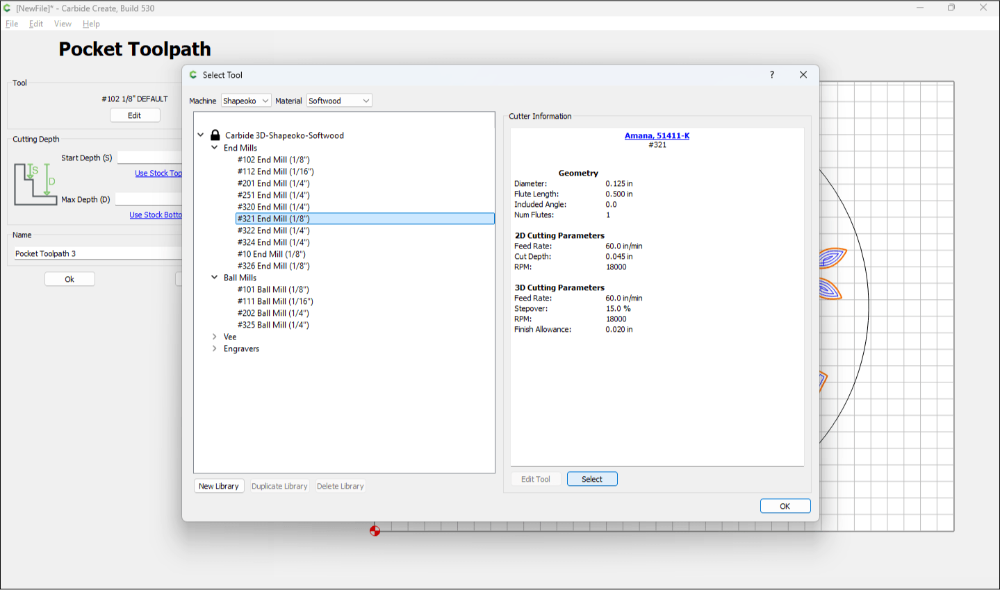

        - See below the **correspondence table** between the bits in the Carbide Create software selection module and the bits available in the workshop (shown in dotted lines below)

        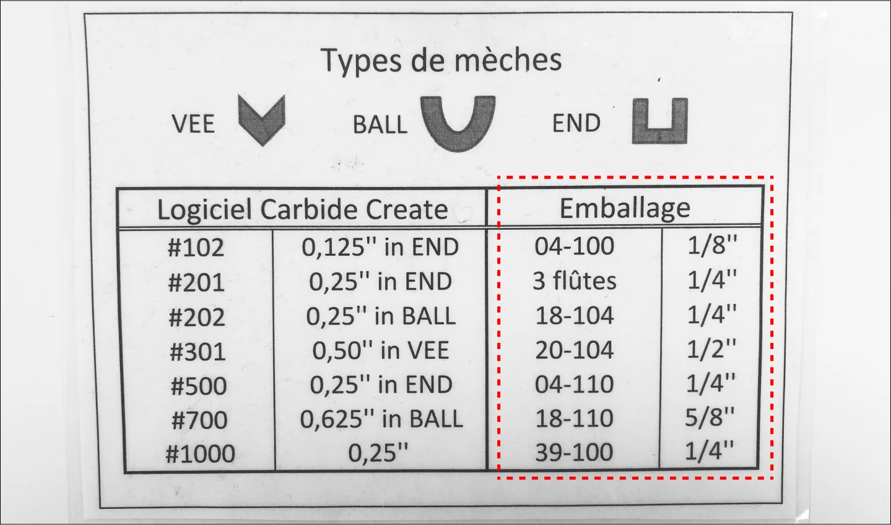

    - Then define the depth of the cut to be made in the section **« Cutting Depth »**. Make sure that the **bit that you are going to install in the router is sufficiently long** to make the cut at the entered depth.

        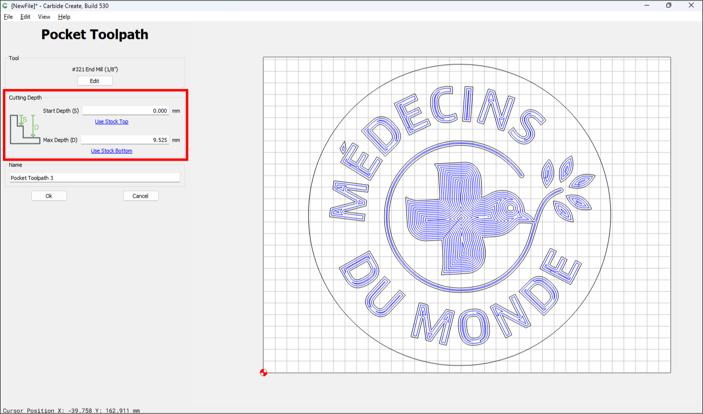

        - The first variable **«Start Depth» (S)** must be zero since we want to start milling on the surface of the material. The second variable, **«Max Depth» (D)** is the measurement of the maximum depth of the cut (By default, this distance is measured from the top of the board).
    <!-- - Set offset direction
        - This “Offset direction” section allows you to choose which side the bit will pass in relation to the cutting of your design.   -->
    - Once you have completed the different sections, click on **«Ok»**

:::note[Advice]
In the case of a complex drawing, you must define the order of cutting to be carried out for each group of drawings. For example, it is best to start by cutting the interior elements of a design before finishing with the exterior contours: This helps maintain the stability of the part during cutting.
:::

:::tip[Several bits in one file]
Thanks to the BitSetter, each toolpath can use **a different bit**:
- Choose the bit of each toolpath as explained above. Carbide Create numbers the bits automatically.
- Carbide Motion will ask you to change the bit each time two toolpaths in a row use different bits. **Group the toolpaths that use the same bit** to limit the changes: the order of the toolpath list is the cutting order.
- Check that each bit exists at the FabLab and that it is long enough.
- **Write down the list of bits in order** (and their rotation speed) before going to the machine.
:::

- Check the machine route by previewing it by pressing **« Show simulation »**
    - You can then see the simulation of the cutting

    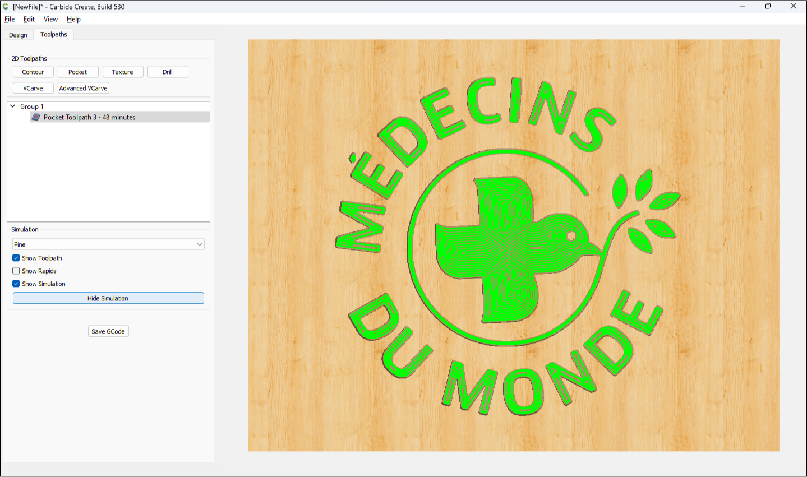

- Once the design cutout parameters have been configured, **save your work** as a Carbide Create **.c2d** file (e.g. ma_decoupe_cnc.c2d): Carbide Motion V6 opens this file directly
    - You can also **export the drawing in G-code format** by giving it a name (e.g. ma_decoupe_cnc.nc): Carbide Motion accepts this file too

    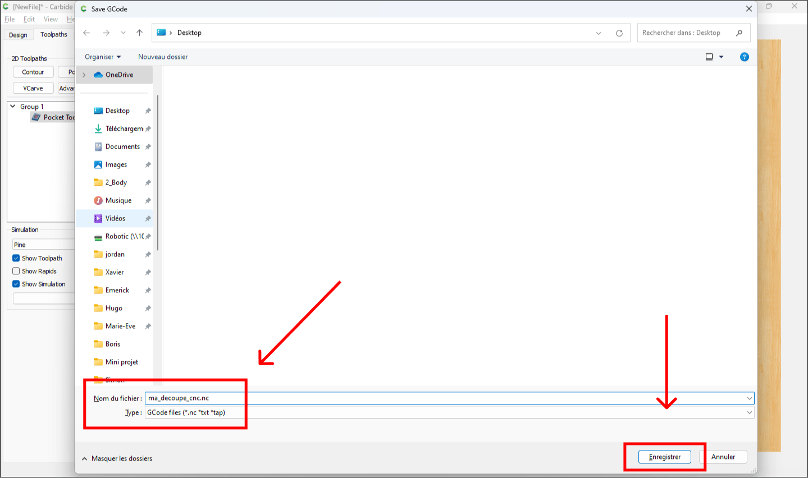

## 4. Using Carbide Motion software

For an overview, see the [The process at a glance](#the-process-at-a-glance) diagram.

- Before opening the software, first check that the **work surface of the CNC machine does not contain any objects or obstacles** on the work surface

    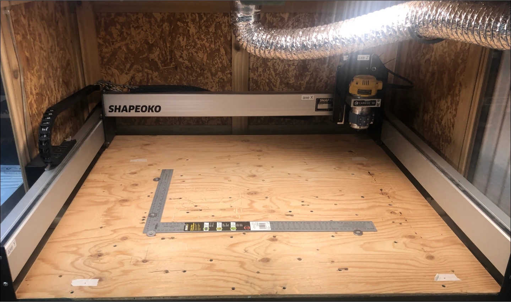

- Also check that the **BitSetter (front right of the machine) is clear** and that its **button is clean** (no chips)

- Installing the bit on the router (**router switched off**)
    - Select the appropriate bit for your project. If your file uses several bits, install **the first bit** of the file
        - Make sure that the diameter of the tail of the bit corresponds to the collar installed on the router (the diameter of the tail of the bit must be **0,25″** inch or 6.35 mm)
        - The bit must stick out of the collet by **at least 12.7 mm (0.5 inch)** so that the BitSetter can measure it
    - Gently insert the tail of the bit into the corresponding collar of the router

        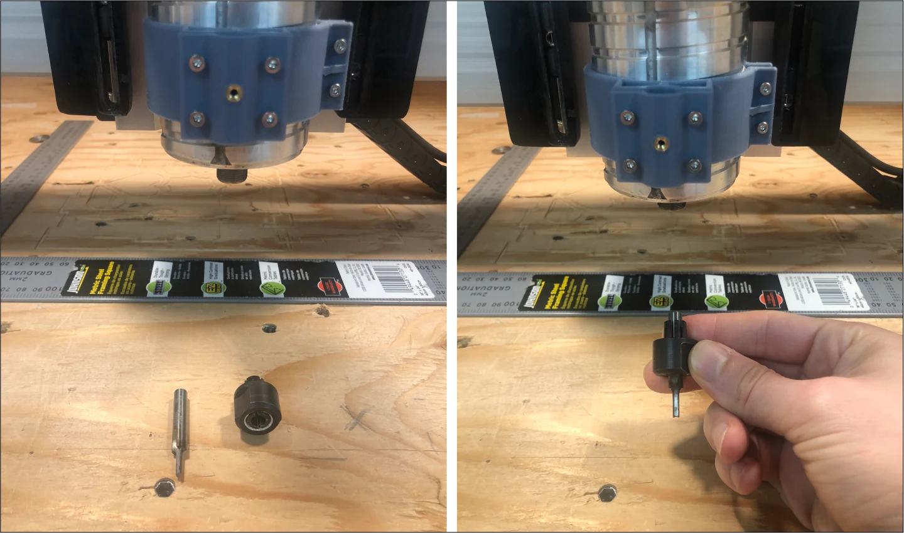

    - Bit tightening
        - **Screw the collar with the drill bit** in the spinning top shaft
        - Locate the yellow lock button on the **left side of the top**
        - **Hold button** to prevent the shaft from rotating
        - Use a wrench to firmly tighten the collar nut into the **counterclockwise** (do not overtighten, to avoid damaging the collar or bit)
        - **Release** the yellow lock button

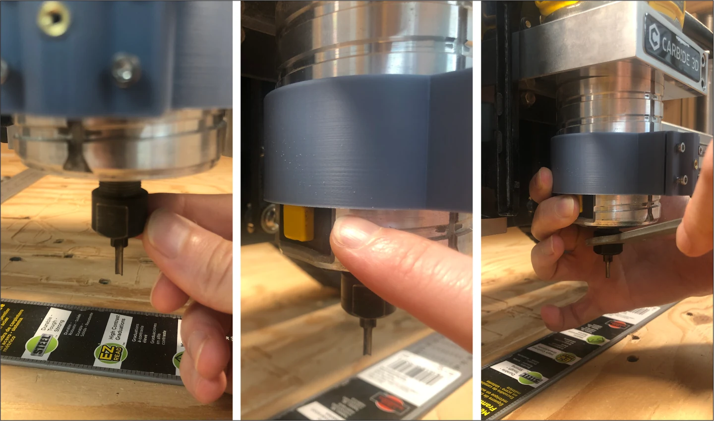

:::note[Note]
After releasing the yellow lock button, gently rotate the bit by hand to ensure it is **properly centered and does not wobble** in the collar. The bit is now correctly installed in the router!
:::

- On the compact router, select the rotation speed at which the bit should rotate depending on your project (**rotation speed between 1 and 6**)
    - Carbide Motion will remind you of the speed to use when the job starts and at each bit change

  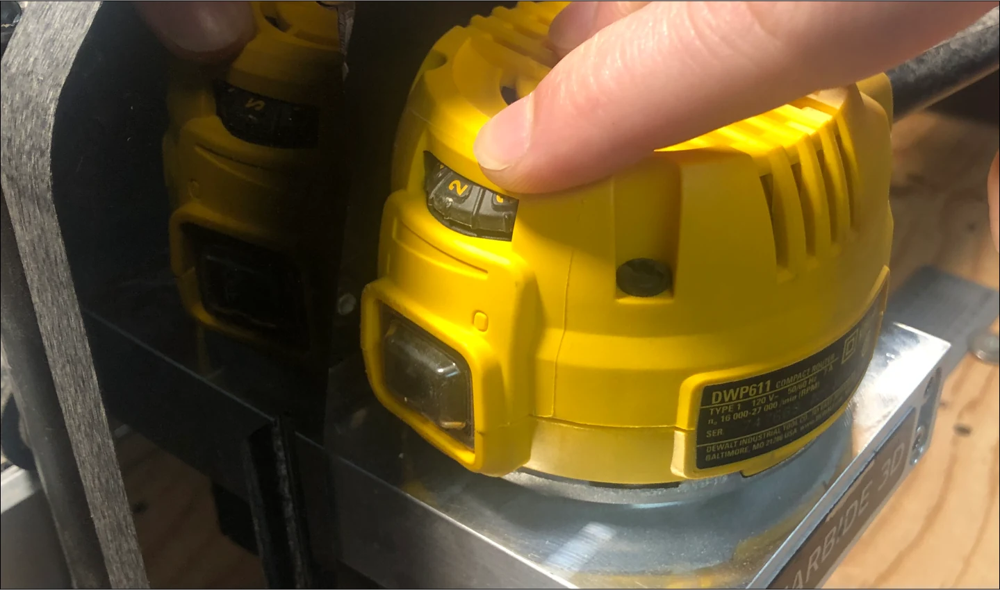

- Check out the below **correspondence table** between the setting of the selection wheel and the rotation speed of the router

  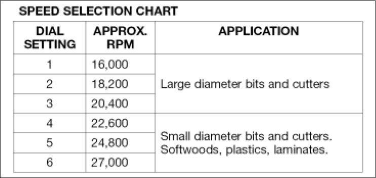

- Open Carbide Motion software now

  

- Click on “Connect to cutter”

  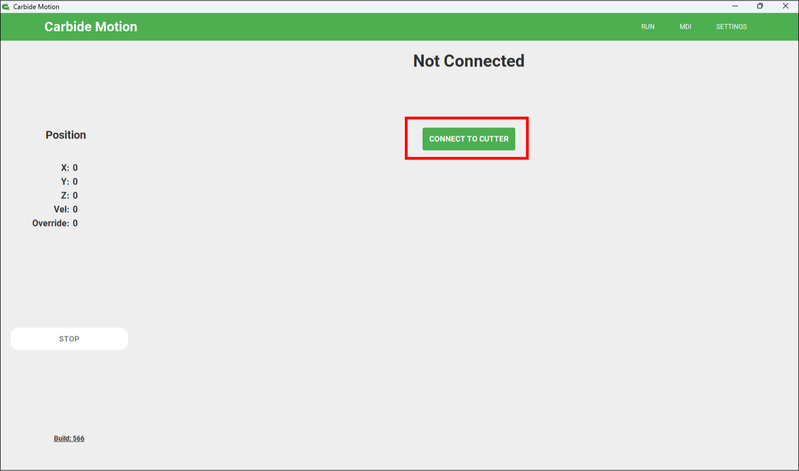

- Click on “Initialize machine”

  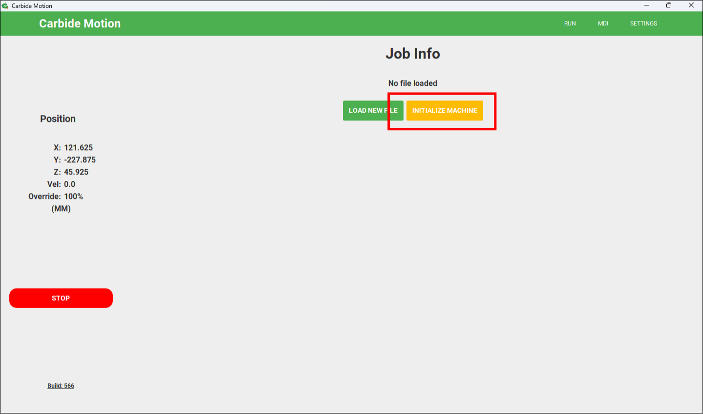

:::caution
When you click on “Initialize machine”, the machine will **automatically move to initial position**, first going **to the back of the machine**, then moving **to the front**. So it must not encounter any objects or obstacles on its way!
:::

:::note[Note]
Once the machine is in its initial position and is stopped, **position your cutting board on the work area using the fixing blocks**.
:::

- The fixing blocks will hold the board so that it does not move during machining
    - Do not place **any block or object in front of or next to the BitSetter** (front right of the machine): the router must be able to reach it freely

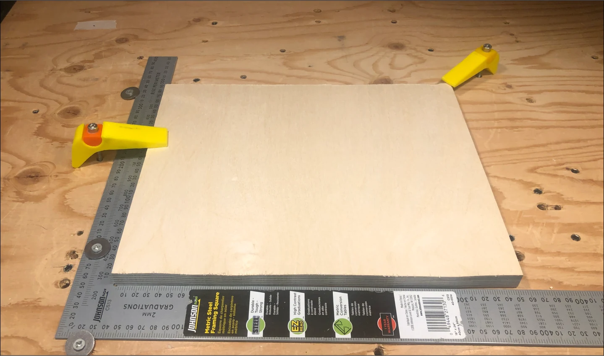

- Then click on the **“JOG”** tab
    - This tab allows you to manually control the router's movements on all axes (X, Y and Z) and is used to **set the starting point (zero point) of the CNC machine**

    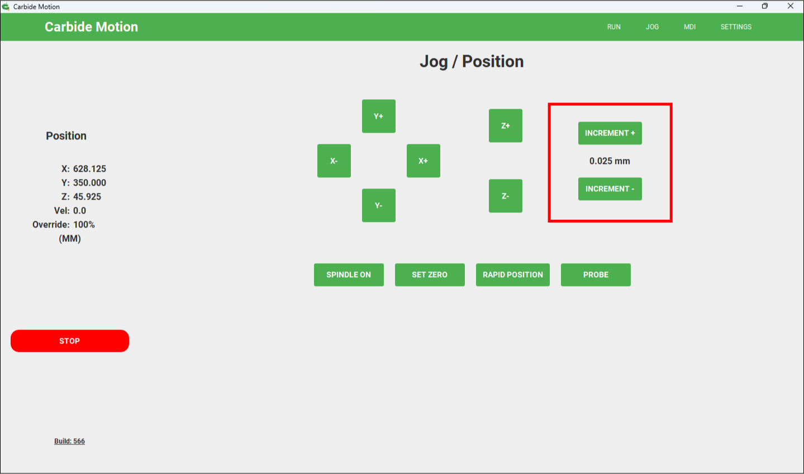

- Movement speed control
    - Locate the buttons **“INCREMENT +” and “INCREMENT -”** on the control interface. These buttons allow you to adjust the speed of movement of the router on the work surface.
    - The increment determines how precisely the router moves with each press of the X, Y, and Z movement buttons. Use these buttons to increase or decrease the increment as needed.
- Choice of speed
    - For rapid movement: Gradually increase the increment until **«FAST»** (use this option with caution, especially near the edges of the board.)
    - For a precise adjustment: Decrease the increment until **«0.025mm»**. This allows very fine control of the positioning of the router.
- Position the starting point of the machine

  - Adjustment on the X and Y axes: Use the controls on the tab **"JOG"** to move the router on the X and Y axes in order to **position the bit at the desired starting position on the board**.

  - The router is placed in its starting position:

    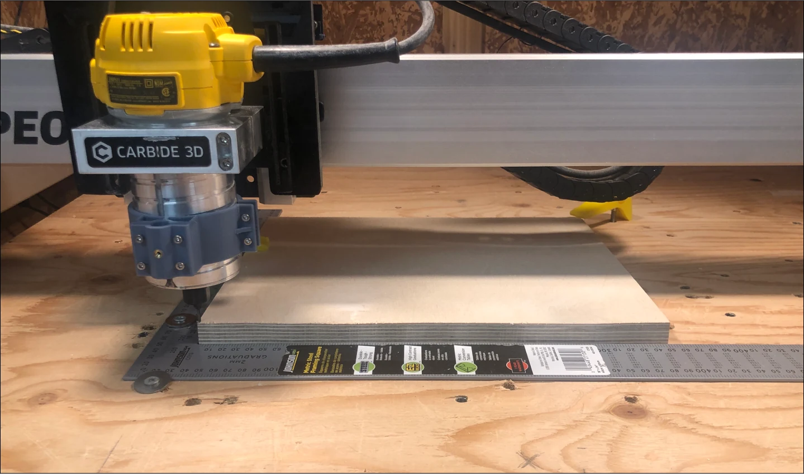

  - Z-axis adjustment: Use the Z-axis controls to adjust **gently lower the router until the bit touches the surface of the board**.

    :::caution
    Be careful when lowering the head with the bit. Too rough contact could damage the bit or the board.
    :::

    :::note[Note]
    Use a standard sheet of paper as a thickness gauge. The bit should just pinch the paper without tearing it.
    :::

    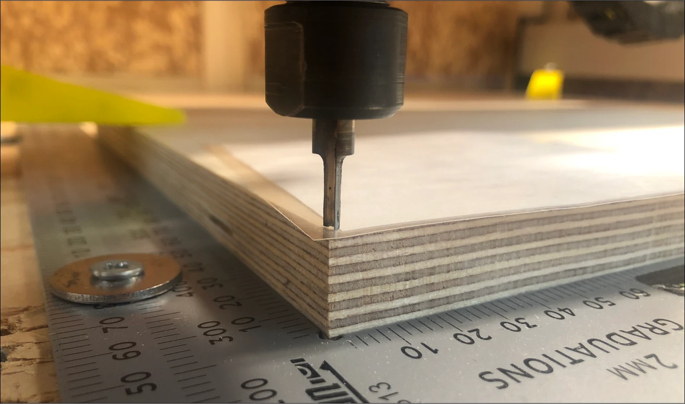

- Final check: Visually confirm that the starting position of the bit is correct on all axes.

    :::caution
    Make sure that the mounting blocks do not end up in the path of the bit when cutting and when calibrating the Z axis with the BitSetter.
    :::

- Once the positioning of the machine has been verified, click on **"Set Zero"**
- Then click on **"Zero All"** to save the zero point on all 3 axes (X, Y and Z)

    :::danger[Warning: the machine moves as soon as you click "Zero All"]
    As soon as you click **"Zero All"**, the machine **moves on its own to the BitSetter** to measure the bit, then comes back above your starting point, **router raised**. Keep your hands out of the machine and the router switched off.

    After the measurement, the **Z shown is no longer 0** (for example **+30**): this is normal, the router is simply raised. **Do not set the zero again.**
    :::

- Click on **"Done"** to confirm the positioning of the CNC machine in its starting position

- Then click on **"RUN"**
  - Click on **"LOAD NEW FILE"**
  - Open the file created in the previous step with Carbide Create (**.c2d** file, e.g. ma_decoupe_cnc.c2d, or **.nc** G-code file)
  - Click on **"Done"**

- Place the vacuum cleaner on the router

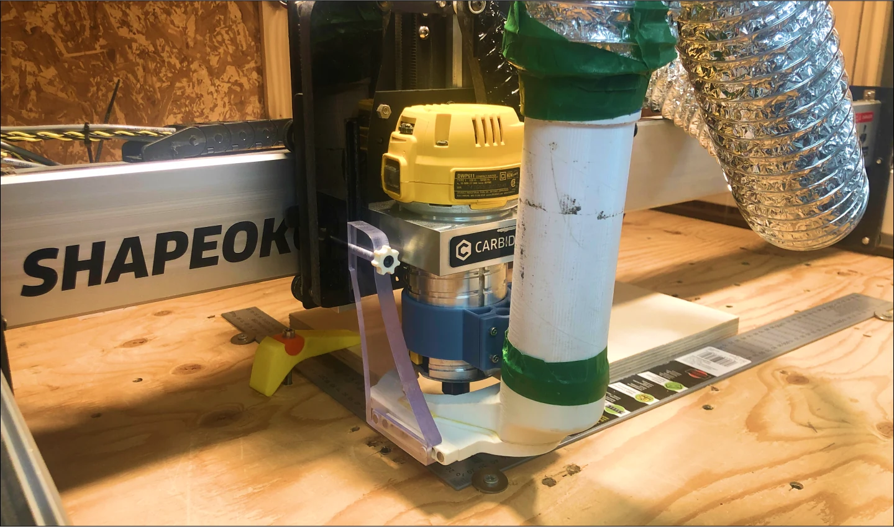

- Check that the ventilation hatch on the back of the CNC machine is **completely open**

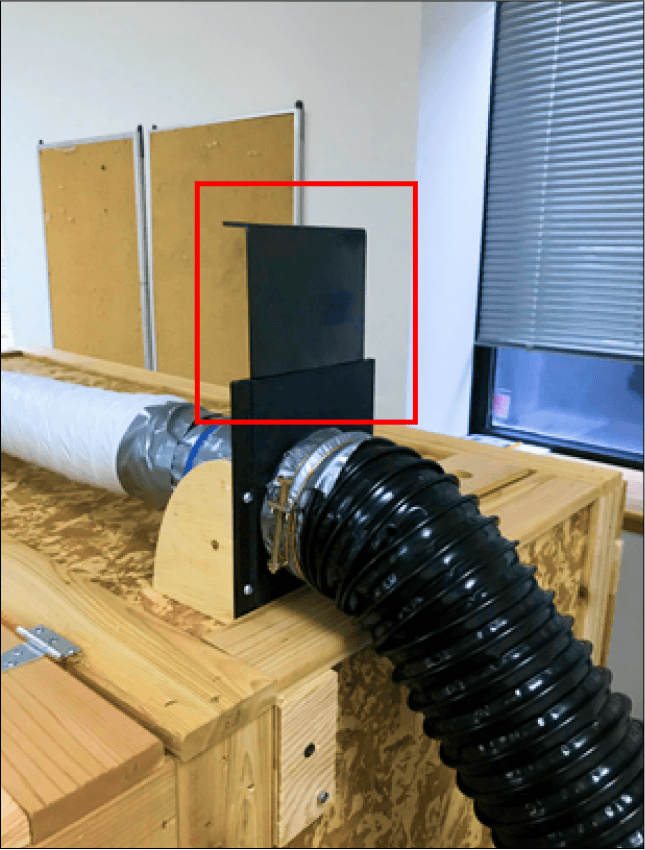

- Turn on the ventilation system inside the metal cabin

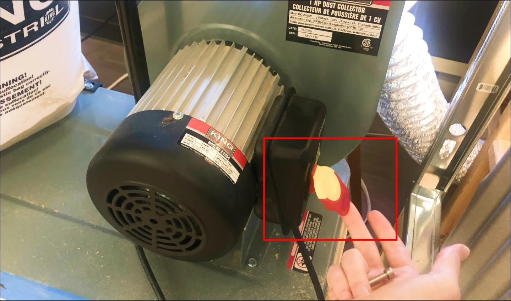

- Close the protective cover of the CNC machine

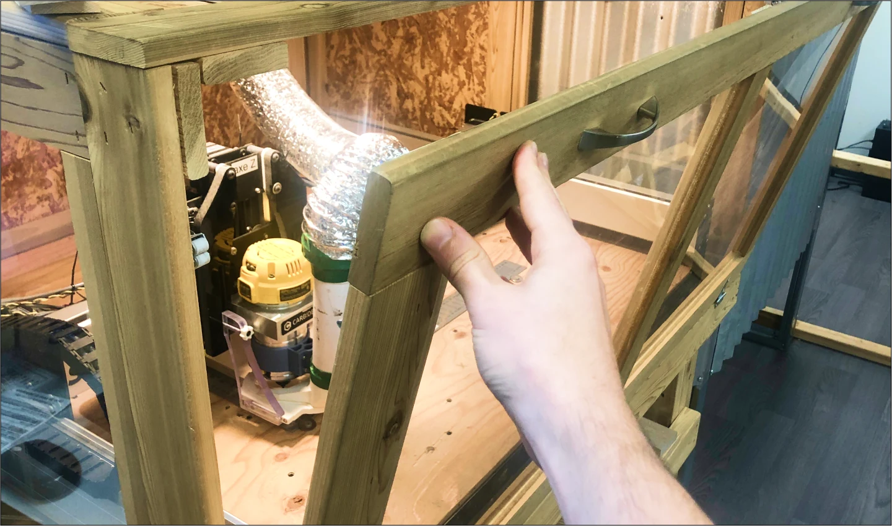

:::danger[Attention]
Never start the CNC machine with the protective cover open
:::

:::danger[Do not switch the router on now!]
With the BitSetter, the router must stay **off** when the job starts: the machine will first measure the bit. You will switch the router on **only when Carbide Motion asks you to** (steps below).
:::

- Start the machine now
    - Click on **"START JOB"**
    - Click on **"START"**

    :::caution
    As soon as you click **"START"**, the machine moves **next to the BitSetter** to load the bit (even if the bit is already in place).
    :::

- A **"Please insert tool"** message (*Tool Change Required*) appears

    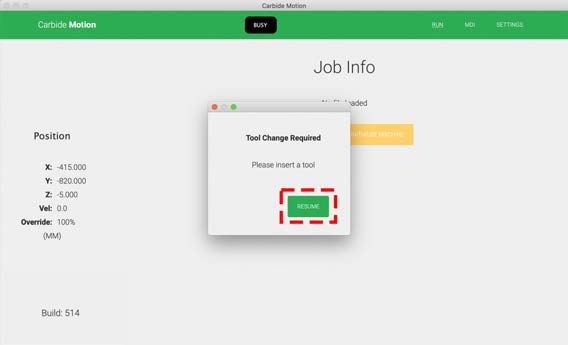

    *Screenshot from the official Carbide 3D guide (older Carbide Motion version)*

    - Check that the installed bit is **the one requested** (the first bit of your file). If needed, change it (router off), then close the cover
    - Click on **"OK"** (or **"Resume"**)

    :::danger[Warning]
    As soon as you click **"OK"**, the machine **goes down to measure the bit on the BitSetter**. Hands out of the machine, router off!
    :::

- A message then shows the **rotation speed** to use for this bit

    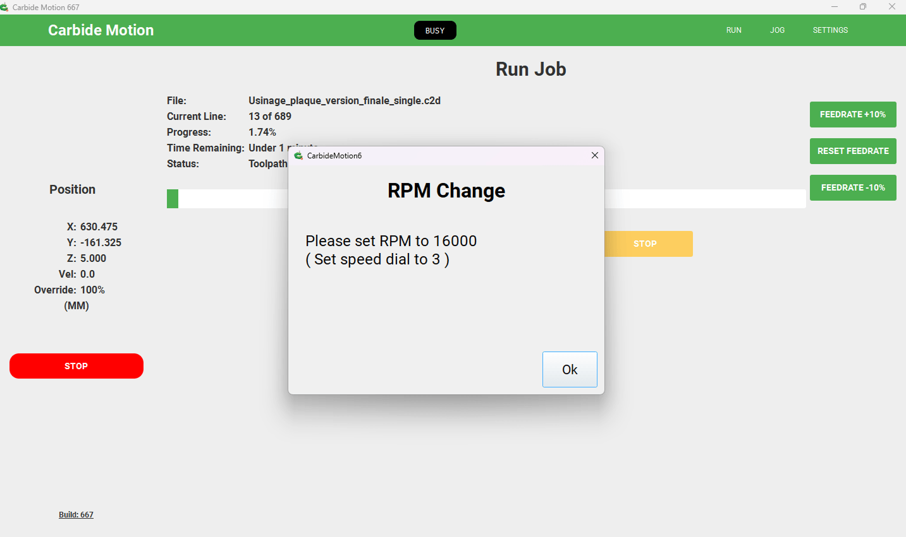

    - Set the router dial (1 to 6) **manually** to the requested speed (see the correspondence table above)
    - Check that the protective cover is closed
    - **Switch the router on**: activate the **Toupie** switch on the left-hand side of the CNC machine

    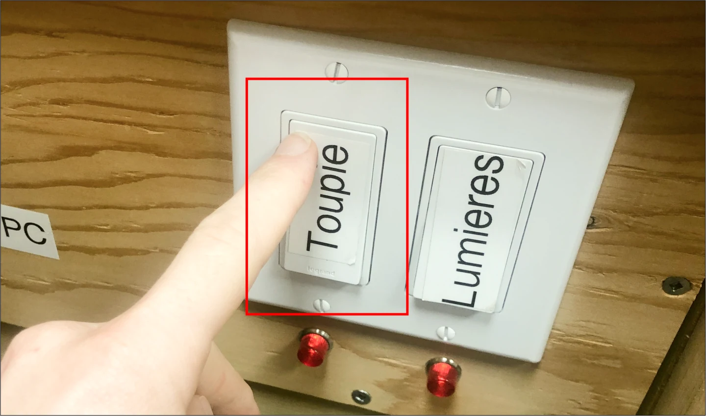

    - Click on **"OK"**

    :::danger[Warning]
    As soon as you click **"OK"**, **machining starts**!
    :::

:::note
The CNC machine will now **carry out the machining of your part following the instructions in the G-code file**. During machining, the cutting progress and estimated remaining time are **displayed in real time** in the software.
:::

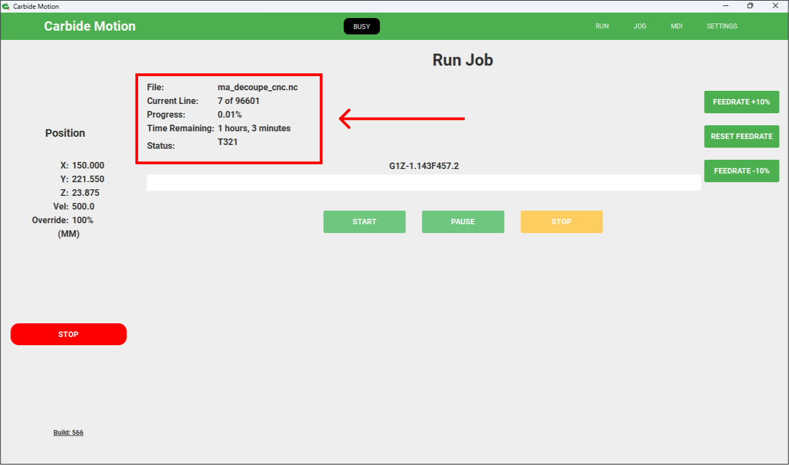

:::danger[Attention]
- **Never leave the machine unattended** during its operation
- In the event of an abnormality or danger, immediately use the **emergency stop button “Interrupteur Principal”** on the left of the machine or via the interface by clicking on the button **"STOP"** in the Carbide Motion software.
:::

### Changing bits during a job

If your file uses several bits, the machine stops at each bit change:

1. The machine stops cutting, **raises the router and moves next to the BitSetter**. The **"Please insert tool"** message appears with the requested bit.
2. **Switch off the router** (**Toupie** switch) and **wait for the bit to stop completely**.

    :::danger[Warning]
    Carbide Motion **does not switch off the router**: you must do it **before opening the cover**. Never touch a bit that is still spinning. The bit can also be **very hot** after cutting.
    :::

3. Open the cover and **replace the bit** with the requested one (same method as at the start: yellow lock button and wrench). The new bit must stick out of the collet by at least 12.7 mm.
4. Close the cover, then click on **"OK"**: the machine **goes down to measure the new bit** on the BitSetter (router still off, hands out of the machine).
5. At the speed message: set the router dial to choose the speed of the new bit, **switch the router on**, then click on **"OK"**. Machining resumes with the new bit.

### End of the job

:::danger[Warning: the machine moves on its own at the end]
As soon as the job is finished, a **`Please turn spindle off`** message shows: you can then **switch off the router switch**. When you click on **"OK"**, the machine **automatically goes back to the back right corner**: so **nothing (blocks, objects, hands) must be in the router's path**!
:::

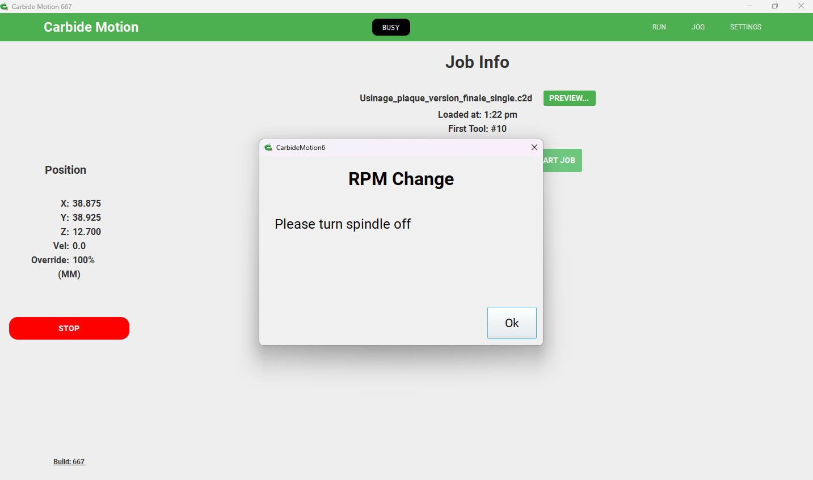

### Running the same job again

To run the same file again (for example on a new board placed at the same spot):

1. Click on **"Quick Actions"**
2. Click on **"Move cutter above current XY zero"**
3. A confirmation message appears: click on **"YES"**

    :::caution
    The machine moves as soon as you click **"YES"**: check that the path is clear.
    :::

4. Start the job again with **"START JOB"** then **"START"**, and follow the same steps as above ("Please insert tool" message, bit measurement, rotation speed).

:::note[Note]
The zero point is kept as long as the board has not moved. If you change the board (or the board thickness) or its position, **set the zero again** (**"Set Zero"** then **"Zero All"**).
:::

## 5. Cleaning after use

:::caution
Make sure the machine has finished its work and is **stopped and turned off** before starting cleaning
:::

1. Stopping and securing:
   - Deactivate the router by pressing the **"Toupie"** switch and wait for it to stop completely
2. Opening and withdrawal:
   - Open the machine’s protective cover
   - Remove the mounting blocks and remove the machined board from the CNC machine housing
3. Cleaning:
   - Use the vacuum cleaner to remove wood chips and dust
   - Clean the guide rails with a clean cloth
   - Clean the router head
   - Vacuum the chips around the BitSetter, without hitting its button
   - Once cleaning is complete, switch off the ventilation system
4. Switch off the computer:
   - Deactivate the **"PC et CNC"** switch

## To go further

- Consult the <a href="https://docs.carbide3d.com/" target="_blank" rel="noopener noreferrer">official Carbide 3D documentation</a> for detailed software and hardware information.

- **Good to know**: a 3D printed adapter can be installed on the router shaft to use markers (Sharpie type) instead of bits. This adapter will allow you to **draw on supports such as paper or wood, instead of performing a machining operation**.

## Safety sheet

This sheet sums up the machine's safety rules. Print it to post it next to the machine.

<button type="button" class="safety-print" data-print-sheet>Print</button>

  
Machine safety sheet

  
CNC Router (Shapeoko 3)

#### Description

This computer-controlled machine spins a cutting bit at very high speed to remove material (wood, wax) and make precise cuts, engravings or 3D carvings.

#### Danger level (compared with the other machines in the room)

  

    

  

  

    
<strong>High danger (5/5)</strong>

    
Main risks: part spinning at high speed (cuts, flying pieces, getting caught), flying chips and broken bits, dust, noise

  

#### Main risks

- **Injuries from the spinning bit:** touching the spinning bit can cause severe injuries.
- **Violent projections:** chips, wood splinters or pieces of a broken bit can fly out at high speed and cause injuries (eyes, skin).
- **Fine dust:** cutting makes dust (especially MDF-type wood) that is harmful to the lungs if breathed in.
- **Loud noise:** the motor and the cutting are loud enough to damage hearing.
- **Moving material:** a badly clamped piece can move or be thrown out during cutting.

#### Personal protective equipment (PPE)

- **Chip/dust extraction system: MUST BE ON** before and during the whole job.
- **Protective cover (if fitted): MUST BE KEPT CLOSED**.
- **Safety glasses: MUST BE WORN** at all times near the machine while it runs.
- **Hearing protection (earplugs or earmuffs): MUST BE WORN** while the machine runs.
- **Dust mask (N95 type): RECOMMENDED**, especially for long jobs or very dusty materials (MDF).

#### Mandatory safety rules

- **Check that the material is clamped FIRMLY AND SAFELY** to the bed before EVERY job. Use the right clamps.
- **Make sure the bit is fitted correctly and tightened** in the router's collet. Use suitable, undamaged bits.
- **NEVER LEAVE THE MACHINE UNATTENDED** while it is running.
- **Keep hands and body AWAY** from the work area and moving parts while it runs. Never try to remove chips by hand while the machine is turning.
- **Know where the EMERGENCY STOP BUTTON is and how it works**, and be able to reach it easily.
- **Use cutting settings (spindle speed, feed rate) suited** to the material and the bit. If in doubt, ASK the person in charge.
- **Clean chips and debris from the work area ONLY when the machine is completely stopped**.

#### In an emergency / if something goes wrong

- If the **material moves or is thrown out**: emergency stop right away. Do not try to hold the piece back.
- If a **bit breaks**: emergency stop. Wait until the spinning has completely stopped before doing anything. Check for damage. Tell the person in charge.
- Press the **EMERGENCY STOP BUTTON** right away to cut the main power if needed.
- If someone is **injured (cut, caught)**: emergency stop right away. Press directly on the wound. Tell the person in charge and call emergency services (911) WITHOUT DELAY.
- If a **FIRE GETS OUT OF CONTROL**: **EVACUATE IMMEDIATELY**, set off the fire alarm and call emergency services (911).
- Report any damage or malfunction to the person in charge right away.

#### Emergency contacts

- Person in charge of the RoboTic room: Victor Bruzeau
- Emergency: 911 (emergencies), 1-800-463-5060 (Québec poison control centre)

