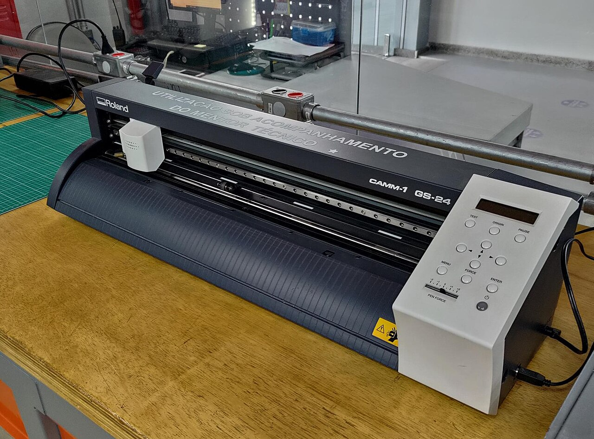
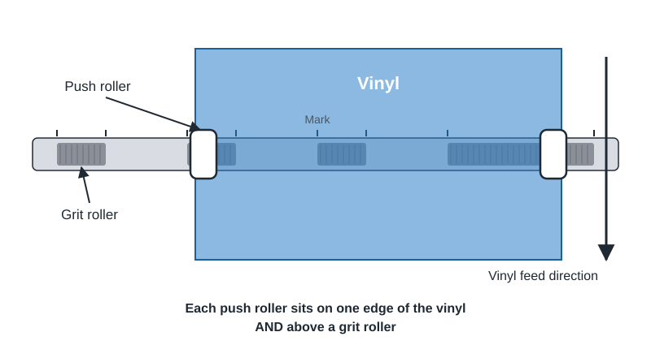
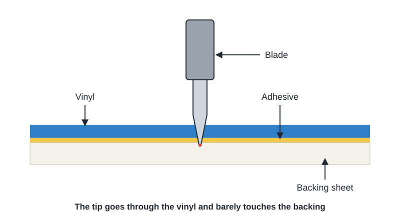
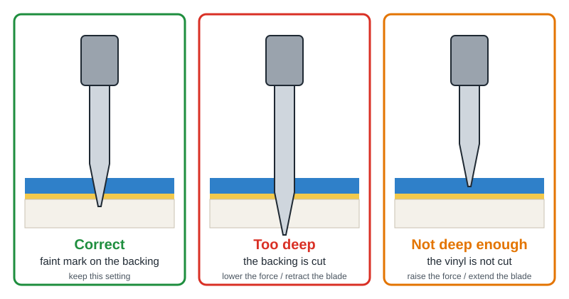
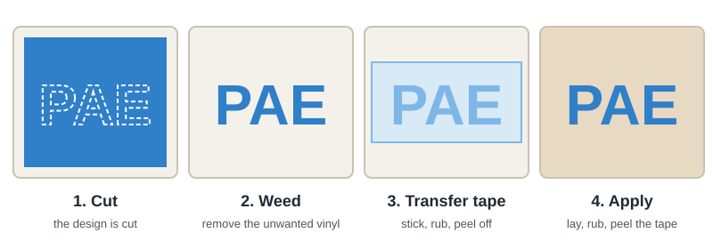

This guide takes you step by step through the use of the **Graphtec CE6000-60 Plus** cutting plotter. This machine cuts shapes out of a thin sheet, most often **adhesive vinyl**, using a **small blade that follows the lines of your design**. It is used to make stickers, lettering, stencils or designs to transfer onto fabric.

## Personal safety

- The plotter blade is very sharp. Always follow these rules:
  - **Never** touch the tool tip while the machine is on or moving.
  - While cutting, keep **hands, hair, loose clothing and jewelry** away from the tool carriage, the rollers and the media: the carriage and the media can move suddenly, including right after cutting or while changing settings.
  - Put used blades back in their storage case: never throw them loose in the bin.
  - Do not leave the machine unattended while it is running.

## Hardware reference

*Example of a cutting plotter in another fablab (a different model from ours).*

- Plotter model: **Graphtec CE6000-60 Plus** (<a href="https://mygraphtec.jp/site_download/02_manual/data/CE6000_UserManual(CE6000-UM-154).pdf" target="_blank" rel="noopener noreferrer">user's manual</a>)
  - Machine presentation page: <a href="https://web.archive.org/web/20190820094844/https://graphtec-graphtec.squarespace.com/vinyl-cutter-cut-plotter-ce6000-plus/" target="_blank" rel="noopener noreferrer">Graphtec CE6000 Plus (archived Graphtec website)</a>
  - Maximum cutting width: **603 mm** (guaranteed precision over 584 mm × 2 m)
  - Accepted media width: **from 50 mm to 712 mm**, minimum length **125 mm**
  - Media thickness: **0.25 mm maximum**
  - Cutting force: 20 to 450 g, adjustable in **38 steps**
  - Cutting speed: 1 to 60 cm/s
  - Computer connection: **USB**
- Cutting tool: blade mounted in a **0.9 mm blade holder (plunger) with a blue cap**
  - The knob at the top of the holder sets the blade length: **one mark = about 0.1 mm**, one full turn = about 0.5 mm.

## Glossary

- **Adhesive vinyl**: colored plastic film, stuck on a protective sheet (the **backing sheet**).
- **Weeding**: removing the unwanted vinyl around the design by hand, after cutting.
- **Transfer tape**: transparent adhesive sheet used to lift the design in one piece and lay it on its final surface.
- **Offset**: a small correction for the gap between the blade tip and the center of the holder. A well-set offset gives sharp corners.
- **Push rollers**: the small wheels that press the media onto the **grit rollers** (knurled rollers) to move it forward and back.

## Work area

- Cutting happens across the width between the two push rollers, up to **603 mm**.
- The push rollers must sit **above the grit rollers**, shown by the position marks on the machine.

## Usable materials

- Allowed materials
  - Adhesive vinyl (lettering, stickers, signs)
  - Standard fluorescent or reflective vinyl
  - Heat transfer vinyl (for fabric): the design must be **cut mirrored**
- Forbidden materials
  - Any media **thicker than 0.25 mm**
  - **Strongly curled** or creased media: it can jam in the carriage. Flatten it before loading.

## Workflow

1. Switch on the plotter
2. Load the vinyl and lock it with the push rollers
3. Check the blade length
4. Choose the cutting conditions and run a test cut
5. Prepare the design in Graphtec Studio 2 and send it to the plotter
6. Watch the cut
7. Weed and transfer the design
8. Tidy up and switch off the machine

## 1. Switching on

- Check that nothing is in the way of the tool carriage or the media path, in front of and behind the machine.
- Switch on the plotter with its power switch. The control panel screen lights up, shows the firmware version, then asks you to load media.

## 2. Loading the vinyl

1. **Lower the media set lever**: the push rollers lift up.
2. Slide the vinyl in **from the back towards the front**, colored side up.
   - **Sheet**: line up the right edge of the sheet with the guideline at the front.
   - **Roll**: place the roll on the rear supports and pull enough vinyl so it comes out at the front and fully covers the sensor.
3. Move the two push rollers so they sit **on both edges of the vinyl** and **above the grit rollers** (marks on the machine).
   - For a long cut (more than 2 m), place them at least **15 mm** inside the edges.
4. Pull the vinyl taut so there are no folds, then **raise the media set lever**: the push rollers lock the media.
5. The screen asks for the media type: press key **[2] ROLL-2 CURRENT POSITION** (cutting from the current position, so no vinyl is wasted).
6. The plotter measures the width (and the length for a sheet), then shows **READY**: it is ready to receive a cut.

:::caution
If the push roller position message appears, a push roller is not above a grit roller. Lower the lever, fix the position and try again.
:::

## 3. Setting the blade

- Remove the blade holder from the tool holder by turning it counterclockwise, then look at the tip.
- The blade should stick out **slightly less than the thickness of the vinyl plus its backing**. For common adhesive vinyl, it should barely stick out of the cap.
  - Turn the knob to extend or retract the blade: one mark = about 0.1 mm.
- Put the blade holder back in its place: push it in until its flange touches the top of the holder, then tighten the screw.

:::danger[Warning]
A blade that sticks out too far cuts the backing sheet and damages the machine's cutting strip. Always set it **shorter than the thickness of the material**.
:::

## 4. Cutting conditions and test cut

Before each new material, run a **test cut** in a corner of the vinyl: it only costs a few centimeters and saves you from ruining a whole cut.

- Choose the cutting conditions
  - Press **[COND/TEST]**: the screen shows the saved cutting conditions.
  - Select the condition that matches your material, then adjust if needed:
    - **FORCE**: the blade pressure. Start low and increase little by little.
    - **SPEED**: the cutting speed. Slower = more precise, especially for small details.
  - Confirm with **[ENTER]**.
- Run the test
  - In the conditions screen, choose **CUT TEST**.
  - Move the tool with the **POSITION arrows** to a free corner of the vinyl.
  - Press **[ENTER]**: the plotter cuts a small pattern (a square and a triangle).
- Read the result
  - Peel off the triangle:
    - The vinyl peels off cleanly and the blade leaves **a faint mark** on the backing: **correct setting**.
    - The backing is cut through: the force is too high or the blade sticks out too far.
    - The vinyl is not cut everywhere: the force is too low or the blade does not stick out enough.
  - Look at the corners of the square: if they are rounded or not closed, the **offset** needs adjusting (in Normal mode).
  - Repeat until the cut is clean.

## 5. Using the Graphtec Studio 2 software

- Open **Graphtec Studio 2** on the computer connected to the plotter. The software is free: <a href="https://www.graphteccorp.com/download/gs2_w/" target="_blank" rel="noopener noreferrer">Graphtec Studio 2 download page</a>.
- Set the **page size** to match the size of your vinyl.
- Import your design, preferably in **vector format** (SVG or DXF), or draw directly in the software (text, shapes).
- Check the **dimensions** of the design and place it in the area that matches your vinyl.
- For **heat transfer vinyl**, flip the design horizontally (**mirror**): it will be laid with the adhesive side against the fabric.
- Open the **send** panel:
  - Check that the selected plotter is the **CE6000-60 Plus**.
  - Choose the material or cutting conditions that match your test.
  - Click **Send** to start cutting.

:::note
Graphtec Studio 2 is in English or French depending on the computer's language, and button names may change slightly from one version to another. This guide does not cover creating vector designs.
:::

## 6. Cutting

- The plotter starts cutting as soon as it receives the file. The starting point is the **origin**: by default, the tool position after loading.
- Stay near the machine and check that the vinyl feeds straight, without folds.

:::danger[Warning]
- **Never** put your hands near the carriage or the rollers while cutting.
- If something goes wrong, press **[PAUSE/MENU]**: cutting stops.
  - **[1] CONTINUE JOB** to resume
  - **[2] QUIT JOB** to cancel, then **[1] YES, CLEAR** to empty the plotter's memory. Before clearing it, make sure the computer is no longer sending data.
:::

## 7. Weeding and transfer

- Once cutting is finished, lower the media set lever and take out the vinyl. For a roll, cut off the part that was cut.
- **Weed right away**: remove the unwanted vinyl with a hook or tweezers. If you wait too long, the adhesive closes up along the cuts and weeding becomes difficult.
- For a sticker or lettering:
  - Lay the **transfer tape** over the design and rub it with a squeegee.
  - Peel off the transfer tape: the design stays stuck to it, without the backing.
  - Lay the design on a clean, dry surface, rub again, then remove the transfer tape.
- For heat transfer vinyl: place the design on the fabric and heat-press it following the vinyl maker's instructions.

## 8. Tidying up after use

- Take out the remaining vinyl and store reusable rolls and offcuts.
- Remove the blade holder, **fully retract the blade** with the knob and put it away.
- Leave the **media set lever lowered** (push rollers raised): this avoids marking the rollers.
- Switch off the plotter with its power switch.

## Maintenance

- Regularly clean the opening of the blade holder: unscrew the cap and remove vinyl scraps and dust, which wear the blade.
- Clean the cutting strip with a dry cloth, and the casing with a slightly damp cloth (water and mild detergent).
- **Never** oil the machine, and do not use solvents (alcohol, thinner) on the casing or the sensors.
- Changing the blade: retract it with the knob, unscrew the cap, remove the old blade, insert the new one into the cap and screw it back on.

## Troubleshooting

Common problems and solutions:

- **The backing is cut through**: lower the force or retract the blade a little, then run a new test cut.
- **The vinyl is not cut everywhere**: raise the force or extend the blade a little. If the problem continues, the blade may be worn.
- **Corners are rounded or not closed**: adjust the offset and run a new test cut.
- **The vinyl shifts or feeds crooked**: check that the push rollers are above the grit rollers and that the vinyl is taut and not curled.
- **The plotter does not detect the media**: the vinyl must cover the sensor at the front of the machine, and the lever must be raised.
- **Nothing happens when sending**: check that the plotter shows **READY**, that the USB cable is plugged in and that the right plotter is selected in Graphtec Studio 2.

## Going further

- Read the <a href="https://mygraphtec.jp/site_download/02_manual/data/CE6000_UserManual(CE6000-UM-154).pdf" target="_blank" rel="noopener noreferrer">full CE6000 manual</a> for advanced functions: cutting around a printed design with registration marks (ARMS), cutting large panels, multiple copies.
- Picture credits: plotter photo "<a href="https://commons.wikimedia.org/wiki/File:Plotter_-_Fab_LAB_Newton.jpg" target="_blank" rel="noopener noreferrer">Plotter - Fab LAB Newton</a>" by Vivian Guerra Moreira (Wikimedia Commons, <a href="https://creativecommons.org/licenses/by-sa/4.0/" target="_blank" rel="noopener noreferrer">CC BY-SA 4.0</a> license); diagrams made for this guide.
