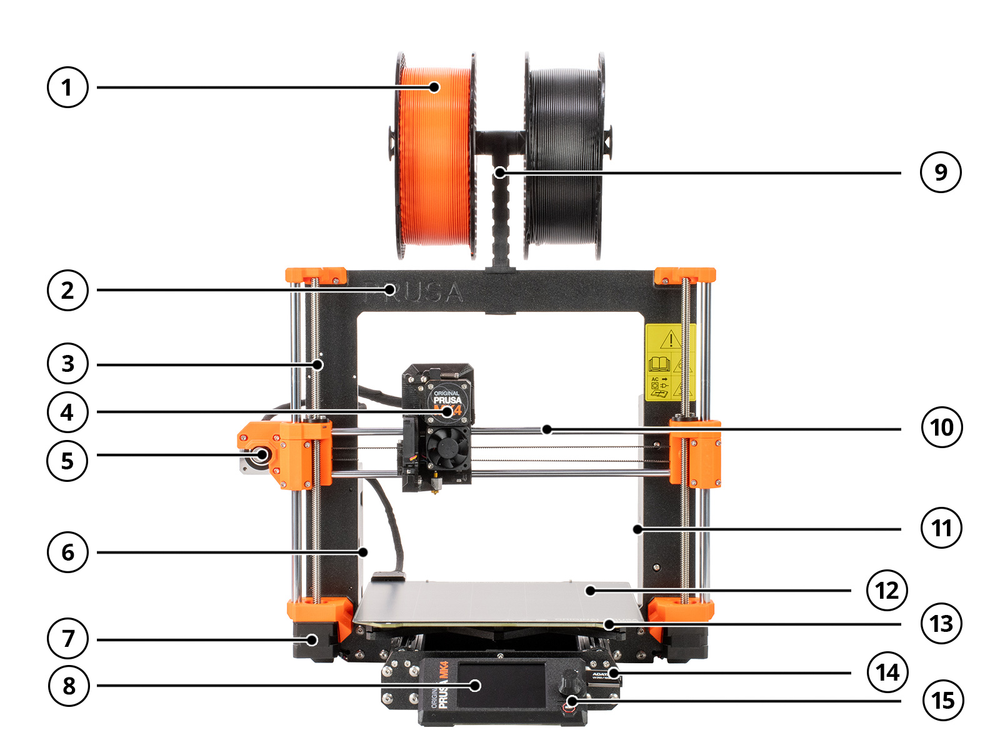
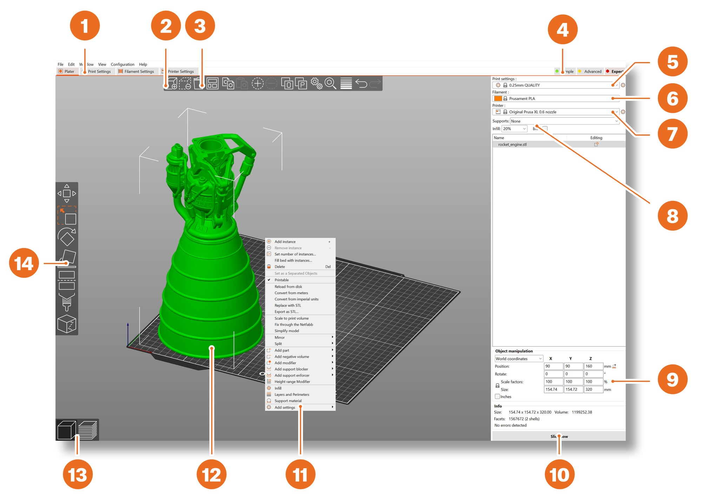
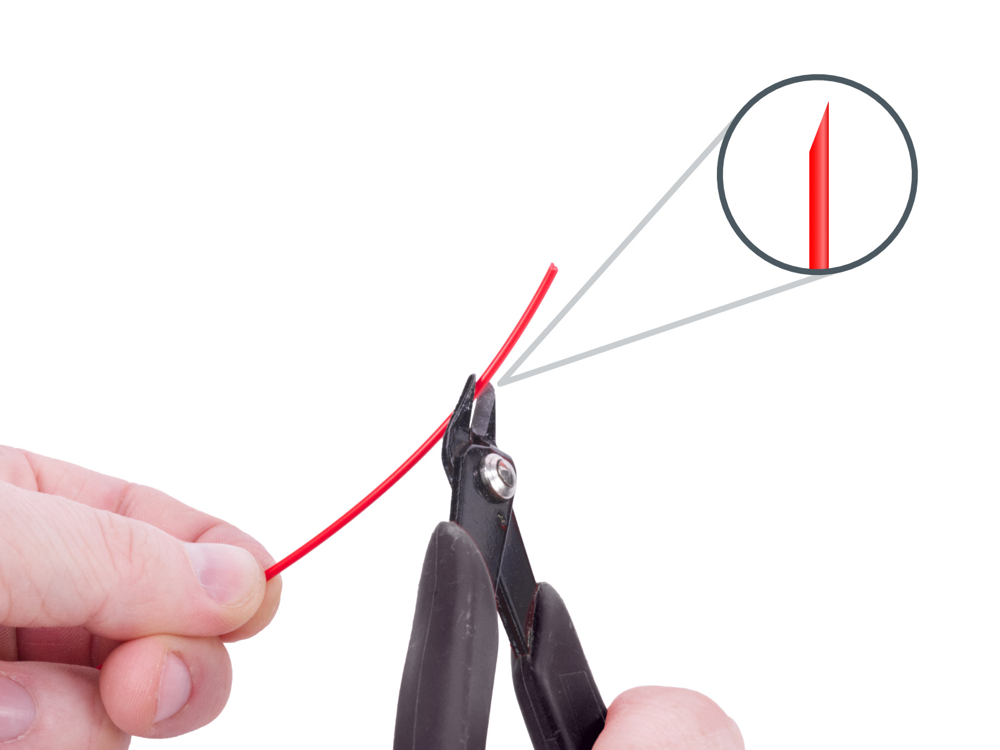
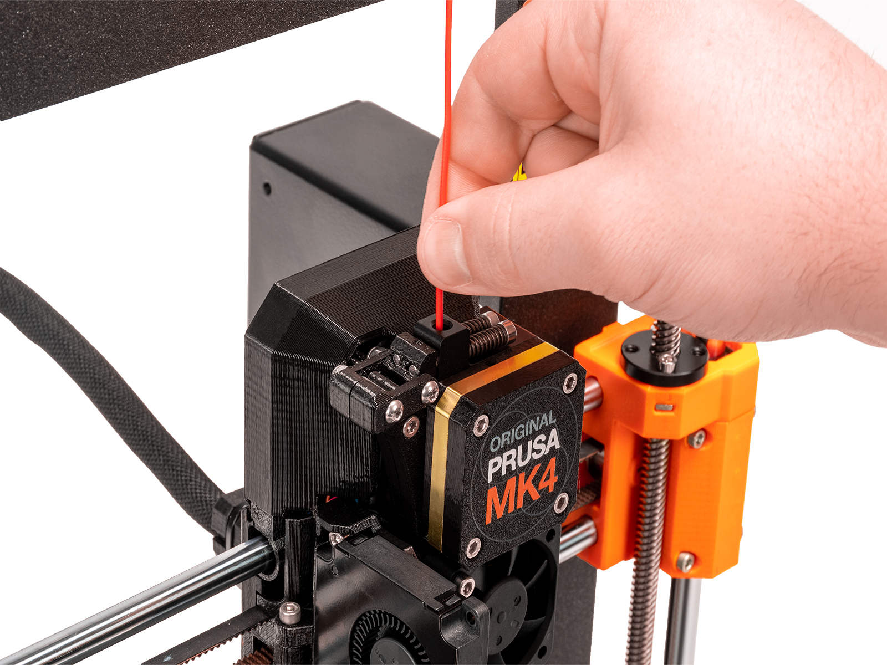
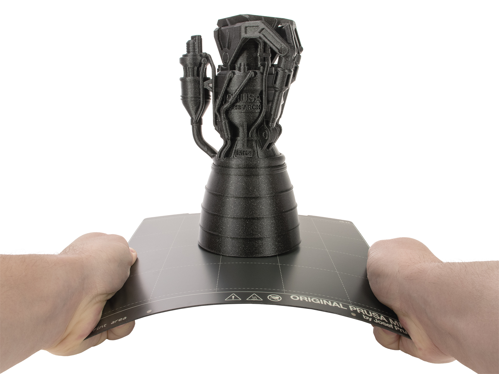

This guide takes you step by step through the use of the **Original Prusa MK4** 3D printer. It makes plastic objects by **laying down a strand of melted plastic (the filament), layer by layer**, from a 3D model. It is used to create prototypes, spare parts, cases, holders or decorative objects.

## Personal safety

- The printer has hot parts and moving parts. Always follow these rules:
  - **Never** touch the nozzle, the print head or the bed during printing or right after: the nozzle goes above **200 °C** and the bed can go above **100 °C**.
  - Keep your fingers away from the axes and belts while the printer is powered on.
  - **Never** put anything under the heatbed: it moves back and forth while printing.
  - If melted plastic is stuck to the nozzle, do not remove it by hand: use pliers.
  - Some filaments give off a smell while printing: **air the room** regularly and **close the protective cover** around the printer for the whole print.

## Hardware reference

- Printer model: **Original Prusa MK4** (user's manual: <a href="https://www.prusa3d.com/downloads/manual/prusa3d_manual_MK4_MK39_103_en.pdf" target="_blank" rel="noopener noreferrer">in English</a> / <a href="https://www.prusa3d.com/downloads/manual/prusa3d_manual_MK4_MK39_103_fr.pdf" target="_blank" rel="noopener noreferrer">in French</a>)
  - Build volume: **250 × 210 × 220 mm** (width × depth × height)
  - Nozzle diameter: **0.4 mm**
  - Filament diameter: **1.75 mm**
- Latest firmware, to check and update regularly: <a href="https://help.prusa3d.com/downloads/mk4" target="_blank" rel="noopener noreferrer">Prusa MK4 download page</a>
- Printer overview:

  

  1. Filament spool
  2. Frame
  3. Z axis: moves the print head up and down
  4. Print head (Nextruder)
  5. X-axis motor
  6. Electronics box
  7. Z-axis motor
  8. Control screen
  9. Spool holder
  10. X axis: moves the print head left and right
  11. Power supply unit
  12. Print sheet
  13. Heatbed
  14. USB port and USB drive
  15. Rotary knob
- **Nextruder** print head: before each print, the nozzle taps the sheet at several points to measure its height (**Loadcell** sensor). The first layer is therefore set **automatically**.
- Controls: a **screen** and a **rotary knob** (turn to choose, press to confirm).
- Print sheet: **flexible sheet**, removable, held by magnets on the heatbed.

## Glossary

- **Filament**: plastic strand wound on a spool, which the printer melts. Often sold in **1 kg** spools, with a strand **1.75 mm** in diameter.
- **Slicer**: software that cuts the 3D model into layers and works out the nozzle's path. At the workshop we mainly use **PrusaSlicer**, but slicers from other makers (**OrcaSlicer**, **Bambu Studio**) can also be used.
- **G-code**: the instruction file made by the slicer and read by the printer (extension **.bgcode** or **.gcode**).
- **Layer height**: the thickness of each layer. The lower it is, the finer the object, but the longer the print.
- **Infill**: the inner structure of the object, given as a percentage. Printed objects are almost never solid.
- **Supports**: temporary structures, like scaffolding, that hold up overhanging parts. They are removed after printing.
- **Brim**: a thin ring printed around the first layer so the object sticks better to the sheet.

## Print area

- The object must fit in a volume **25 cm wide, 21 cm deep and 22 cm high** (the maximum dimensions of the Prusa MK4).
- In PrusaSlicer, an object shown **in blue** does not fit in the print area: scale it down, rotate it or cut it into several pieces.

## Usable materials

- Allowed materials
  - **PLA** (recommended): the easiest to print, almost odorless. Ideal for beginners, small details and prototypes.
    - Nozzle: 215 °C, bed: 50 to 60 °C
    - Limits: brittle, softens from 50 to 60 °C, not suited for outdoor use.
  - **PETG**: stronger and more flexible than PLA, for mechanical parts or parts that get a little warm.
    - Nozzle: 240 °C, bed: 70 to 90 °C
    - On the smooth sheet, apply a thin layer of **glue stick** before printing: PETG sticks too strongly and can tear off the sheet's surface.

## Workflow

1. Find or create the 3D model
2. Prepare the print in PrusaSlicer and export the G-code to a USB drive
3. Prepare the printer (clean sheet)
4. Load the filament
5. Start the print and watch the first layer
6. Remove the part once the sheet has cooled
7. Tidy up and switch off

## 1. Finding or creating the 3D model

- Download a ready-made model, for example on <a href="https://www.printables.com" target="_blank" rel="noopener noreferrer">Printables</a> or <a href="https://makerworld.com" target="_blank" rel="noopener noreferrer">MakerWorld</a>, or create your own with 3D modeling software (for example <a href="https://www.autodesk.com/products/fusion-360" target="_blank" rel="noopener noreferrer">Autodesk Fusion</a>, or <a href="https://www.tinkercad.com" target="_blank" rel="noopener noreferrer">Tinkercad</a>, free and usable in the browser).
- Formats accepted by PrusaSlicer: **STL, 3MF, OBJ, STEP**.

:::note[Note]
This guide explains how to print an existing model, but it **does not cover creating 3D models**.
:::

## 2. Using the PrusaSlicer software

- Open **PrusaSlicer** on the workshop computer. To install or update the software: <a href="https://help.prusa3d.com/downloads/mk4" target="_blank" rel="noopener noreferrer">latest PrusaSlicer version</a>.
- The areas of the window (example screenshot: the selected printer must be the **Original Prusa MK4**):

  

  1. Detailed print, filament and printer settings
  2. **Add**: import a 3D model
  3. **Delete** / **Delete all**
  4. Simple / Advanced / Expert modes
  5. Print settings (quality and speed)
  6. Filament choice
  7. Printer choice
  8. Quick settings: supports, infill, brim
  9. Object information (size, print time after slicing)
  10. **Slice now** / **Export G-code**
  11. Right-click menu on the model
  12. 3D view of the model
  13. Switch between the 3D editor and the layer preview
  14. Move, Scale, Rotate, Cut, Paint-on supports, Seam painting tools
- In the right-hand column, check the three drop-down menus:
  - **Printer**: **Original Prusa MK4** with the **0.4 mm** nozzle
  - **Filament**: the profile that matches the spool (for example *Prusament PLA* or *Generic PLA*)
  - **Print settings**: the layer height. If unsure, choose **0.15 mm** (a good balance), or **0.20 mm** to go faster.
- Import the model with the **Add** button (or drag the file into the window).
- Place the model on the bed:
  - Use the tools in the left bar: **Move**, **Scale**, **Rotate**.
  - Lay the **largest flat face** on the bed: the **Place on face** tool (**F** key) does it in one click.
  - If you need supports, rotate the model so they do not touch the visible faces.
- Set the quick options in the right-hand column:
  - **Infill**: **10 to 20 %** for most objects. No need to go above 40 % unless the part must be very strong.
  - **Supports**: *None* if no part of the object is in mid-air, otherwise *Support on build plate only* or *Everywhere*. A wall leaning more than 45° from vertical needs supports.
  - **Brim**: tick it if the object touches the bed over a small area.
- Click **Slice now**.
- **Check the preview**: scroll through the layers with the slider on the right. Check that the first layer touches the bed and that no part is printed in mid-air. The print time and the amount of filament are shown on the right.
- Plug the printer's USB drive into the computer (the drive is found to the right of the printer's control screen), click **Export G-code** and save the file on the drive. Use a simple name (for example `phone_stand`).
- Eject the drive properly before unplugging it.

:::caution
Always check the preview before exporting: it is the best way to avoid a failed print.
:::

## 3. Preparing the printer

- Switch on the printer with the **power supply switch**, at the back.
- Check that the **print sheet** is in place.
  - To reposition it, lift it by the **two front corners**. Never slide it on the bed: this would scratch it.
- Check that the sheet is **clean**: wipe it with **isopropyl alcohol (90 % or more)** and a paper towel, then do not touch the surface with your fingers (grease marks stop the object from sticking).
- Check that there are no plastic leftovers on the sheet or under the bed.

## 4. Loading the filament

- Look at the bottom of the screen to see which filament is loaded. If it is the right one, go to the next step.
- To change filament, first remove the old one: **Menu - Filament - Unload Filament**. The printer heats up, then pulls the filament back. Take it out by hand and **secure its end** in the spool so it does not tangle.
- To load the new filament:
  1. Put the spool on the spool holder, on top of the printer.
  2. Cut the end of the filament **at an angle** with cutting pliers. Do not let go of the end: the filament would tangle.

     

  3. Feed the filament through the guide, then into the opening at the top of the print head. If the filament sensor is on, loading starts by itself. Otherwise, choose **Menu - Filament - Load Filament**.

     

  4. Choose the **filament type** from the list and wait for the nozzle to heat up.
  5. Gently push the filament until you feel the gear pulling it in.
  6. Some plastic comes out of the nozzle. If the color is right, answer **Yes**. Otherwise, choose **Purge More** until the right color comes out.

## 5. Starting the print

- Plug the USB drive into the printer's **USB port**.
- Open the **Print** menu, choose your file and confirm with the rotary knob.
- The printer heats up, measures the sheet (the nozzle taps it at several points), prints a purge line, then starts the object.
- **Watch the first layer**: it should be well squashed and stuck to the sheet.
  - If the plastic peels off or curls, stop the print (**Stop print** on the screen), clean the sheet with isopropyl alcohol and start again.
- During the print, the **Tune** menu lets you adjust the **speed**, for example.

:::danger[Warning]
- If something goes wrong (strange noise, burning smell, a loose object dragged by the nozzle), stop the print from the screen. In an emergency, press the **reset button** under the rotary knob or turn off the **power supply switch**.
:::

## 6. Removing the part

:::caution
Wait for the sheet to **cool down** before removing the part: the sheet and the bed can go above 100 °C. The bed temperature is shown at the bottom of the screen.
:::

- Lift the print sheet off the bed by its front corners.

  

- **Bend the sheet slightly** one way then the other: the part comes off. If needed, turn the sheet a quarter turn and repeat.
- Also remove the purge line and every small plastic leftover. Do not use your nails or a sharp metal object: use a **plastic spatula**.
- Remove supports and brim with cutting pliers or by hand.

:::danger[Warning]
Wear **safety glasses** when removing supports, brim and plastic leftovers: chips can fly off.
:::

- Put the clean sheet back on the bed.

## 7. Tidying up after use

- If the printer is no longer in use, unload the filament (**Menu - Filament - Unload Filament**), unless the workshop says otherwise.
- Remove plastic leftovers around the printer and under the bed.
- Switch off the printer with the **power supply switch**, at the back.

## Maintenance

- **Print sheet**: clean it with isopropyl alcohol before each print.
- **Cleanliness**: regularly remove plastic strands and dust around the printer and under the bed with a brush or a vacuum cleaner.
- **Fans**: check them every few hundred hours of printing and remove plastic strands with fine tweezers.

## Troubleshooting

Common problems and solutions:

- **The first layer peels off**: the sheet is greasy. Clean it with isopropyl alcohol and stop touching the surface. Add a brim for small parts.
- **No filament comes out of the nozzle**: unload then reload the filament. Check that the spool turns freely and that the filament is not tangled.
- **The printer does not see the USB drive**: restart the printer. Use a drive formatted in **FAT32**, with a single partition.
- **The file does not show on the printer**: check that it was exported for the **Original Prusa MK4** (and not another model) and give it a simple name.
- **The object stops growing or moves**: it came loose or the nozzle caught it. Stop the print, clean the sheet and add a brim or supports.
- **Error message on the screen**: read the message. Most show a **QR code** leading to the matching help article. Tell the workshop team.

## Going further

- Read the <a href="https://help.prusa3d.com" target="_blank" rel="noopener noreferrer">Prusa knowledge base</a> for detailed explanations on the printer, materials and errors.
- PrusaSlicer can print an object **in several colors** with a single filament: in the preview, add a **color change** at the layer you want. The printer stops at that layer and guides you through changing the filament.
- An object that is too big can be **cut into several pieces** with PrusaSlicer's **Cut** tool (**C** key), then assembled.
- The sources of the photos and pictures in this guide are listed on the [Photo credits](/pae-docs/en/credits-photos/) page.

## Safety sheet

This sheet sums up the machine's safety rules. Print it to post it next to the machine: the button prints only the sheet, on one A4 page.

<button type="button" class="safety-print" data-print-sheet>Print the sheet</button>

  
Machine safety sheet

  
3D Printer (Original Prusa MK4)

#### Description

This 3D printer builds objects by laying down melted plastic, layer by layer. It uses filaments made of various plastics (PLA, PETG, TPU, etc.).

#### Danger level (compared with the other machines in the room)

  

    

  

  

    
<strong>Moderate danger (3/5)</strong>

    
Main risks: burns (hot parts), pinching (mechanism)

  

#### Main risks

- **Burns:** the nozzle (about 200-300 °C) and the heated bed (about 60-110 °C) are very hot during and after printing.
- **Moving parts:** the axes (X, Y, Z) and the print head move fast and can pinch or crush fingers.
- **Fumes (depending on the material):** some plastics can give off fumes/particles when extruded (ABS). We do not use this kind of plastic in the room.

#### Personal protective equipment (PPE)

- Safety glasses when removing parts (risk of flying chips).
- Heat-resistant gloves are optional for handling parts after printing.

#### Mandatory safety rules

- **NEVER touch the nozzle or the heated bed** while printing or right after the print ends. Wait at least 5 minutes for them to cool down.
- **Keep hands and loose clothing AWAY** from moving parts while printing.
- **Use the white spatula provided CAREFULLY** to remove parts from the bed once it has cooled, pushing AWAY from your body and hands.
- **Do not leave a print UNATTENDED.** Any print that lasts longer than your time in the room must be approved by the person in charge.
- **Watch the start of the print** (first layer) to make sure it sticks well.
- **Know how to use the printer's PAUSE and STOP functions** on the touch screen in case of a problem.
- **Only use compatible filaments** approved by the person in charge of the room.

#### In an emergency / if something goes wrong

- Use the STOP function on the screen or switch off the power with the switch at the back.
- If there is a strange smell or smoke: stop the print immediately and unplug the printer.
- If someone is burned: tell the person in charge immediately. Cool the burn with plenty of cold water for at least 15-20 minutes.
- If there is a fire: use the CO₂ fire extinguisher inside the laser engraver's enclosure, evacuate and call emergency services.
- Report any malfunction or damage to the person in charge of the room.

#### Emergency contacts

- Person in charge of the RoboTic room: Victor Bruzeau
- Emergency: 911 (emergencies), 1-800-463-5060 (Québec poison control centre)

