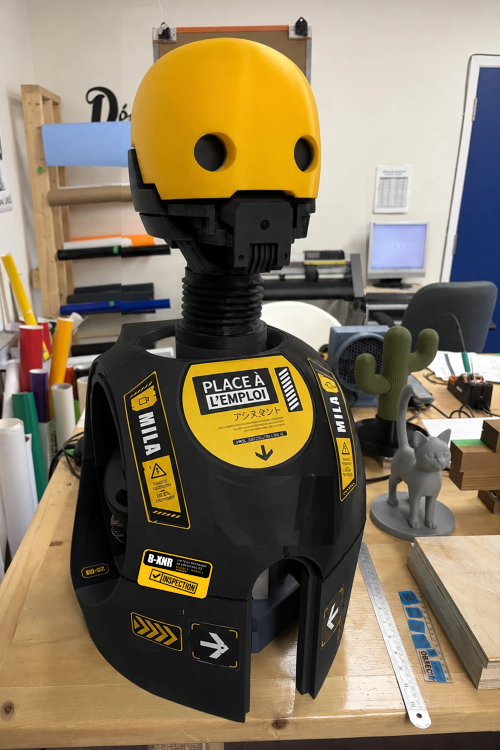

**MILA** is our lab assistant: a **3D-printed robot head** that detects the face of a person walking past and **follows it with its eyes in real time**.

## Why this project

MILA is an initiative of **Place à l'emploi** in Longueuil, as part of the **RoboTic exploratory workshop**. The workshop welcomes people who are out of work and out of school, to discover basic robotics and try out useful tools.

## How MILA is built

- A **3D-printed head**.
- A **miniature camera** to see faces.
- Two **servomotors**: one turns the head left and right, the other tilts it up and down.
- **Animated eyes** shown on two small LCD screens.

## Work in progress

- Working today: real-time **face detection and tracking**.
- In development: **voice activation** and a **lighting sequence**.

## Learn more

The whole project (designs, programs and documentation) is openly available on GitHub: <a href="https://github.com/Fablab-PAE/MILA" target="_blank" rel="noopener noreferrer">MILA project on GitHub</a>.
