Ce guide vous accompagne pas à pas dans l'utilisation de la machine CNC Shapeoko 3. Celle-ci est principalement utilisée pour le fraisage, un procédé de fabrication où la machine **enlève de la matière d'un bloc (comme du bois, du métal ou du plastique) en faisant tourner très rapidement une mèche coupante**. Cela permet de créer dans le matériau des gravures et des découpes précises.

## Sécurité personnelle
- La sécurité est primordiale lors de l'utilisation d'une machine CNC. Suivez toujours ces règles :
  - Ne jamais démarrer la machine CNC avec le capot de protection ouvert
  - Porter des lunettes de protection
  - Porter des protections auditives au besoin
  - S'assurer que le système de ventilation est fonctionnel
  - Ne jamais laisser la machine sans surveillance pendant son fonctionnement
  - Toujours **éteindre la toupie** (interrupteur **Toupie**) et attendre l'arrêt complet de la mèche avant de toucher à la mèche

## Référence matérielle

- Modèle de machine CNC utilisée : <a href="https://docs.google.com/viewer?url=https://raw.githubusercontent.com/Fablab-PAE/pae-docs/main/public/pdf/shapeoko3_assembly_guide.pdf&embedded=true" target="_blank" rel="noopener noreferrer">Shapeoko 3</a>
- Toupie compacte industrielle utilisée : **DEWALT DWP611** (<a href="https://docs.google.com/viewer?url=https://raw.githubusercontent.com/Fablab-PAE/pae-docs/main/public/pdf/dwp611.pdf&embedded=true" target="_blank" rel="noopener noreferrer">Manuel d'utilisation</a>)
    - Collets disponibles : **0,25" (6,35 mm)**
    - Plusieurs types de mèches sont disponibles et peuvent être installées sur la toupie

    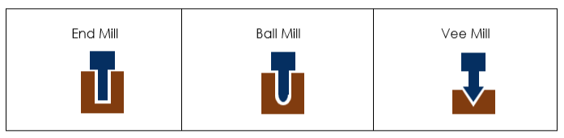

    - Voir ci dessous un exemple des différentes mèches disponibles à insérer dans le collet

    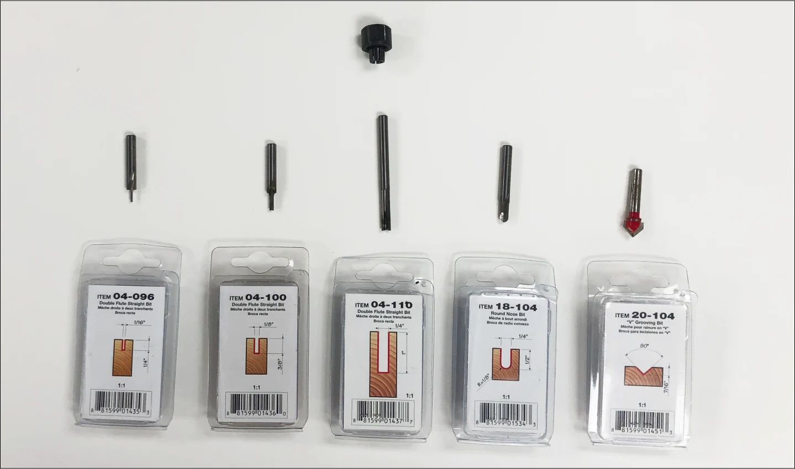

    - Voir ci dessous le **processus d'installation d'une mèche dans le collet**

    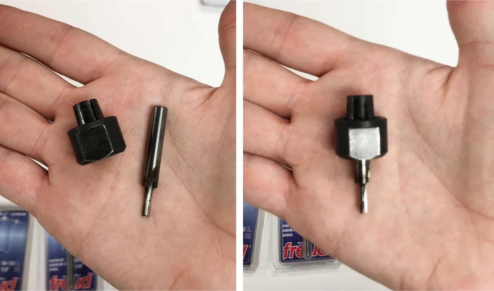

- Module **BitSetter** : capteur qui mesure automatiquement la longueur de la mèche, pour pouvoir **utiliser plusieurs mèches dans un même usinage** (voir la section [Module BitSetter](#module-bitsetter-changement-de-mèches))

- **Utilisateurs avancés**: Mettre à jour le firmware de la machine CNC périodiquement en connectant la machine CNC à votre ordinateur en utilisant un câble USB et en  utilisant l'IDE Arduino pour téléverser le programme
    - Mise à jour Firmware : GRBL 1.1h (mise à jour depuis la version 1.1f) <a href="https://github.com/gnea/grbl/releases/tag/v1.1h.20190825" target="_blank" rel="noopener noreferrer">Lien Firmware</a>

## Zone de travail

- La surface de travail est d'**environ 30" (largeur) x 27" (longueur) (soit 76,20 cm x 68,58 cm)**

    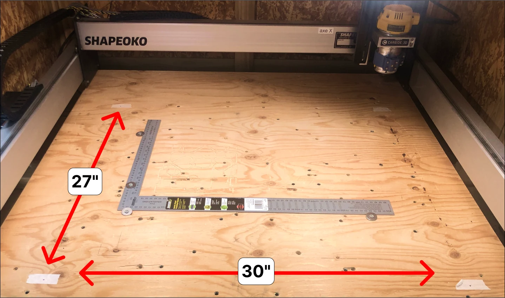

## Matériaux usinables

- Bois : Tous types de bois
    - Épaisseur de découpe du matériau possible : **1 pouce (25,4 mm) et moins**. Cela dépends des mèches que vous utiliserez (**inspecter les mèches et leurs boites**)
- Plastique
    - **Non usinable** (Nous n'avons pas de système d'aération pour expulser les fumées dégagées par le plastique)
- Métal
    - **Non usinable**
- Plaques de cuivre
    - Plaques de cuivre (de type FR1) pour la création des circuits imprimés

## Logiciels à utiliser

Carbide 3D fournit une **suite de 2 logiciels** conçu pour ses machines CNC (logiciels disponible uniquement en anglais):

1. **Carbide Create** 
   - Pour définir les paramètres de découpe et générer le fichier G-code (la liste d’instructions que la machine CNC devra suivre)
2. **Carbide Motion** 
   - Pour contrôler la machine CNC et exécuter le fichier G-code généré dans Carbide Create

:::note[Note]
Ce guide explique comment opérer la machine CNC pour réaliser une découpe à partir d'un dessin existant, mais il **ne couvre pas ici la création de dessins vectoriels**.
:::

## Module BitSetter (changement de mèches)

La machine est équipée d'un **BitSetter** : un petit capteur fixé à l'avant droit de la machine qui **mesure automatiquement la longueur de la mèche** installée dans la toupie.

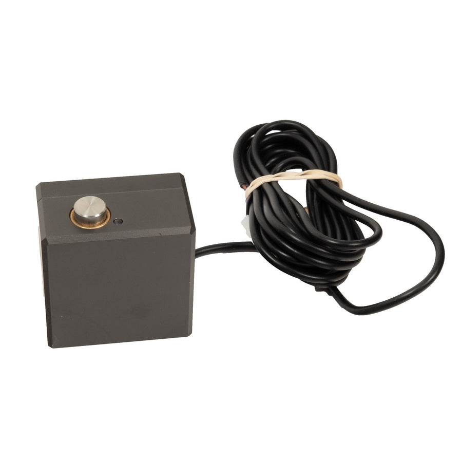

*Photo : Carbide 3D*

### À quoi sert le BitSetter ?

- Il permet d'**utiliser plusieurs mèches dans un même fichier d'usinage** (par exemple une mèche plus grosse pour enlever rapidement de la matière, puis une mèche fine pour graver un dessin plus petit).
- À chaque changement de mèche, Carbide Motion mesure la nouvelle mèche, la compare à la précédente et **recalcule automatiquement le zéro de l'axe Z**.
- Avant le BitSetter, il fallait exporter un fichier séparé pour chaque mèche et refaire le zéro Z à chaque changement.

### Où se trouve-t-il ?

- Il est fixé sur la **plaque avant de la machine, à environ 114 mm (4,5 pouces) du bord droit**.

  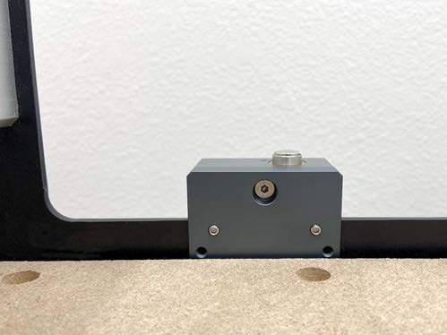

  *Photo : Carbide 3D (guide d'installation du BitSetter)*

- Pour mesurer une mèche, la machine place la toupie juste au-dessus du bouton du BitSetter, puis **descend doucement jusqu'à ce que la mèche touche le bouton**.

  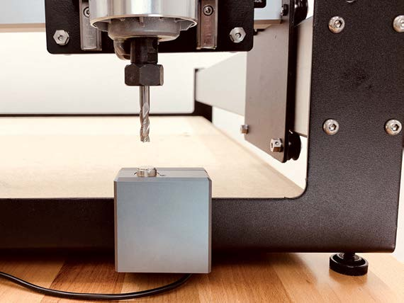

  *Photo : Carbide 3D (guide d'installation du BitSetter)*

### Le déroulement en un coup d'œil

Le schéma ci-dessous montre tout le déroulement d'un usinage avec le BitSetter. Le détail de chaque étape est dans la section [4. Utilisation du logiciel Carbide Motion](#4-utilisation-du-logiciel-carbide-motion).

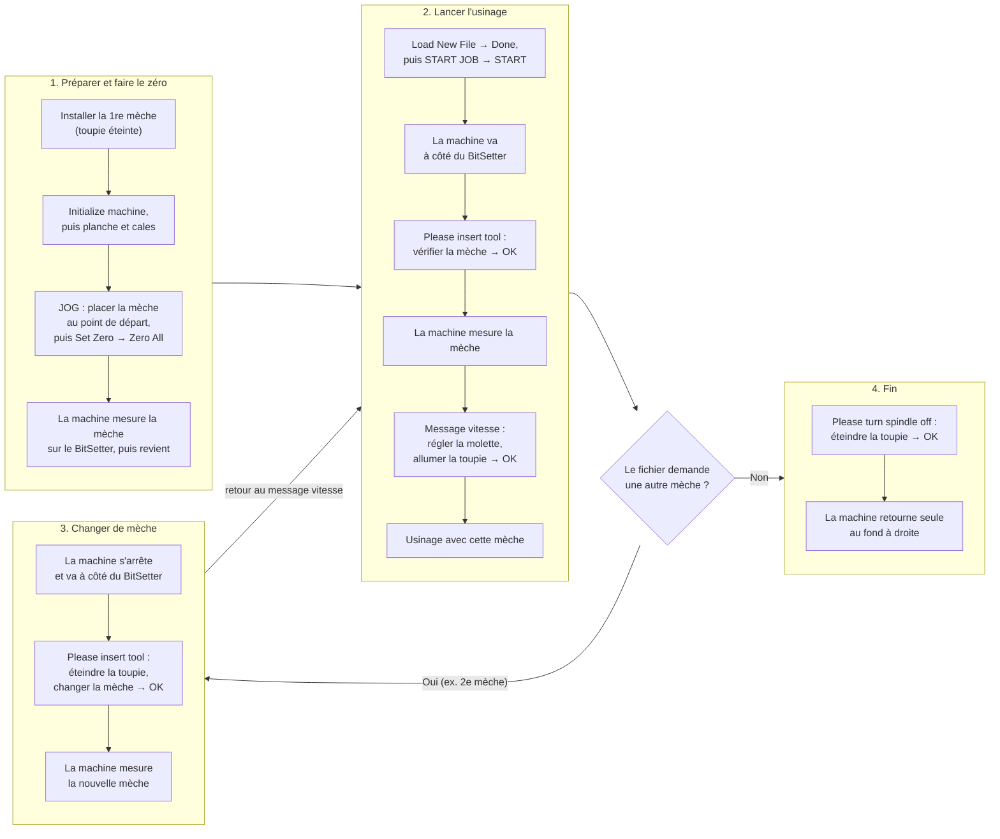

Les couleurs du schéma :
- **Bleu** : ce que vous faites
- **Orange** : Carbide Motion affiche un message et attend votre action
- **Rouge** : la machine bouge toute seule (mains hors de la machine !)
- **Vert** : l'usinage est en cours (toupie allumée, capot fermé)

Avec **une seule mèche**, on passe directement de l'usinage à « Non », puis à la fin. Avec **deux mèches** (par exemple une grosse mèche pour enlever la matière, puis une fine pour graver), on fait une fois la boucle « Oui » : changement de mèche, mesure de la nouvelle mèche, réglage de la vitesse, puis l'usinage reprend.

### Quand la machine bouge-t-elle toute seule ?

Avec le BitSetter, la machine **se déplace toute seule vers le BitSetter** à plusieurs moments :
- quand vous faites le **zéro de l'axe Z** (boutons **"Zero All"** ou **"Zero Z"**) ;
- quand vous lancez l'usinage (bouton **"START"**) ;
- à chaque **changement de mèche** demandé par le fichier ;
- parfois aussi quand vous ramenez la toupie au point zéro (**"Rapid Position"** ou **"Quick Actions"**).

:::danger[Attention : soyez vigilant aux déplacements de la machine]
Carbide 3D le résume ainsi : **lorsque vous touchez au zéro Z, considérez que la machine pourrait se mettre en mouvement**. Avant chacune de ces actions :
- retirez vos mains de la machine ;
- vérifiez que **rien** (cales, outils, câbles, tuyau d'aspirateur) ne se trouve sur le chemin de la toupie ni autour du BitSetter ;
- vérifiez que la **toupie est éteinte**.
:::

### Les règles d'or du BitSetter

:::caution[À respecter à chaque usinage]
1. **Toupie éteinte pendant chaque mesure** : la mèche ne doit jamais tourner quand elle touche le BitSetter (cela abîmerait le capteur et la mèche).
2. **Changer de mèche uniquement quand Carbide Motion le demande** (message **"Please insert tool"**). Si vous changez la mèche à un autre moment, la machine ne connaît pas sa longueur : elle risque de **s'enfoncer dans la planche** ou d'usiner dans le vide. Si cela arrive, refaites le zéro de l'axe Z (**"Set Zero"** puis **"Zero Z"**) : la nouvelle mèche sera mesurée.
3. **Mèche assez longue** : elle doit dépasser du collet d'**au moins 12,7 mm (0,5 pouce)** pour atteindre le bouton du BitSetter.
4. **Bouton propre** : un copeau sur le bouton fausse la mesure, et donc la profondeur de coupe. Rien ne doit se trouver sur le bouton du BitSetter avant de commencer.
5. **Ne pas déplacer le BitSetter** : sa position est enregistrée dans Carbide Motion.
:::

### Versions installées à l'atelier

| Élément | Version utilisée |
|---|---|
| Machine | Shapeoko 3 XXL, axe Z à courroie (*belt-drive*) |
| Carte de contrôle | Carbide Motion **v2.4e** |
| Firmware | GRBL **1.1** |
| Carbide Motion | **V6**, build **667** (mis à jour le 2 novembre 2026) |
| Carbide Create | **V7**, build **778** |

:::note[Note]
Carbide 3D a changé la façon d'utiliser le BitSetter **à partir du build 623 de Carbide Motion** (2024) : la mèche est maintenant mesurée au moment où l'on fait le zéro Z et au lancement de l'usinage. Ce guide décrit ce fonctionnement (build 667). Après une mise à jour de Carbide Motion, vérifiez que les étapes sont toujours les mêmes.
:::

### Documentation

- <a href="https://my.carbide3d.com/pdf/bitsetter-v2.pdf" target="_blank" rel="noopener noreferrer">Guide officiel d'installation et de réglage du BitSetter</a> (PDF Carbide 3D, en anglais)
- <a href="https://carbide3d.com/blog/bitsetter-changes-carbide-motion" target="_blank" rel="noopener noreferrer">Article Carbide 3D sur le nouveau fonctionnement du BitSetter</a> (en anglais)
- <a href="https://my.carbide3d.com/gettingstarted/shapeoko3/" target="_blank" rel="noopener noreferrer">Bien démarrer avec la Shapeoko</a> et cours <a href="https://carbide3d.com/hub/courses/getting-started-cnc/" target="_blank" rel="noopener noreferrer">Getting Started with CNC</a> (Carbide 3D, en anglais)
- <a href="https://carbide3d.com/downloads/" target="_blank" rel="noopener noreferrer">Télécharger ou mettre à jour Carbide Create et Carbide Motion</a>

## 1. Mise sous tension de la machine

Les interrupteurs et boutons pour démarrer la machine sont disponibles sur le côté gauche : 

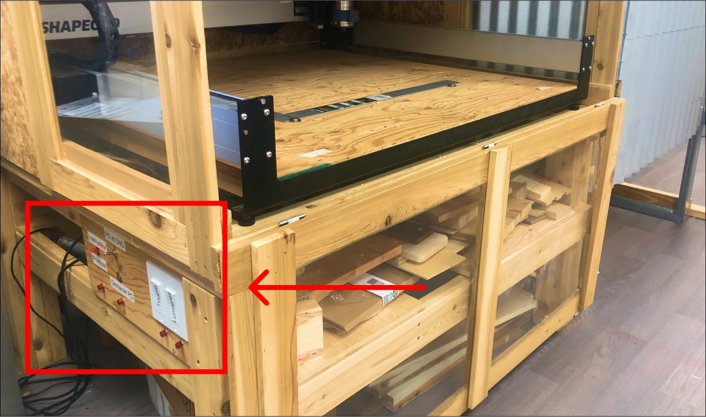

1. Activer l'interrupteur **Interrupteur Principal**
2. Activer l'interrupteur **PC et CNC**
3. Presser le bouton **Démarrer PC**
4. Activer l'interrupteur **Lumières**
5. **Ne pas toucher** à l'interrupteur **Toupie** pour le moment

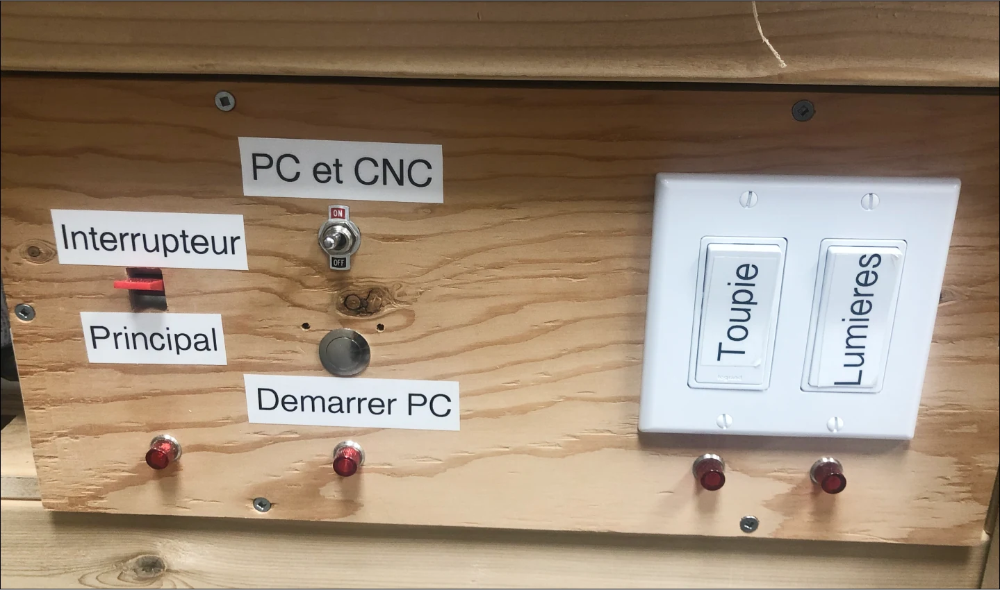

## 2. Préparation de la planche à découper
- Mesurer la planche à découper (largeur, longueur et épaisseur) à l'aide d'un mètre à ruban **SANS la placer pour le moment sur la zone de travail**. Cette étape interviendra ultérieurement.

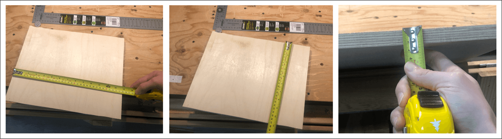

## 3. Utilisation du logiciel Carbide Create
- Ouvrir le logiciel

  

- Saisir dans le logiciel les dimensions de la planche
  - Dans le menu de gauche, dans la section **"Setup"** de l'onglet **"Design"**, cliquer sur l’icône en forme d’écrou. Une boite de dialogue va s'ouvrir.

  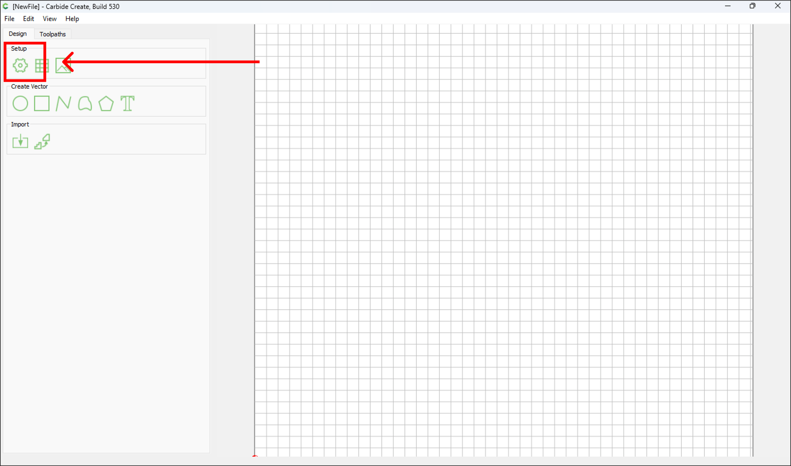

  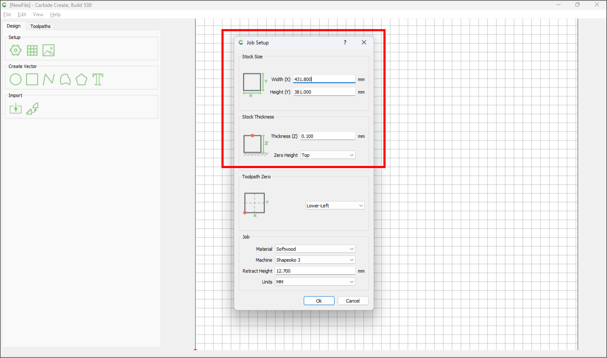

  - Dans cette fenêtre, saisir la largeur, la longueur **«Stock Size»** et l’épaisseur de votre matériau **«Stock Thickness»** à usiner en millimètres. Il est possible de changer l’unité de mesure dans cette fenêtre en cliquant sur le menu déroulant à droite de **«Units»** et en sélectionnant **«Inch»**. 
    <!-- - (vous pouvez aussi utiliser un convertisseur d'unité au besoin tel que <a href="https://www.wolframalpha.com/input?i=inch+mm" target="_blank" rel="noopener noreferrer">wolframalpha.com</a>) -->
  - Ne pas toucher à la variable **«Zero Height»** qui doit rester sur **«Top»** ni la section **«Toolpath Zero»** qui correspond à la position initiale de la machine (le point zéro rouge qui correspond à l'endroit où la machine débutera son travail). Généralement, c'est le coin inférieur gauche **«Lower Left»**.
  - Cliquer sur **«Ok»** pour enregistrer les informations saisies. En cliquant sur **«Ok»**, la fenêtre va se fermer et la zone de travail va se mettre à jour pour présenter un cadre **représentant les dimensions de votre matériau** (représenté en pointillé ci-dessous)

    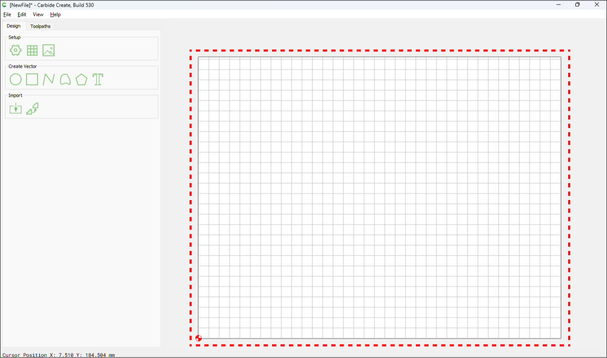

- Importer le dessin à usiner
    - Importer ensuite votre dessin à usiner au **format vectoriel (fichier de type .svg)** en cliquant sur le bouton **"Import"** de la section **"Import"**.
      - Au clic, une boite de dialogue va s'ouvrir et vous demander de sélectionner le fichier à importer. **Sélectionnez le fichier** et cliquez sur le bouton **«Ouvrir»**

    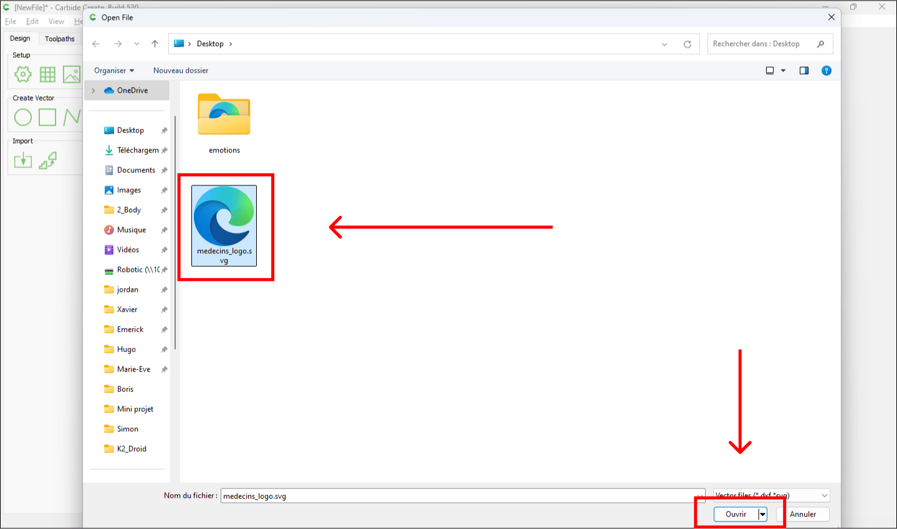

    - C'est maintenant l'étape de **vérifier les dimensions du dessin importé par rapport aux dimensions de votre planche**. Au besoin, mettre le dessin à l'échelle avec l'outil **"Scale"** dans la section **"Transform"** et positionnez ensuite votre dessin à l'endroit de votre planche où vous désirez éffectuer le l'usinage

      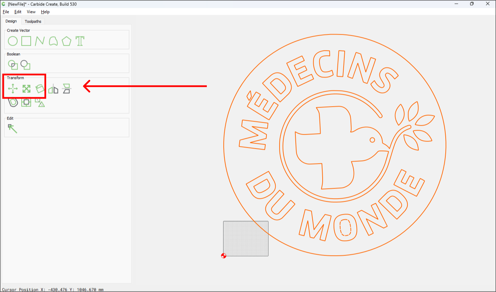

      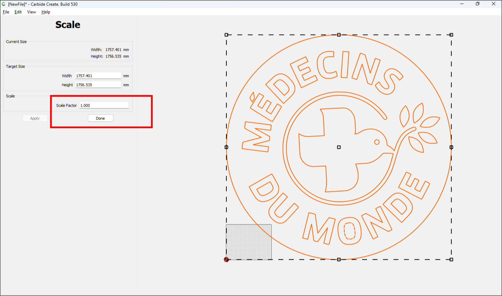

    - Cliquer sur **"Apply"** puis sur **"Done"**
- Paramétrez maintenant l'usinage à faire sur le dessin choisi
  - Sélectionner le ou les différents éléments du dessin. Le dessin s'affiche en orange lorsque sélectionné
  

    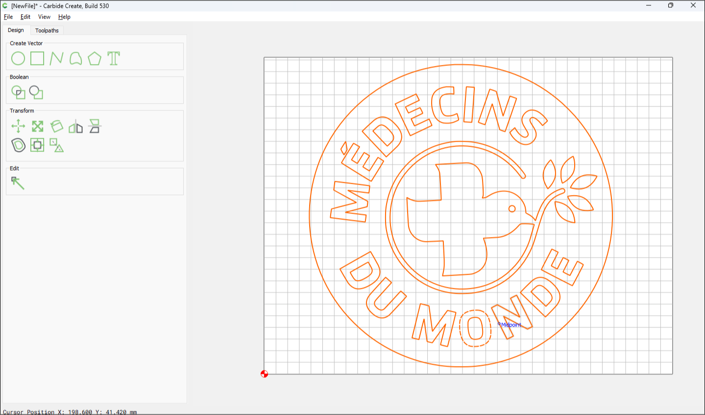

  - Cliquez ensuite sur l'onglet **"Toolpath"** à la droite de l'onglet **"Design"**
    - Plusieurs options de gravure sont disponibles dans la section "2D Toolpath":

        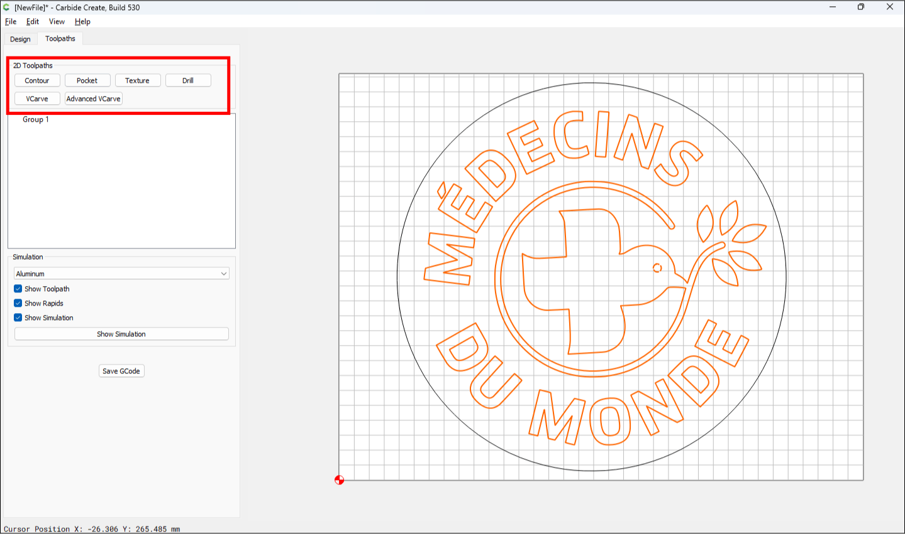

        - Sélectionner **«Contour»** pour graver les contours de l’objet
        - Sélectionner **«Pocket»** pour creuser tout l’intérieur de l’objet de façon uniforme
        - Sélectionner **«Texture»** pour creuser à l’intérieur d’un objet pour créer une texture en relief
        - Sélectionner **«Drill»** pour faire un trou dans un objet
        - Sélectionner **«VCarve»** pour graver l’intérieur d’un objet en produisant des côtés en angle (cette option est surtout utilisée pour le texte en surface)
    - Maintenant que vous avez sélectionné une option de gravure pour votre projet, il vous reste à sélectionner le choix de mèche à utiliser dans la sous-section **«Tool»** du sous-menu **«Contour Toolpaths»**

        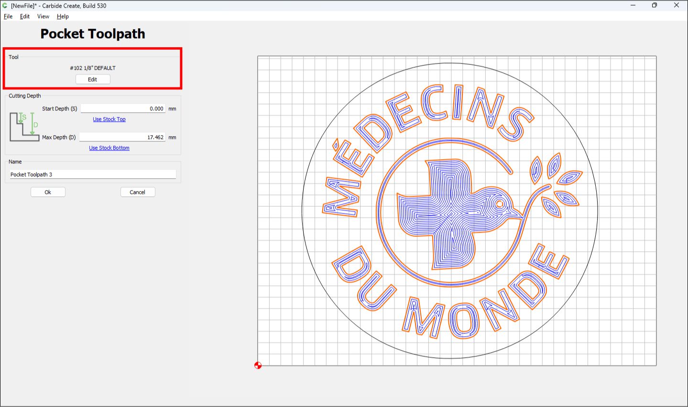

        - Cliquer sur **«Edit»** et une boite de dialogue va s'ouvrir 
        - Cliquer sur **«Select Tool»** permet d’accéder au module de sélection des mèches disponibles dans le logiciel

        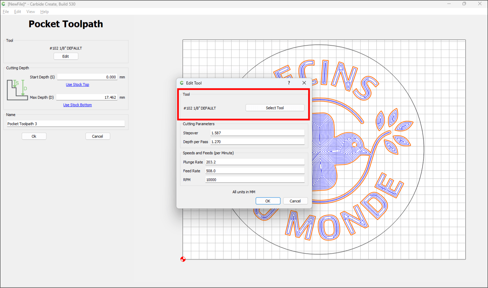

        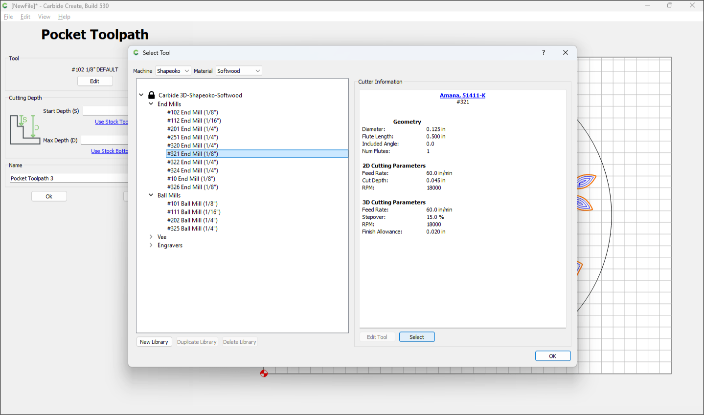

        - Voir ci-dessous le **tableau de correspondance** entre les mèches du module de sélection du logiciel Carbide Create et les mèches disponibles dans l'atelier (représenté en pointillé ci-dessous)

        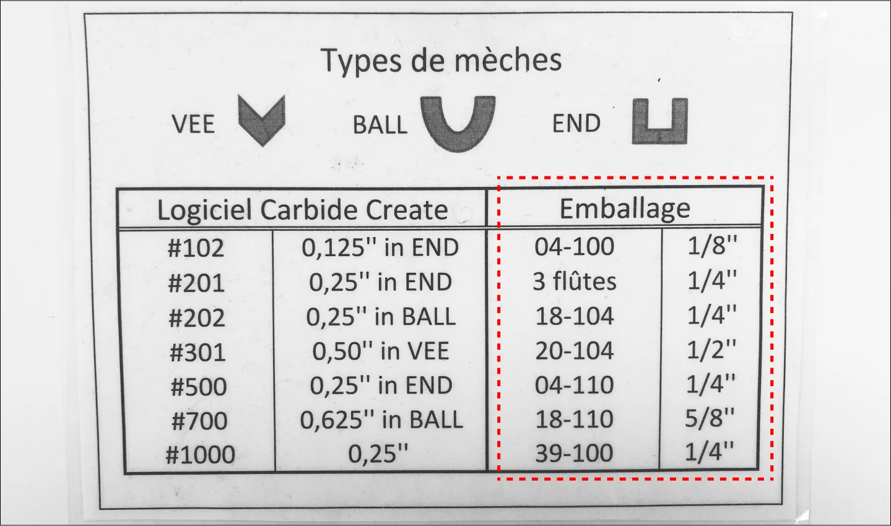

    - Définissez ensuite la profondeur de la découpe à effectuer dans la section **« Cutting Depth »**. Assurez-vous que la **mèche que vous aller installer dans la toupie est suffisamment longue** pour réaliser la découpe à la profondeur saisie.

        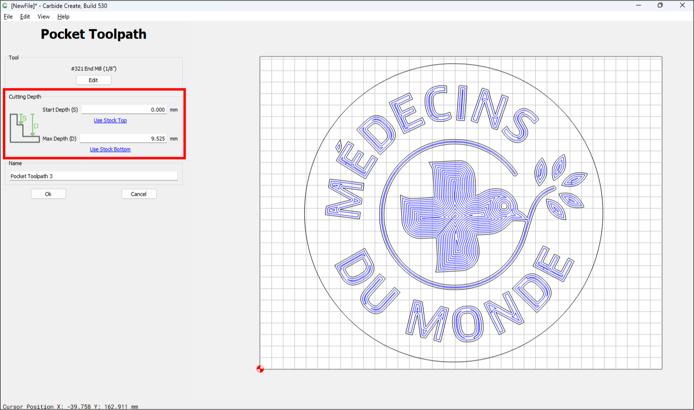

        - La première variable **«Start Depth» (S)** doit être à zéro puisque nous voulons commencer à fraiser à la surface du matériau. La deuxième variable, **«Max Depth» (D)** est la mesure de la profondeur maximale de la coupe (Par défaut, cette distance est mesurée à partir du dessus de la planche).
    <!-- - Définir la direction de décalage
        - Cette section « Offset direction » vous permet de choisir de quel côté passera la mèche en relation avec la découpe de votre dessin.   -->
    - Une fois que vous avez rempli les différentes sections, cliquer sur **«Ok»**

:::note[Conseil]
Dans le cas d'un dessin complexe, il faut définir l'ordre de la découpe à effectuer pour chaque groupe de dessins. Par exemple, il est préférable de commencer par découper les éléments intérieurs d'un dessin avant de terminer par les contours extérieurs : Cela permet de maintenir la stabilité de la pièce pendant la découpe.
:::

:::tip[Plusieurs mèches dans un même fichier]
Grâce au BitSetter, chaque parcours d'usinage (*toolpath*) peut utiliser **une mèche différente** :
- Choisissez la mèche de chaque parcours comme expliqué ci-dessus. Carbide Create numérote les mèches automatiquement.
- Carbide Motion vous demandera de changer de mèche chaque fois que deux parcours qui se suivent utilisent des mèches différentes. **Regroupez les parcours qui utilisent la même mèche** pour limiter les changements : l'ordre de la liste des parcours est l'ordre d'usinage.
- Vérifiez que chaque mèche existe à l'atelier et qu'elle est assez longue.
- **Notez la liste des mèches dans l'ordre** (et leur vitesse de rotation) avant d'aller à la machine.
:::

- Vérifier le parcours de la machine en le prévisualisant en appuyant sur **« Show simulation »**
    - Vous pouvez alors voir la simulation de la découpe

    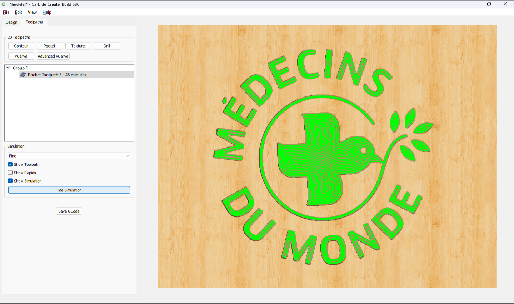

- Une fois les paramètres de découpe du dessin configurés, **enregistrer votre travail** au format Carbide Create **.c2d** (e.g. ma_decoupe_cnc.c2d) : Carbide Motion V6 ouvre directement ce fichier
    - Vous pouvez aussi **exporter le dessin au format G-code** en lui donnant un nom (e.g. ma_decoupe_cnc.nc) : Carbide Motion accepte aussi ce fichier

    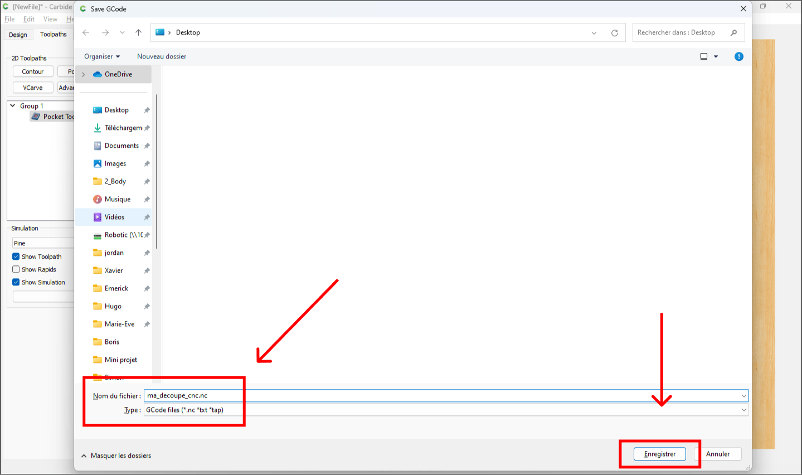

## 4. Utilisation du logiciel Carbide Motion

Pour une vue d'ensemble, voir le schéma [Le déroulement en un coup d'œil](#le-déroulement-en-un-coup-dœil).

### 4.1 Préparer la machine

- Avant d'ouvrir le logiciel, vérifier tout d'abord que le **plan de travail de la machine CNC ne comporte aucun objet ou obstacle** sur la surface de travail

    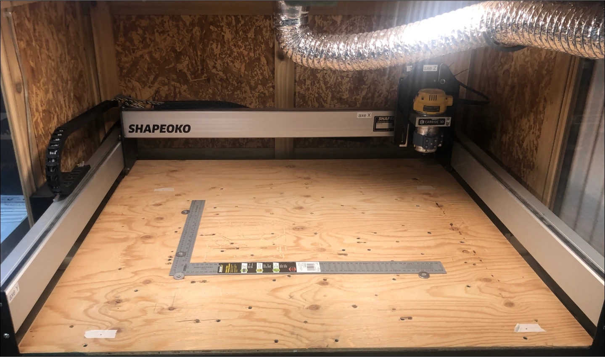

- Vérifier aussi que le **BitSetter (à l'avant droit de la machine) est dégagé** et que son **bouton est propre** (sans copeaux)

### 4.2 Installer la mèche

- Installation de la mèche sur la toupie (**toupie éteinte**)
    - Sélectionner la mèche appropriée pour votre projet. Si votre fichier utilise plusieurs mèches, installez **la première mèche** du fichier
        - Assurez vous que le diamètre de la queue de la mèche correspond au collet installé sur la toupie (le diamètre de la queue de la mèche doit être de **0,25″** inch soit 6.35 mm)
        - La mèche doit dépasser du collet d'**au moins 12,7 mm (0,5 pouce)** pour pouvoir être mesurée par le BitSetter
    - Insérer délicatement la queue de la mèche dans le collet correspondant de la toupie

        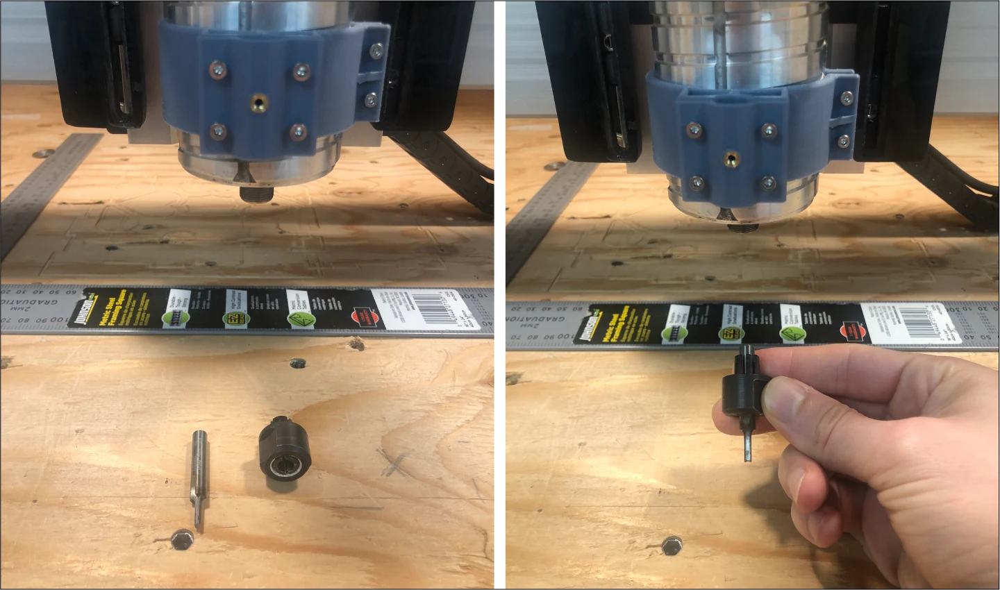

    - Serrage de la mèche
        - **Visser le collet avec la mèche** dans l'arbre de la toupie
        - Localiser le bouton de verrouillage jaune sur le **côté gauche de la toupie**
        - **Maintenir le bouton enfoncé** pour empêcher l'arbre de tourner
        - Utiliser une clé pour serrer fermement l'écrou du collet dans le **sens antihoraire** (ne pas serrer excessivement, pour ne pas endommager le collet ou la mèche)
        - **Relâcher** le bouton de verrouillage jaune

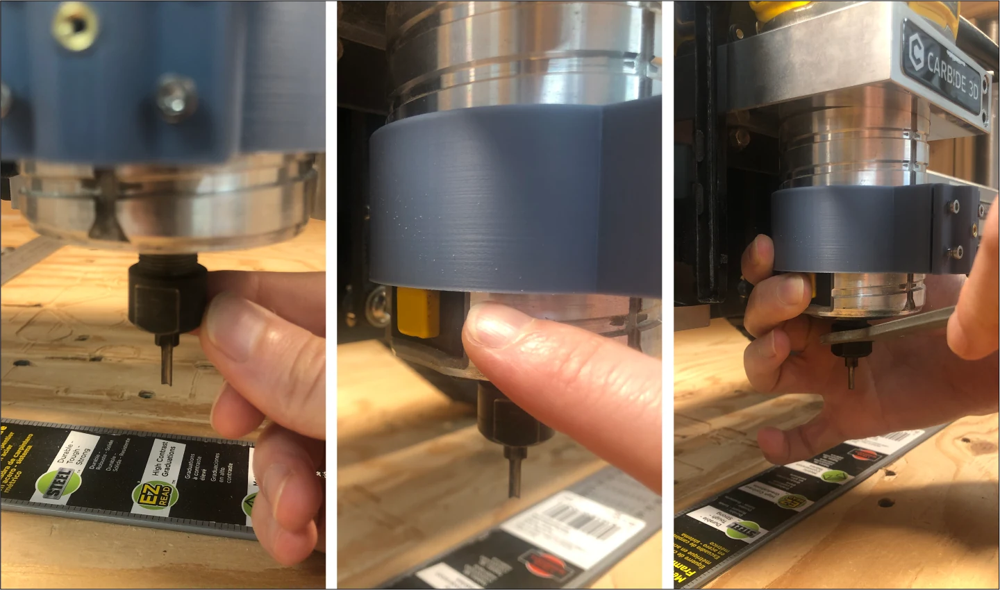

:::note[Note]
Après avoir relâché le bouton de verrouillage jaune, faire tourner doucement la mèche à la main pour vous assurer qu'elle est **correctement centrée et ne vacille pas** dans le collet. La mèche est maintenant correctement installée dans la toupie !
:::

### 4.3 Régler la vitesse de la toupie

- Sur la toupie compacte, sélectionner la vitesse de rotation à laquelle la mèche devra tourner en fonction de votre projet (**vitesse de rotation entre 1 et 6**)
    - Carbide Motion vous rappellera la vitesse à utiliser au lancement de l'usinage et à chaque changement de mèche

  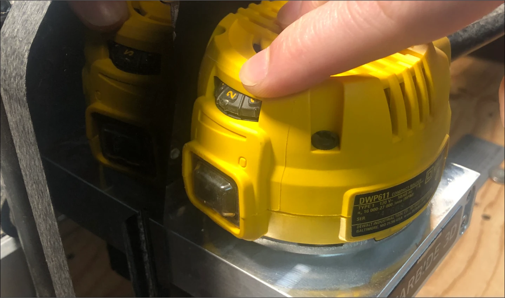

- Consultez ci-dessous le **tableau de correspondance** entre le réglage de la molette de sélection et la vitesse de rotation de la toupie

  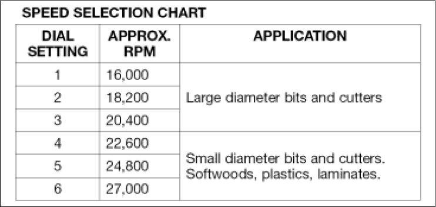

### 4.4 Connecter et initialiser la machine

- Ouvrir maintenant le logiciel Carbide Motion

  

- Cliquer sur "Connect to cutter"

  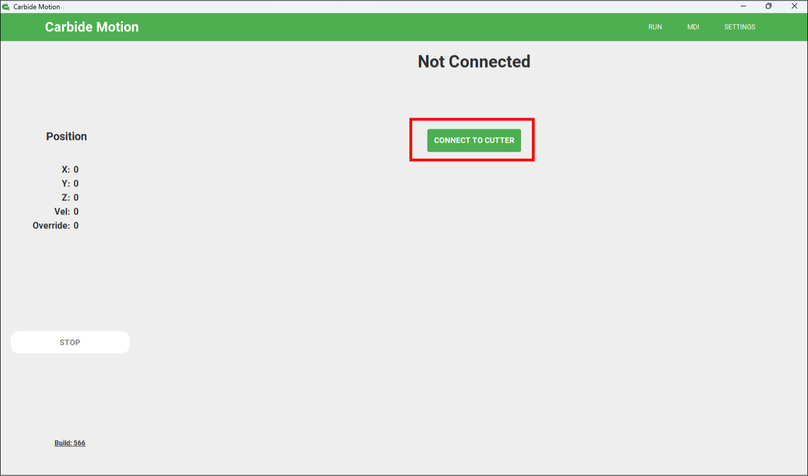

- Cliquer sur "Initialize machine"

  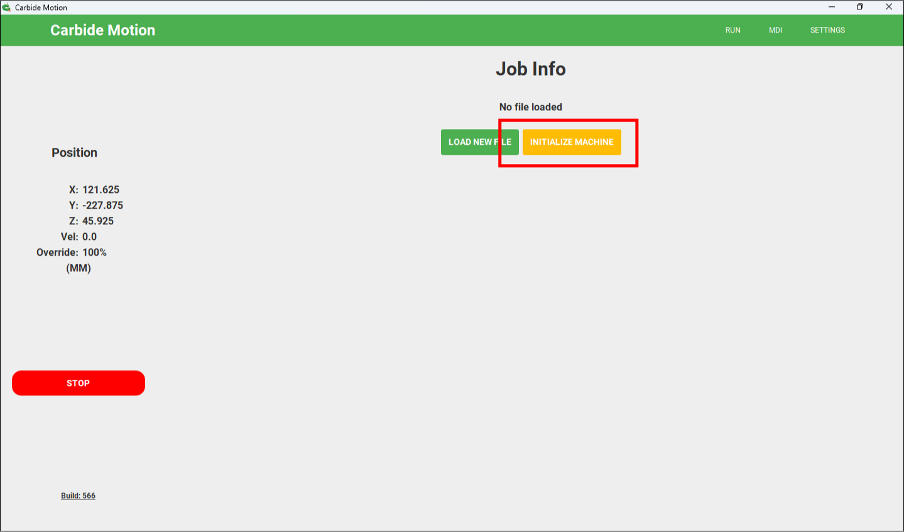

:::caution
Lorsque vous cliquez sur “Initialize machine”, la machine va se **déplacer automatiquement en position initiale** en allant d'abord **au fond de la machine**, puis en se positionnant **devant**. Il ne faut donc pas qu'elle rencontre des objets ou obstacles sur son chemin !
:::

### 4.5 Fixer la planche

:::note[Note]
Une fois que la machine s'est placée en position initiale et est à l'arrêt, **positionnez votre planche à découper sur la zone de travail en utilisant les cales de fixation**.
:::

- les cales de fixation maintiendront la planche pour qu’elle ne bouge pas pendant l’usinage
    - Ne placez **aucune cale ni aucun objet devant ou à côté du BitSetter** (avant droit de la machine) : la toupie doit pouvoir y aller librement

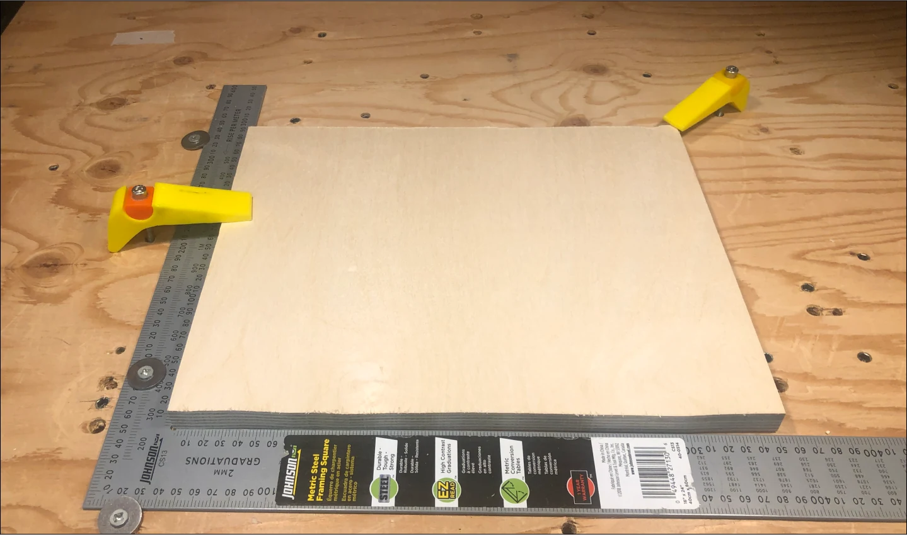

### 4.6 Définir le point zéro

- Cliquer ensuite sur l'onglet **"JOG"**
    - Cet onglet vous permet de contrôler manuellement les mouvements de la toupie sur tous les axes (X, Y et Z) et sert à **définir le point de démarrage (point zéro) de la machine CNC**

    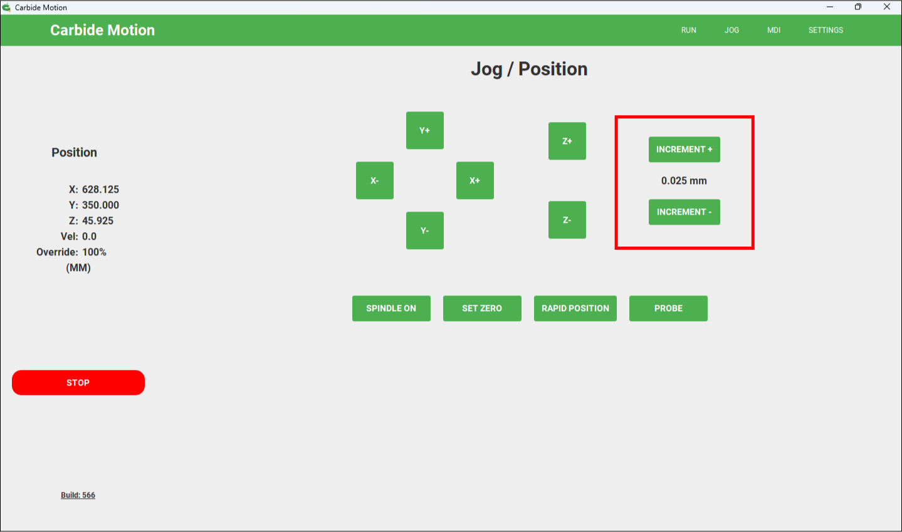

- Contrôle de la vitesse de déplacement
    - Repérez les boutons **«INCREMENT +» et «INCREMENT -»** sur l'interface de contrôle. Ces boutons permettent d'ajuster la vitesse de déplacement de la toupie sur le plan de travail.
    - L'incrément détermine la précision du mouvement de la toupie à chaque pression sur les boutons de déplacement X, Y et Z. Utilisez ces boutons pour augmenter ou diminuer l'incrément selon vos besoins.
- Choix de la vitesse
    - Pour un déplacement rapide : Augmentez progressivement l'incrément jusqu'à **«FAST»** (utilisez cette option avec prudence, surtout près des bords de la planche.)
    - Pour un ajustement précis : Diminuez l'incrément jusqu'à **«0.025mm»**. Cela permet un contrôle très fin du positionnement de la toupie.
- Positionner le point de départ de la machine

  - Ajustement sur les axes X et Y : Utilisez les commandes de l'onglet **"JOG"** pour déplacer la toupie sur les axes X et Y afin de **positionner la mèche à la position de départ souhaitée sur la planche**.

  - La toupie est maintenant placée dans sa position de départ :

    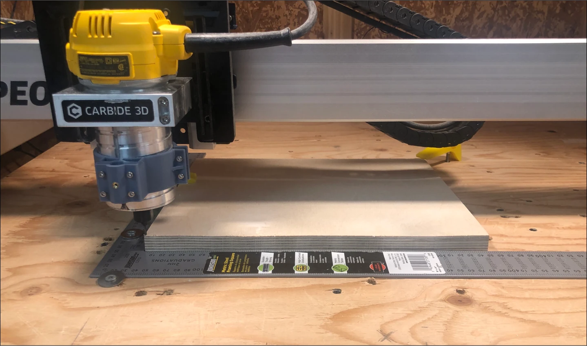

  - Ajustement sur l'axe Z : Utilisez les commandes de l'axe Z pour **abaisser délicatement la toupie jusqu'à ce que la mèche effleure la surface de la planche**.

    :::caution
    Faites attention lors de l'abaissement de la tête avec la mèche. Un contact trop brusque pourrait endommager la mèche ou la planche.
    :::

    :::note[Note]
    Utilisez une feuille de papier standard comme jauge d'épaisseur. La mèche doit tout juste pincer le papier sans le déchirer.
    :::

    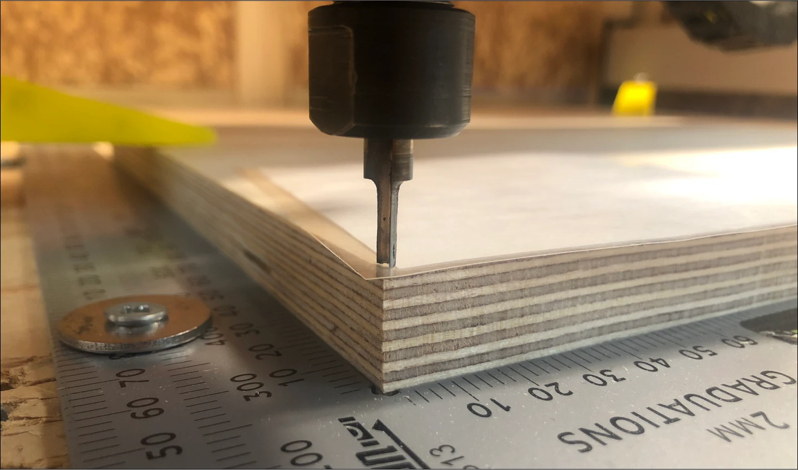

- Vérification finale: confirmez visuellement que la position de départ de la mèche est correcte sur tous les axes.

    :::caution
    Assurez-vous que les cales de fixation ne se retrouvent pas sur le trajet de la mèche lors de la découpe et lors du calibrage de l'axe Z avec le BitSetter. 
    :::

- Une fois le positionnement de la machine vérifié, cliquer sur **"Set Zero"**
- Cliquer ensuite sur **"Zero All"** pour enregistrer le point zéro sur les 3 axes (X, Y et Z)

    :::danger[Attention : la machine bouge dès que vous cliquez sur « Zero All »]
    Dès que vous cliquez sur **"Zero All"**, la machine **part toute seule vers le BitSetter** pour mesurer la mèche, puis revient au-dessus de votre point de départ, **toupie relevée**. Gardez les mains hors de la machine et la toupie éteinte.

    Après la mesure, le **Z affiché n'est plus 0** (par exemple **+30**) : c'est normal, la toupie est simplement relevée. **Ne refaites pas le zéro.**
    :::

- Cliquer sur **"Done"** pour confirmer le positionnement de la machine CNC dans sa position de départ

### 4.7 Charger le fichier

- Cliquer ensuite sur **"RUN"**
  - Cliquer sur **"LOAD NEW FILE"**
  - Ouvrir le fichier créé à l'étape précédente avec Carbide Create (fichier **.c2d**, e.g. ma_decoupe_cnc.c2d, ou fichier G-code **.nc**)
  - Cliquer sur **"Done"**

### 4.8 Aspiration, ventilation et capot

- Mettre l'aspirateur en place sur la toupie

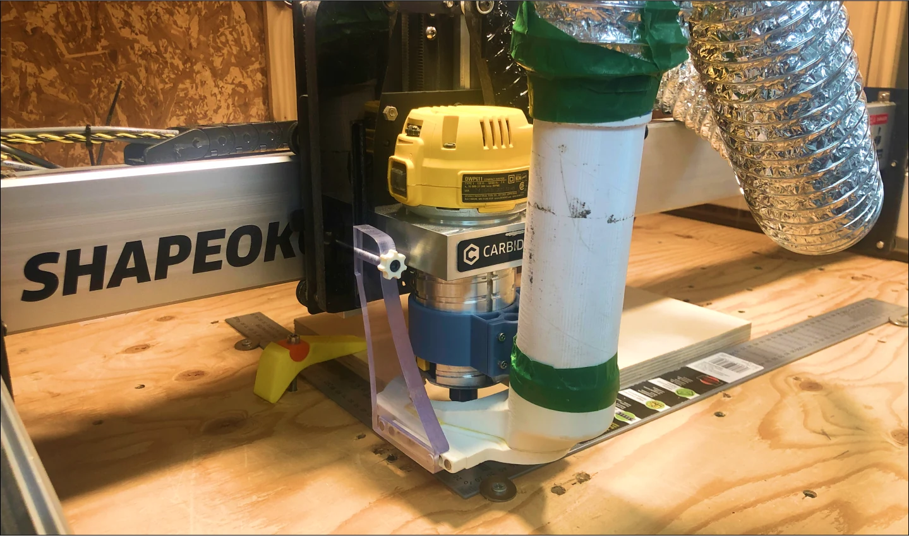

- Vérifier que la trappe de ventilation à l'arrière de la machine CNC est **complètement ouverte**

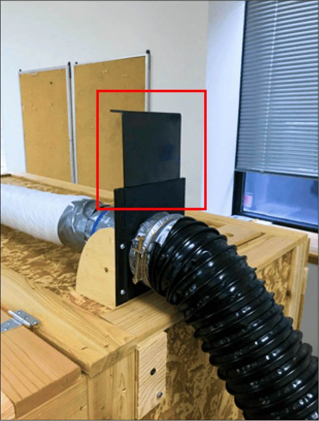

- Allumer le système de ventilation à l'intérieur de la cabine métallique

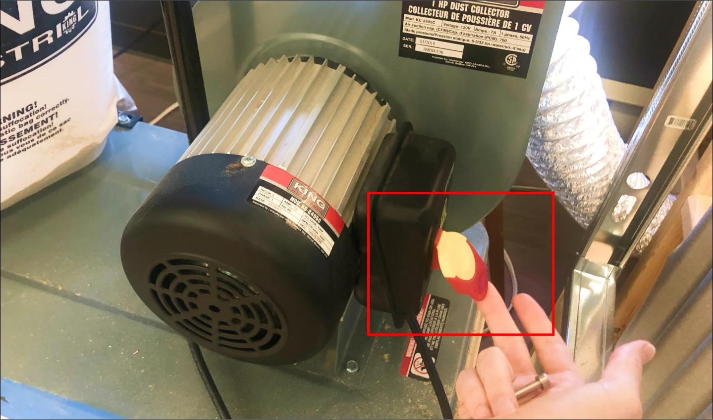

- Fermer le capot de protection de la machine CNC

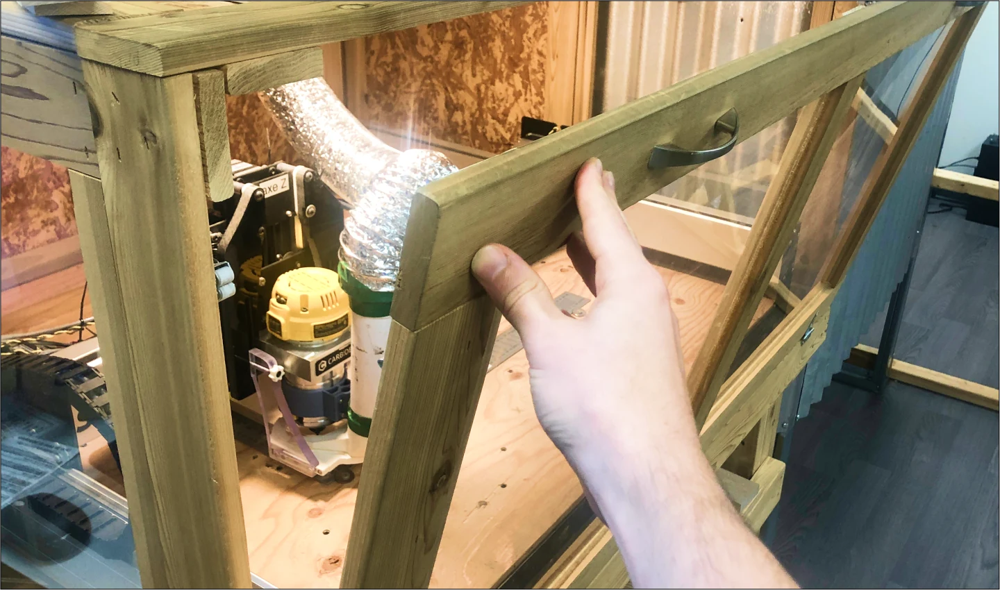

:::danger[Attention]
Ne jamais démarrer la machine CNC avec le capot de protection ouvert
:::

:::danger[Ne pas allumer la toupie maintenant !]
Avec le BitSetter, la toupie doit rester **éteinte** au lancement de l'usinage : la machine va d'abord mesurer la mèche. Vous allumerez la toupie **seulement quand Carbide Motion vous le demandera** (étapes ci-dessous).
:::

### 4.9 Lancer l'usinage

- Démarrer maintenant la machine
    - Cliquer sur **"START JOB"**
    - Cliquer sur **"START"**

    :::caution
    Dès que vous cliquez sur **"START"**, la machine se place **à côté du BitSetter** pour le chargement de la mèche (même si la mèche est déjà en place).
    :::

- Un message **"Please insert tool"** (*Tool Change Required*) s'affiche

    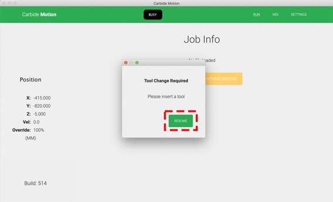

    *Capture du guide officiel Carbide 3D (ancienne version de Carbide Motion)*

    - Vérifier que la mèche installée est **bien celle demandée** (la première mèche de votre fichier). Si besoin, la changer (toupie éteinte), puis refermer le capot
    - Cliquer sur **"OK"** (ou **"Resume"**)

    :::danger[Attention]
    Dès que vous cliquez sur **"OK"**, la machine **descend mesurer la mèche sur le BitSetter**. Mains hors de la machine, toupie éteinte !
    :::

- Un message s'affiche ensuite avec la **vitesse de rotation** à utiliser pour cette mèche

    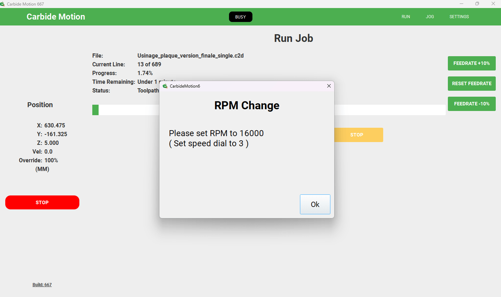

    - Régler **manuellement** la molette de la toupie (1 à 6) selon la vitesse demandée (voir le tableau de correspondance plus haut)
    - Vérifier que le capot de protection est fermé
    - **Allumer la toupie** : activer l'interrupteur **Toupie** sur le côté gauche de la machine CNC

    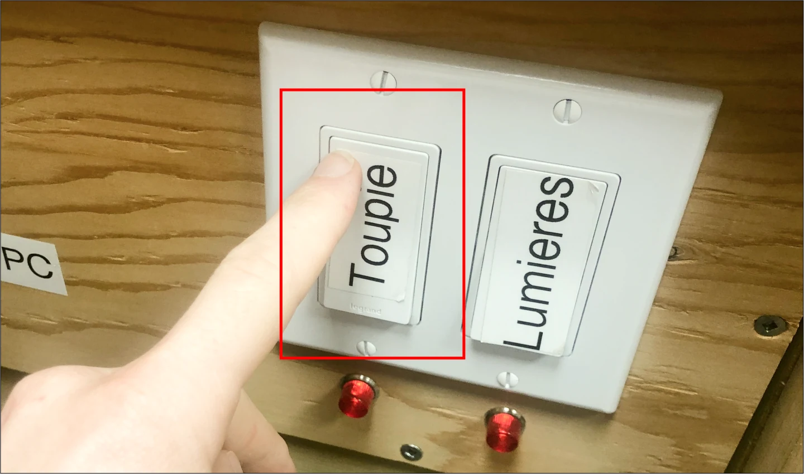

    - Cliquer sur **"OK"**

    :::danger[Attention]
    Dès que vous cliquez sur **"OK"**, **l'usinage commence** !
    :::

:::note
La machine CNC va maintenant **effectuer l'usinage de votre pièce en suivant les instructions du fichier G-code**. Pendant l'usinage, la progression de la découpe et le temps restant estimé sont **affichés en temps réel** dans le logiciel.
:::

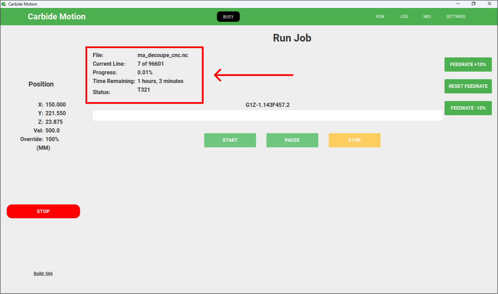

:::danger[Attention]
- **Ne jamais laisser la machine sans surveillance** pendant la durée de son fonctionnement
- En cas d'anomalie ou de danger, utilisez immédiatement le **bouton d'arrêt d'urgence "Interrupteur Principal"** sur la gauche de la machine ou via l'interface en cliquant sur le bouton **"STOP"** dans le logiciel Carbide Motion.
:::

Si votre fichier utilise **plusieurs mèches**, la machine s'arrête à chaque changement de mèche : suivez l'[annexe A. Changement de mèche pendant l'usinage](#a-changement-de-mèche-pendant-lusinage).

### 4.10 Fin de l'usinage

:::danger[Attention : la machine se déplace toute seule à la fin]
Dès que l'usinage est terminé, un message s'affiche **`Please turn spindle off`** : vous pouvez alors **éteindre l'interrupteur de la toupie**. En cliquant sur **"OK"**, la machine va alors **se replacer automatiquement au fond à droite** : **rien (cales, objets, mains) ne doit donc se trouver sur le chemin de la toupie** !
:::

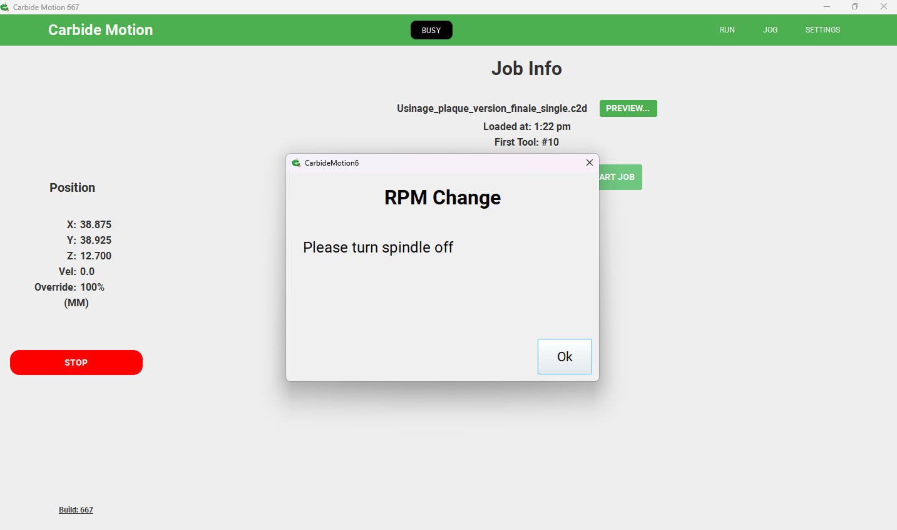

Pour relancer le même fichier (par exemple sur une nouvelle planche), voir l'[annexe B. Refaire le même usinage](#b-refaire-le-même-usinage).

## 5. Nettoyage après utilisation

:::caution
Assurez-vous que la machine a terminé son travail et qu'elle est **arrêtée et éteinte** avant de commencer le nettoyage
:::

1. Arrêt et sécurisation :
   - Désactiver la toupie en appuyant sur l'interrupteur **"Toupie"** et attendre son arrêt complet
2. Ouverture et retrait :
   - Ouvrir le capot de protection de la machine
   - Enlever les cales de fixation et retirer la planche usinée de l'habitacle de la machine CNC
3. Nettoyage :
   - Utiliser l'aspirateur pour éliminer les copeaux de bois et la poussière
   - Nettoyer les rails de guidage avec un chiffon propre
   - Nettoyer la tête de la toupie
   - Aspirer les copeaux autour du BitSetter, sans taper sur son bouton
   - Une fois le nettoyage complet, éteindre le système de ventilation
4. Eteindre l'ordinateur :
  - Désactiver l'interrupteur **"PC et CNC"**

## Annexes

### A. Changement de mèche pendant l'usinage

Si votre fichier utilise plusieurs mèches, la machine s'arrête à chaque changement de mèche :

1. La machine arrête d'usiner, **relève la toupie et se place à côté du BitSetter**. Le message **"Please insert tool"** s'affiche avec la mèche demandée.
2. **Éteindre la toupie** (interrupteur **Toupie**) et **attendre l'arrêt complet** de la mèche.

    :::danger[Attention]
    Carbide Motion **n'éteint pas la toupie** : c'est à vous de le faire **avant d'ouvrir le capot**. Ne touchez jamais une mèche qui tourne encore. La mèche peut aussi être **très chaude** après l'usinage.
    :::

3. Ouvrir le capot et **remplacer la mèche** par celle demandée (même méthode qu'au début : bouton de verrouillage jaune et clé). La nouvelle mèche doit dépasser du collet d'au moins 12,7 mm.
4. Refermer le capot, puis cliquer sur **"OK"** : la machine **descend mesurer la nouvelle mèche** sur le BitSetter (toupie toujours éteinte, mains hors de la machine).
5. Au message de vitesse : régler la molette de la toupie pour choisir la vitesse de la nouvelle mèche, **allumer la toupie**, puis cliquer sur **"OK"**. L'usinage reprend avec la nouvelle mèche.

### B. Refaire le même usinage

Pour relancer le même fichier (par exemple sur une nouvelle planche placée au même endroit) :

1. Cliquer sur **"Quick Actions"**
2. Cliquer sur **"Move cutter above current XY zero"**
3. Un message de confirmation s'affiche : cliquer sur **"YES"**

    :::caution
    La machine se déplace dès que vous cliquez sur **"YES"** : vérifiez que le chemin est libre.
    :::

4. Relancer l'usinage avec **"START JOB"** puis **"START"**, et suivre les mêmes étapes qu'en [4.9 Lancer l'usinage](#49-lancer-lusinage) (message "Please insert tool", mesure de la mèche, vitesse de rotation).

:::note[Note]
Le point zéro est conservé tant que la planche n'a pas bougé. Si vous changez de planche (ou d'épaisseur de planche) ou de position, **refaites le zéro** (**"Set Zero"** puis **"Zero All"**).
:::

## Pour aller plus loin

- Consultez la <a href="https://docs.carbide3d.com/" target="_blank" rel="noopener noreferrer">documentation officielle de Carbide 3D</a> pour des informations détaillées sur le logiciel et le matériel.

- **Bon à savoir** : un adaptateur imprimé en 3D peut être installé sur l'arbre de la toupie pour utiliser des feutres (type Sharpie) à la place des mèches. Cet adaptateur vous permettra de **dessiner sur des supports comme du papier ou du bois, au lieu de réaliser une opération d'usinage**.

## Fiche de sécurité

Cette fiche résume les règles de sécurité de la machine. Imprimez-la pour l'afficher à côté de la machine.

<button type="button" class="safety-print" data-print-sheet>Imprimer</button>

  
Fiche sécurité machine

  
Fraiseuse CNC (Shapeoko 3)

#### Description

Cette machine à commande numérique utilise une fraise (mèche) rotative à très haute vitesse pour enlever de la matière (bois, cire) afin de réaliser des découpes, gravures ou usinages 3D précis.

#### Niveau de danger (comparé aux autres machines du local)

  

    

  

  

    
<strong>Danger élevé (5/5)</strong>

    
Risques principaux : pièce rotative à haute vitesse (coupure/projection/happement), projections (copeaux, bris d'outil), poussières, bruit

  

#### Risques principaux

- **Blessures par l'outil rotatif :** le contact direct avec la fraise en rotation peut causer des blessures sévères.
- **Projections violentes :** copeaux de matière, éclats de bois ou fragments d'outil brisé peuvent être projetés à haute vitesse et causer des blessures (yeux, peau).
- **Poussières fines :** l'usinage génère des poussières (surtout bois de type MDF) nocives pour les voies respiratoires si elles sont inhalées.
- **Bruit intense :** le moteur et l'usinage génèrent un niveau sonore élevé pouvant endommager l'audition.
- **Mouvement du matériau :** une pièce mal fixée peut bouger ou être éjectée pendant l'usinage.

#### Équipements de protection individuelle (EPI)

- **Système d'aspiration des copeaux/poussières : ACTIVATION OBLIGATOIRE** avant et pendant toute la durée de l'usinage.
- **Capot de protection (si équipé) : UTILISATION FERMÉE OBLIGATOIRE**.
- **Lunettes de sécurité : PORT OBLIGATOIRE** en tout temps à proximité de la machine en fonctionnement.
- **Protecteurs auditifs (bouchons ou casque) : PORT OBLIGATOIRE** pendant le fonctionnement de la machine.
- **Masque antipoussière (type N95) : RECOMMANDÉ**, surtout pour les usinages longs ou de matériaux générant beaucoup de poussière (MDF).

#### Règles de sécurité impératives

- **Vérifier la fixation SOLIDE ET SÉCURITAIRE du matériau** sur le plateau avant CHAQUE usinage. Utiliser les cales de fixation appropriées.
- **S'assurer que la fraise est correctement installée et serrée** dans la pince (collet) du routeur. Utiliser des fraises adaptées et non endommagées.
- **NE JAMAIS LAISSER LA MACHINE SANS SURVEILLANCE** pendant son fonctionnement.
- **Garder les mains et le corps ÉLOIGNÉS** de la zone de travail et des pièces mobiles pendant le fonctionnement. Ne jamais essayer d'enlever des copeaux à la main pendant que la machine tourne.
- **Connaître l'emplacement et le fonctionnement du BOUTON D'ARRÊT D'URGENCE** et pouvoir l'atteindre facilement.
- **Utiliser des paramètres de coupe (vitesse de rotation, avance) adaptés** au matériau et à la fraise utilisés. En cas de doute, DEMANDER au responsable.
- **Nettoyer la zone de travail** des copeaux et débris UNIQUEMENT lorsque la machine est **complètement arrêtée**.

#### En cas d'urgence / problème

- En cas de **mouvement/éjection du matériau** : arrêt d'urgence immédiat. Ne pas tenter de retenir la pièce.
- En cas de **bris d'outil** : arrêt d'urgence. Attendre l'arrêt complet de la rotation avant d'intervenir. Inspecter les dégâts potentiels. Prévenir le responsable.
- Appuyer immédiatement sur le **BOUTON D'ARRÊT D'URGENCE** pour couper l'alimentation générale si nécessaire.
- En cas de **blessure (coupure, happement)** : arrêt d'urgence immédiat. Appliquer une pression directe sur la plaie. Prévenir le responsable et appeler les secours (911) SANS DÉLAI.
- En cas d'**INCENDIE NON MAÎTRISABLE** : **ÉVACUER IMMÉDIATEMENT**, déclencher l'alarme incendie et appeler les secours (911).
- Signaler immédiatement au responsable tout dommage ou dysfonctionnement.

#### Contacts d'urgence

- Responsable du local RoboTic : Victor Bruzeau
- Secours : 911 (Urgences), 1-800-463-5060 (Centre antipoison du Québec)

