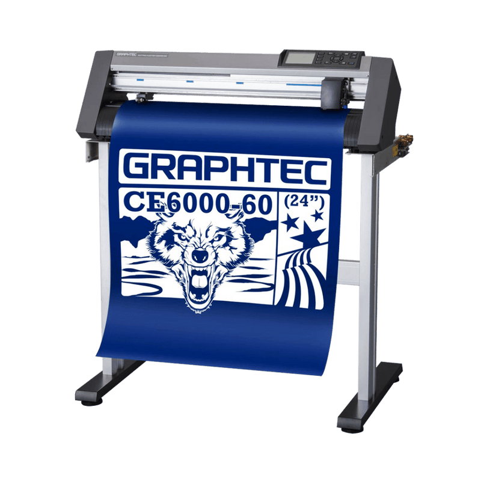
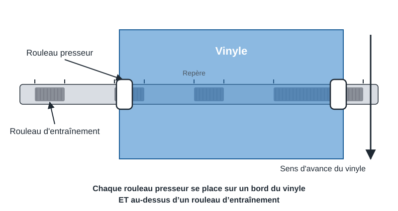
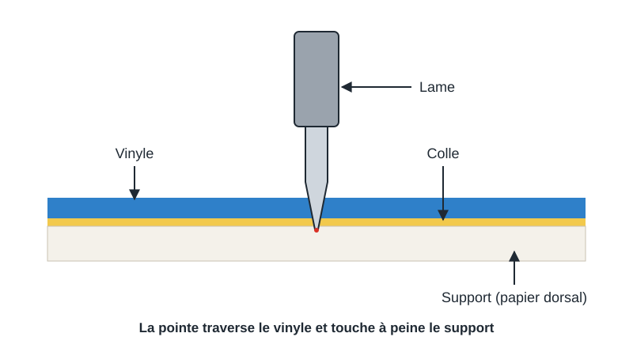
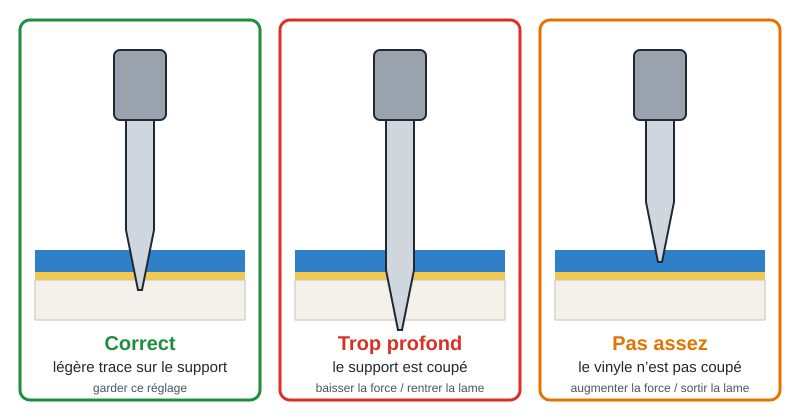
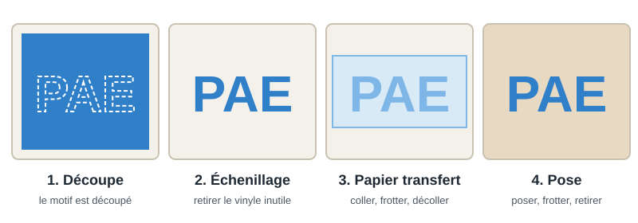

Ce guide vous accompagne pas à pas dans l'utilisation du plotter de découpe **Graphtec CE6000-60 Plus**. Cette machine découpe des formes dans une feuille fine, le plus souvent du **vinyle adhésif**, à l'aide d'une **petite lame qui suit le tracé de votre dessin**. Elle sert à fabriquer des autocollants, des lettrages, des pochoirs ou des motifs à transférer sur un textile.

## Sécurité personnelle

- La lame du plotter est très coupante. Respectez toujours les règles suivantes :
  - Ne touchez **jamais** la pointe de l'outil lorsque la machine est allumée ou en mouvement.
  - Pendant la découpe, gardez **les mains, les cheveux, les vêtements amples et les bijoux** loin du chariot de l'outil, des rouleaux et du support : le chariot et le support peuvent bouger brusquement, y compris juste après la découpe ou lors des réglages.
  - Remettez les lames usagées dans leur boîte de rangement : ne les jetez jamais telles quelles à la poubelle.
  - Ne laissez pas la machine sans surveillance pendant son fonctionnement.

## Référence matérielle

*Le plotter Graphtec CE6000-60 Plus.*

- Modèle de plotter utilisé : **Graphtec CE6000-60 Plus** (<a href="https://mygraphtec.jp/site_download/02_manual/data/CE6000_UserManual(CE6000-UM-154).pdf" target="_blank" rel="noopener noreferrer">manuel d'utilisation, en anglais</a>)
  - Page de présentation de la machine : <a href="https://web.archive.org/web/20190820094844/https://graphtec-graphtec.squarespace.com/vinyl-cutter-cut-plotter-ce6000-plus/" target="_blank" rel="noopener noreferrer">Graphtec CE6000 Plus (archive du site Graphtec, en anglais)</a>
  - Largeur de coupe maximale : **603 mm** (précision garantie sur 584 mm × 2 m)
  - Largeur de support acceptée : **de 50 mm à 712 mm**, longueur minimale de **125 mm**
  - Épaisseur de support : **0,25 mm maximum**
  - Force de coupe : de 20 à 450 g, réglable en **38 niveaux**
  - Vitesse de coupe : de 1 à 60 cm/s
  - Connexion à l'ordinateur : **USB**
- Outil de coupe : lame montée dans un **porte-lame (plunger) de 0,9 mm à capuchon bleu**
  - La molette en haut du porte-lame règle la longueur de la lame : **une graduation = environ 0,1 mm**, un tour complet = environ 0,5 mm.

## Glossaire

- **Vinyle adhésif** : film plastique coloré, collé sur une feuille de protection (le **support** ou **papier dorsal**).
- **Échenillage** : retirer à la main les parties de vinyle inutiles autour du motif, après la découpe.
- **Papier transfert** : feuille adhésive transparente qui sert à décoller le motif d'un seul bloc pour le poser sur sa surface finale.
- **Offset** : petite correction qui tient compte du décalage entre la pointe de la lame et le centre du porte-lame. Un offset bien réglé donne des angles nets.
- **Rouleaux presseurs** : les roulettes qui plaquent le support sur les **rouleaux d'entraînement** (rouleaux crantés) pour le faire avancer.

## Zone de travail

- La découpe se fait sur toute la largeur comprise entre les deux rouleaux presseurs, dans la limite de **603 mm**.
- Les rouleaux presseurs doivent être placés **au-dessus des rouleaux d'entraînement**, repérés par les marques de position sur la machine.

## Matériaux utilisables

- Matériaux autorisés
  - Vinyle adhésif (lettrage, autocollants, signalétique)
  - Vinyle fluorescent ou réfléchissant standard
  - Flex thermocollant (transfert sur textile) : le motif doit être **découpé en miroir**
- Matériaux interdits
  - Tout support de **plus de 0,25 mm d'épaisseur**
  - Support **très enroulé** ou froissé : il risque de se coincer dans le chariot. Aplatissez-le avant de le charger.

## Processus de travail

1. Allumer le plotter
2. Charger le vinyle et le bloquer avec les rouleaux presseurs
3. Vérifier la longueur de la lame
4. Choisir les conditions de coupe et faire un test de coupe
5. Préparer le dessin dans Graphtec Studio 2 et l'envoyer au plotter
6. Surveiller la découpe
7. Écheniller et transférer le motif
8. Ranger et éteindre la machine

## 1. Mise sous tension

- Vérifiez que rien ne gêne le chariot de l'outil ni le passage du support, devant et derrière la machine.
- Allumez le plotter avec son interrupteur. L'écran du panneau de commande s'allume et affiche la version du logiciel interne, puis demande de charger un support.

## 2. Chargement du vinyle

1. **Abaissez le levier de chargement** : les rouleaux presseurs se soulèvent.
2. Glissez le vinyle **depuis l'arrière vers l'avant**, face colorée vers le haut.
   - **Feuille** : alignez le bord droit de la feuille sur la ligne de guidage à l'avant.
   - **Rouleau** : posez le rouleau sur les supports arrière et tirez assez de vinyle pour qu'il dépasse à l'avant et recouvre complètement le capteur.
3. Déplacez les deux rouleaux presseurs pour qu'ils se trouvent **sur les deux bords du vinyle** et **au-dessus des rouleaux d'entraînement** (repères sur la machine).
   - Pour une découpe longue (plus de 2 m), placez-les à au moins **15 mm** à l'intérieur des bords.
4. Tendez le vinyle pour qu'il n'y ait pas de pli, puis **relevez le levier de chargement** : les rouleaux presseurs bloquent le support.
5. L'écran demande le type de support : appuyez sur la touche **[2] ROLL-2 CURRENT POSITION** (découpe à partir de la position actuelle, pour ne pas gaspiller de vinyle).
6. Le plotter mesure la largeur (et la longueur pour une feuille), puis affiche **READY** : il est prêt à recevoir une découpe.

:::caution
Si le message de vérification de la position des rouleaux presseurs apparaît, un rouleau n'est pas au-dessus d'un rouleau d'entraînement. Abaissez le levier, corrigez la position et recommencez.
:::

## 3. Réglage de la lame

- Retirez le porte-lame de son emplacement en le tournant dans le sens inverse des aiguilles d'une montre, puis observez la pointe.
- La lame doit dépasser **un peu moins que l'épaisseur du vinyle et de son support**. Pour du vinyle adhésif courant, elle doit à peine dépasser du capuchon.
  - Tournez la molette pour sortir ou rentrer la lame : une graduation = environ 0,1 mm.
- Remettez le porte-lame à sa place : poussez-le jusqu'à ce que sa collerette touche le haut du support, puis serrez la vis.

:::danger[Attention]
Une lame trop sortie coupe le support et abîme la bande de coupe de la machine. Réglez-la toujours **moins longue que l'épaisseur du matériau**.
:::

## 4. Conditions de coupe et test de coupe

Avant chaque nouveau matériau, faites un **test de coupe** sur un coin du vinyle : il ne coûte que quelques centimètres et évite de gâcher une découpe entière.

- Choisir les conditions de coupe
  - Appuyez sur **[COND/TEST]** : l'écran affiche les conditions de coupe enregistrées.
  - Sélectionnez la condition adaptée à votre matériau, puis réglez si besoin :
    - **FORCE** : la pression de la lame. Commencez bas et augmentez petit à petit.
    - **SPEED** : la vitesse de coupe. Plus lent = plus précis, surtout pour les petits détails.
  - Validez avec **[ENTER]**.
- Lancer le test
  - Dans l'écran des conditions, choisissez **CUT TEST**.
  - Déplacez l'outil avec les **flèches POSITION** jusqu'à un coin libre du vinyle.
  - Appuyez sur **[ENTER]** : le plotter découpe un petit motif (un carré et un triangle).
- Lire le résultat
  - Décollez le triangle :
    - Le vinyle se décolle proprement et la lame laisse **une légère trace** sur le support : **réglage correct**.
    - Le support est coupé : la force est trop élevée ou la lame trop sortie.
    - Le vinyle n'est pas coupé partout : la force est trop faible ou la lame pas assez sortie.
  - Regardez les angles du carré : s'ils sont arrondis ou mal fermés, l'**offset** doit être ajusté (en mode Normal).
  - Recommencez jusqu'à obtenir une découpe propre.

## 5. Utilisation du logiciel Graphtec Studio 2

- Ouvrez **Graphtec Studio 2** sur l'ordinateur relié au plotter. Le logiciel est gratuit : <a href="https://www.graphteccorp.com/download/gs2_w/" target="_blank" rel="noopener noreferrer">page de téléchargement de Graphtec Studio 2</a>.
- Réglez la **taille de la page** pour qu'elle corresponde à la taille de votre vinyle.
- Importez votre dessin, de préférence au **format vectoriel** (SVG ou DXF), ou dessinez directement dans le logiciel (texte, formes).
- Vérifiez les **dimensions** du dessin et placez-le dans la zone qui correspond à votre vinyle.
- Pour du **flex thermocollant**, retournez le dessin horizontalement (**miroir**) : il sera posé face collante contre le textile.
- Ouvrez le panneau d'**envoi** vers le plotter :
  - Vérifiez que le plotter sélectionné est bien le **CE6000-60 Plus**.
  - Choisissez le matériau ou les conditions de coupe correspondant à votre test.
  - Cliquez sur **Envoyer** (*Send*) pour lancer la découpe.

:::note
Graphtec Studio 2 est en anglais ou en français selon la langue de l'ordinateur, et le nom des boutons peut légèrement changer d'une version à l'autre. Ce guide ne couvre pas la création de dessins vectoriels.
:::

## 6. Découpe

- Le plotter commence la découpe dès qu'il reçoit le fichier. Le point de départ est l'**origine** : par défaut, la position de l'outil après le chargement.
- Restez près de la machine et surveillez que le vinyle avance droit, sans plis.

:::danger[Attention]
- Ne mettez **jamais** les mains près du chariot ou des rouleaux pendant la découpe.
- En cas de problème, appuyez sur **[PAUSE/MENU]** : la découpe s'arrête.
  - **[1] CONTINUE JOB** pour reprendre
  - **[2] QUIT JOB** pour annuler, puis **[1] YES, CLEAR** pour vider la mémoire du plotter. Avant de vider la mémoire, assurez-vous que l'ordinateur n'envoie plus de données.
:::

## 7. Échenillage et transfert

- Une fois la découpe terminée, abaissez le levier de chargement et retirez le vinyle. Pour un rouleau, coupez la partie découpée.
- **Échenillez tout de suite** : retirez les parties de vinyle inutiles à l'aide d'un crochet ou d'une pince. Si vous attendez trop, la colle se referme le long des découpes et l'échenillage devient difficile.
- Pour un autocollant ou un lettrage :
  - Posez le **papier transfert** sur le motif et frottez avec une raclette.
  - Décollez le papier transfert : le motif reste collé dessus, sans le support.
  - Posez le motif sur une surface propre et sèche, frottez de nouveau, puis retirez le papier transfert.
- Pour du flex thermocollant : posez le motif sur le textile et pressez-le à chaud en suivant les indications du fabricant du flex.

## 8. Rangement après utilisation

- Retirez le vinyle restant et rangez les rouleaux et chutes réutilisables.
- Retirez le porte-lame, **rentrez complètement la lame** en tournant la molette et rangez-le.
- Laissez le **levier de chargement abaissé** (rouleaux presseurs relevés) : cela évite de marquer les rouleaux.
- Éteignez le plotter avec son interrupteur.

## Entretien

- Nettoyez régulièrement l'entrée du porte-lame : dévissez le capuchon et retirez les résidus de vinyle et la poussière, qui usent la lame.
- Nettoyez la bande de coupe avec un chiffon sec, et le boîtier avec un chiffon légèrement humide (eau et détergent doux).
- Ne mettez **jamais** d'huile dans la machine, et n'utilisez pas de solvant (alcool, diluant) sur le boîtier ni sur les capteurs.
- Changer la lame : rentrez-la avec la molette, dévissez le capuchon, retirez l'ancienne lame, insérez la nouvelle dans le capuchon et revissez-le.

## Dépannage

Problèmes courants et solutions :

- **Le support est coupé de part en part** : diminuez la force ou rentrez un peu la lame, puis refaites un test de coupe.
- **Le vinyle n'est pas coupé partout** : augmentez la force ou sortez un peu la lame. Si le problème continue, la lame est peut-être usée.
- **Les angles sont arrondis ou mal fermés** : ajustez l'offset et refaites un test de coupe.
- **Le vinyle se décale ou part de travers** : vérifiez que les rouleaux presseurs sont bien au-dessus des rouleaux d'entraînement et que le vinyle est tendu et non enroulé.
- **Le plotter ne détecte pas le support** : le vinyle doit recouvrir le capteur à l'avant de la machine, et le levier doit être relevé.
- **Rien ne se passe à l'envoi** : vérifiez que le plotter affiche **READY**, que le câble USB est branché et que le bon plotter est sélectionné dans Graphtec Studio 2.

## Pour aller plus loin

- Consultez le <a href="https://mygraphtec.jp/site_download/02_manual/data/CE6000_UserManual(CE6000-UM-154).pdf" target="_blank" rel="noopener noreferrer">manuel complet du CE6000</a> (en anglais) pour les fonctions avancées : découpe autour d'un motif imprimé grâce aux repères de calage (ARMS), découpe de grands panneaux, copies multiples.
- Crédits des illustrations : photo du plotter : <a href="https://aaprintsupplyco.com" target="_blank" rel="noopener noreferrer">aaprintsupplyco.com</a> ; schémas réalisés pour ce guide.

## Fiche de sécurité

Cette fiche résume les règles de sécurité de la machine. Imprimez-la pour l'afficher à côté de la machine : le bouton n'imprime que la fiche, sur une page A4.

<button type="button" class="safety-print" data-print-sheet>Imprimer la fiche</button>

  
Fiche sécurité machine

  
Découpeuse Vinyle (Graphtec CE6000-60 Plus)

#### Description

Cette machine de découpe utilise une petite lame extrêmement affûtée pour découper avec précision des rouleaux (ou feuilles) de matériaux fins comme le vinyle adhésif ou le vinyle thermocollant.

#### Niveau de danger (comparé aux autres machines du local)

  

    

  

  

    
<strong>Danger faible (2/5)</strong>

    
Risques principaux : coupures (lame), pincement (mécanisme)

  

#### Risques principaux

- **Coupures :** la lame est **extrêmement tranchante**. Risque de coupure lors de la manipulation, du réglage de la sortie de lame, ou par contact accidentel avec le porte-lame.
- **Pincement :** les rouleaux d'entraînement et le chariot de découpe mobile peuvent pincer les doigts, les cheveux ou les vêtements amples lors du fonctionnement de la machine.

#### Équipements de protection individuelle (EPI)

- Manipulation de la lame avec **extrême précaution** (éviter le contact direct avec la pointe).
- Lunettes de protection (lors du changement/réglage de la lame).

#### Règles de sécurité impératives

- **MANIPULER LA LAME ET LE PORTE-LAME AVEC LA PLUS GRANDE PRUDENCE**, uniquement lorsque la machine est **à l'arrêt**. Ne jamais toucher la pointe de la lame.
- **Ranger immédiatement** les lames neuves ou usagées dans leur boîte de protection après manipulation. Ne jamais laisser une lame sortie sans surveillance.
- **Garder les mains, doigts, cheveux longs (attachés) et vêtements amples ÉLOIGNÉS** du chariot de découpe et des rouleaux d'entraînement pendant le fonctionnement.
- **S'assurer que le matériau est correctement chargé**, aligné et maintenu par les rouleaux avant de lancer la découpe pour éviter les blocages ou déplacements.
- **Ne pas forcer** le matériau ni tenter de le réajuster pendant que la machine est en mouvement. Utiliser les fonctions PAUSE ou ANNULER du panneau de contrôle.
- **Utiliser les réglages de force et de vitesse appropriés** au matériau découpé.
- **Éteindre la machine** via son interrupteur avant toute intervention de maintenance, changement de lame ou nettoyage.

#### En cas d'urgence / problème

- Utiliser la fonction PAUSE ou ANNULER sur le panneau de contrôle, ou couper l'alimentation via l'interrupteur.
- En cas de **coupure** : prévenir immédiatement le responsable du local et nettoyer la plaie (désinfecter si nécessaire et appliquer un pansement compressif). Consulter un médecin si la coupure est profonde.
- Signaler immédiatement toute lame émoussée, endommagée, ou tout dysfonctionnement de la machine au responsable.

#### Contacts d'urgence

- Responsable du local RoboTic : Victor Bruzeau
- Secours : 911 (Urgences)

