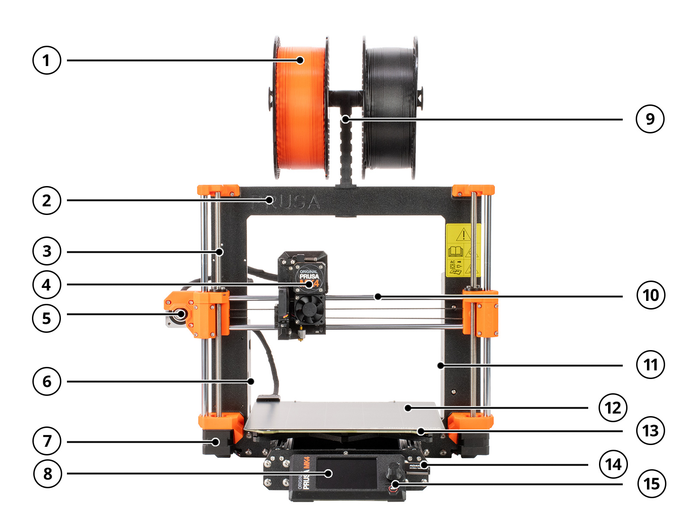
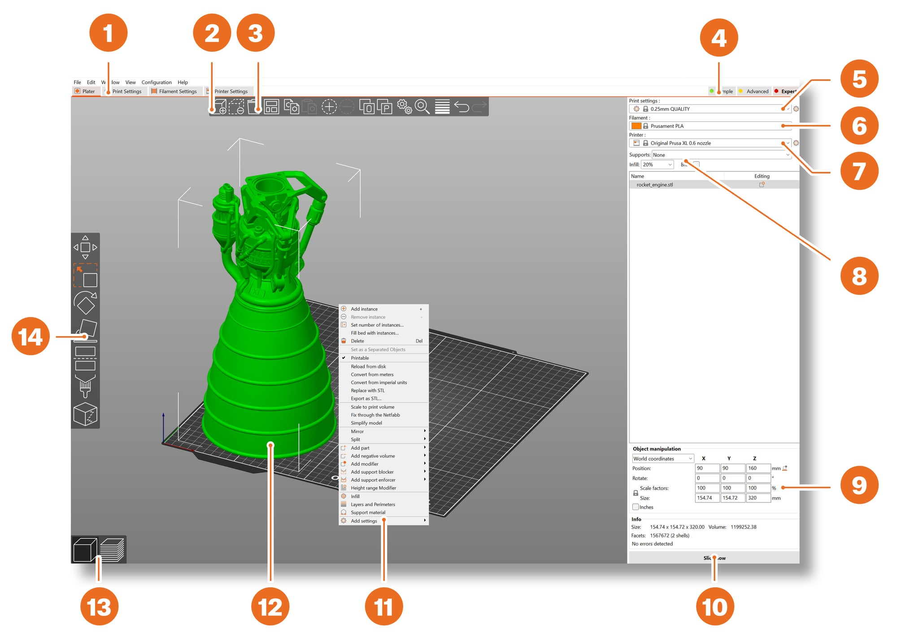
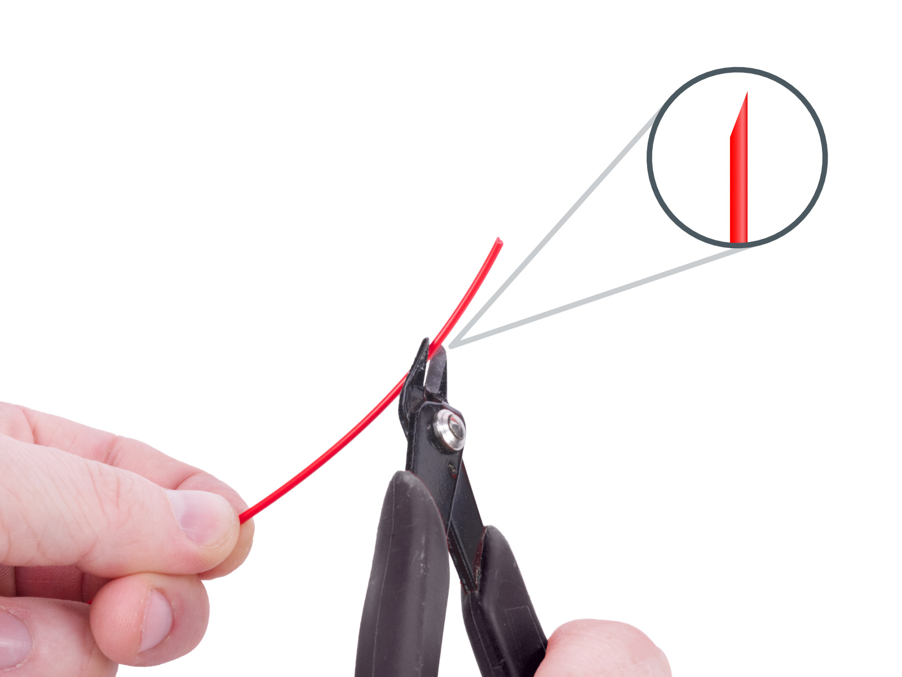
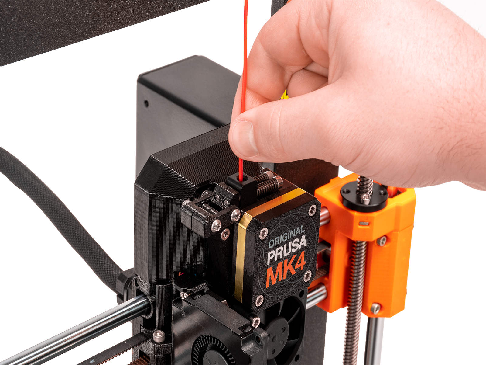
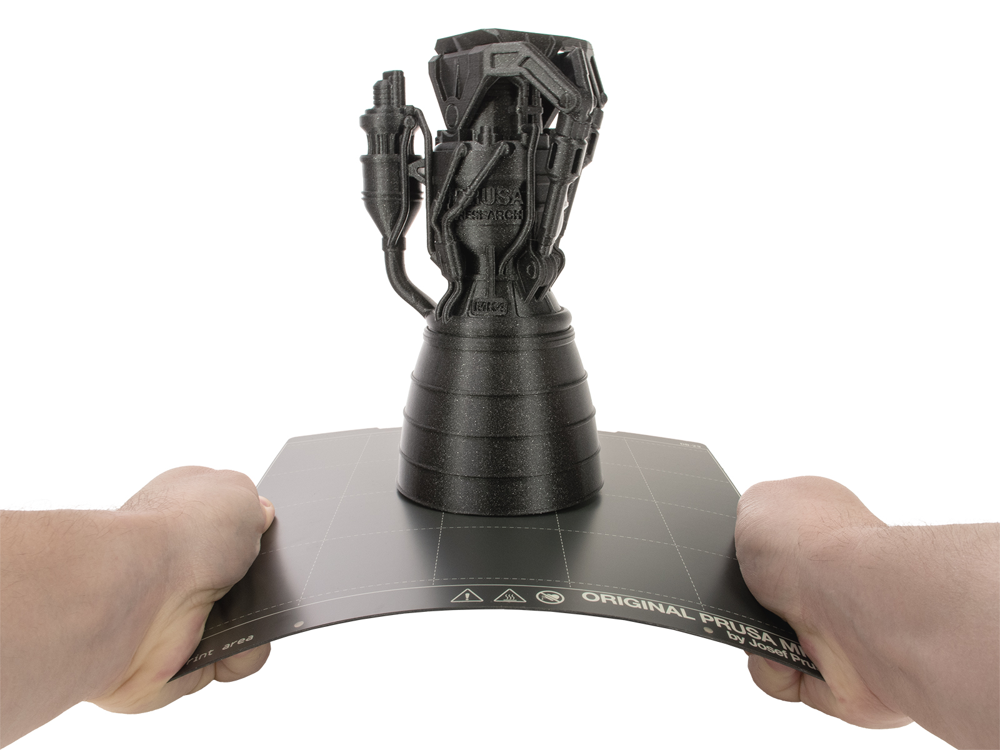

Ce guide vous accompagne pas à pas dans l'utilisation de l'imprimante 3D **Original Prusa MK4**. Elle fabrique des objets en plastique en **déposant un fil de plastique fondu (le filament), couche par couche**, à partir d'un modèle 3D. Elle sert à créer des prototypes, des pièces de rechange, des boîtiers, des supports ou des objets décoratifs.

## Sécurité personnelle

- L'imprimante contient des pièces chaudes et des pièces en mouvement. Respectez toujours les règles suivantes :
  - Ne touchez **jamais** la buse, la tête d'impression ou le plateau pendant l'impression ou juste après : la buse dépasse **200 °C** et le plateau peut dépasser **100 °C**.
  - Ne mettez pas les doigts près des axes et des courroies quand l'imprimante est sous tension.
  - Ne placez **jamais** d'objet sous le plateau chauffant : il se déplace d'avant en arrière pendant l'impression.
  - Si du plastique fondu reste collé à la buse, ne le retirez pas à la main : utilisez une pince.
  - Certains filaments dégagent une odeur pendant l'impression : **aérez la pièce** régulièrement et **fermez la housse de protection** contenant l'imprimante pendant toute la durée de l'impression.

## Référence matérielle

- Modèle d'imprimante utilisée : **Original Prusa MK4** (manuel d'utilisation : <a href="https://www.prusa3d.com/downloads/manual/prusa3d_manual_MK4_MK39_103_fr.pdf" target="_blank" rel="noopener noreferrer">en français</a> / <a href="https://www.prusa3d.com/downloads/manual/prusa3d_manual_MK4_MK39_103_en.pdf" target="_blank" rel="noopener noreferrer">en anglais</a>)
  - Volume d'impression : **250 × 210 × 220 mm** (largeur × profondeur × hauteur)
  - Diamètre de la buse : **0,4 mm**
  - Diamètre du filament : **1,75 mm**
- Logiciel interne (firmware) le plus récent, à vérifier et mettre à jour périodiquement : <a href="https://help.prusa3d.com/downloads/mk4" target="_blank" rel="noopener noreferrer">page de téléchargement Prusa MK4</a>
- Vue d'ensemble de l'imprimante :

  

  1. Bobine de filament
  2. Cadre
  3. Axe Z : déplace la tête d'impression de haut en bas
  4. Tête d'impression (Nextruder)
  5. Moteur de l'axe X
  6. Boîtier de l'électronique
  7. Moteur de l'axe Z
  8. Écran de contrôle
  9. Porte-bobine
  10. Axe X : déplace la tête d'impression de gauche à droite
  11. Bloc d'alimentation
  12. Plaque d'impression
  13. Plateau chauffant
  14. Port USB et clé USB
  15. Bouton rotatif
- Tête d'impression **Nextruder** : avant chaque impression, la buse touche la plaque en plusieurs points pour mesurer sa hauteur (capteur **Loadcell**). Le réglage de la première couche est donc **automatique**.
- Commandes : un **écran** et un **bouton rotatif** (tourner pour choisir, appuyer pour valider).
- Plaque d'impression : **plaque flexible**, amovible, tenue par des aimants sur le plateau chauffant.

## Glossaire

- **Filament** : fil de plastique enroulé sur une bobine, que l'imprimante fait fondre. Souvent vendu en bobines de **1 kg**, avec un fil de **1,75 mm** de diamètre.
- **Trancheur (slicer)** : logiciel qui découpe le modèle 3D en couches et calcule le trajet de la buse. Nous utilisons au local principalement **PrusaSlicer**, mais des trancheurs d'autres fabricants (**OrcaSlicer**, **Bambu Studio**) peuvent aussi être utilisés.
- **G-code** : le fichier d'instructions produit par le trancheur et lu par l'imprimante (extension **.bgcode** ou **.gcode**).
- **Hauteur de couche** : épaisseur de chaque couche. Plus elle est faible, plus l'objet est fin, mais plus l'impression est longue.
- **Remplissage** : structure intérieure de l'objet, exprimée en pourcentage. Les objets imprimés ne sont presque jamais pleins.
- **Supports** : structures temporaires, comme un échafaudage, qui soutiennent les parties en surplomb. On les retire après l'impression.
- **Bordure (brim)** : fine collerette imprimée autour de la première couche pour que l'objet tienne mieux sur la plaque.

## Zone d'impression

- L'objet doit tenir dans un volume de **25 cm de large, 21 cm de profondeur et 22 cm de haut** (ce sont les dimensions maximales de la Prusa MK4).
- Dans PrusaSlicer, un objet qui apparaît **en bleu** ne rentre pas dans la zone d'impression : réduisez-le, tournez-le ou coupez-le en plusieurs morceaux.

## Matériaux utilisables

- Matériaux autorisés
  - **PLA** (recommandé) : le plus simple à imprimer, presque sans odeur. Idéal pour débuter, pour les petits détails et les prototypes.
    - Buse : 215 °C, plateau : 50 à 60 °C
    - Limites : cassant, se déforme dès 50 à 60 °C, ne convient pas à l'extérieur.
  - **PETG** : plus résistant et plus souple que le PLA, pour les pièces mécaniques ou qui chauffent un peu.
    - Buse : 240 °C, plateau : 70 à 90 °C
    - Sur la plaque lisse, appliquez une fine couche de **colle en bâton** avant d'imprimer : le PETG adhère trop fort et peut arracher la surface de la plaque.

## Processus de travail

1. Trouver ou créer le modèle 3D
2. Préparer l'impression dans PrusaSlicer et exporter le G-code sur une clé USB
3. Préparer l'imprimante (plaque propre)
4. Charger le filament
5. Lancer l'impression et surveiller la première couche
6. Retirer la pièce une fois la plaque refroidie
7. Ranger et éteindre

## 1. Trouver ou créer le modèle 3D

- Téléchargez un modèle déjà prêt, par exemple sur <a href="https://www.printables.com" target="_blank" rel="noopener noreferrer">Printables</a> ou <a href="https://makerworld.com" target="_blank" rel="noopener noreferrer">MakerWorld</a>, ou créez le vôtre avec un logiciel de modélisation 3D (par exemple <a href="https://www.autodesk.com/products/fusion-360" target="_blank" rel="noopener noreferrer">Autodesk Fusion</a>, ou <a href="https://www.tinkercad.com" target="_blank" rel="noopener noreferrer">Tinkercad</a>, gratuit et utilisable dans le navigateur).
- Formats acceptés par PrusaSlicer : **STL, 3MF, OBJ, STEP**.

:::note[Note]
Ce guide explique comment imprimer un modèle existant, mais il **ne couvre pas la création de modèles 3D**.
:::

## 2. Utilisation du logiciel PrusaSlicer

- Ouvrez **PrusaSlicer** sur l'ordinateur de l'atelier. Pour installer ou mettre à jour le logiciel : <a href="https://help.prusa3d.com/downloads/mk4" target="_blank" rel="noopener noreferrer">dernière version de PrusaSlicer</a>.
- Les différentes zones de la fenêtre (capture d'exemple : l'imprimante choisie doit être l'**Original Prusa MK4**) :

  

  1. Réglages détaillés d'impression, du filament et de l'imprimante
  2. **Ajouter** : importer un modèle 3D
  3. **Supprimer** / **Tout supprimer**
  4. Modes Simple / Avancé / Expert
  5. Réglages d'impression (qualité et vitesse)
  6. Choix du filament
  7. Choix de l'imprimante
  8. Réglages rapides : supports, remplissage, bordure
  9. Informations sur l'objet (taille, temps d'impression après le découpage)
  10. **Découper maintenant** / **Exporter le G-code**
  11. Menu du clic droit sur le modèle
  12. Aperçu 3D du modèle
  13. Bascule entre l'éditeur 3D et l'aperçu des couches
  14. Outils Déplacer, Redimensionner, Pivoter, Couper, Supports peints, Peinture de jointure
- Dans la colonne de droite, vérifiez les trois menus déroulants :
  - **Imprimante** : **Original Prusa MK4** avec la buse **0,4 mm**
  - **Filament** : le profil qui correspond à la bobine (par exemple *Prusament PLA* ou *Generic PLA*)
  - **Réglages d'impression** : la hauteur de couche. En cas de doute, choisissez **0,15 mm** (bon compromis), ou **0,20 mm** pour aller plus vite.
- Importez le modèle avec le bouton **Ajouter** (ou faites glisser le fichier dans la fenêtre).
- Placez le modèle sur le plateau :
  - Utilisez les outils de la barre de gauche : **Déplacer**, **Redimensionner**, **Pivoter**.
  - Posez la **plus grande face plate** contre le plateau : l'outil **Placer sur la face** (touche **F**) le fait en un clic.
  - Si vous devez supprimer des supports, tournez le modèle pour qu'ils ne touchent pas les faces visibles.
- Réglez les options rapides de la colonne de droite :
  - **Remplissage** : **10 à 20 %** pour la plupart des objets. Inutile de dépasser 40 % sauf pour une pièce qui doit être très solide.
  - **Supports** : *Aucun* si l'objet n'a pas de partie en l'air, sinon *Supports sur le plateau uniquement* ou *Partout*. Une paroi inclinée à moins de 45° par rapport à l'horizontale a besoin de supports.
  - **Bordure** : cochez-la si l'objet touche le plateau sur une petite surface.
- Cliquez sur **Découper maintenant** (*Slice now*).
- **Vérifiez l'aperçu** : faites défiler les couches avec le curseur à droite. Regardez si la première couche touche bien le plateau et si aucune partie n'est imprimée dans le vide. Le temps d'impression et la quantité de filament s'affichent à droite.
- Insérez la clé USB de l'imprimante dans l'ordinateur (elle est située à droite de l'écran de contrôle), cliquez sur **Exporter le G-code** et enregistrez le fichier sur la clé. Utilisez un nom simple (par exemple `support_telephone`).
- Éjectez la clé proprement avant de la retirer.

:::caution
Vérifiez toujours l'aperçu avant d'exporter : c'est le meilleur moyen d'éviter une impression ratée.
:::

## 3. Préparation de l'imprimante

- Allumez l'imprimante avec l'**interrupteur de l'alimentation**, à l'arrière.
- Vérifiez que la **plaque d'impression** est bien en place.
  - Pour la repositionner, soulevez-la par les **deux coins avant**. Ne la faites jamais glisser sur le plateau : cela le rayerait.
- Vérifiez que la plaque est **propre** : nettoyez-la avec de l'**alcool isopropylique (90 % ou plus)** et un essuie-tout, puis ne touchez plus la surface avec les doigts (les traces de gras empêchent l'objet de coller).
- Vérifiez qu'il n'y a aucun reste de plastique sur la plaque ni sous le plateau.

## 4. Chargement du filament

- Regardez en bas de l'écran le filament actuellement chargé. Si c'est le bon, passez à l'étape suivante.
- Pour changer de filament, retirez d'abord l'ancien : **Menu - Filament - Décharger le filament**. L'imprimante chauffe, puis recule le filament. Retirez-le à la main et **bloquez son extrémité** dans la bobine pour qu'il ne s'emmêle pas.
- Pour charger le nouveau filament :
  1. Placez la bobine sur le porte-bobine, en haut de l'imprimante.
  2. Coupez l'extrémité du filament **en biseau** avec une pince coupante. Ne lâchez pas l'extrémité : le filament s'emmêlerait.

     

  3. Passez le filament dans le guide, puis insérez-le dans l'ouverture en haut de la tête d'impression. Si le capteur de filament est activé, le chargement démarre tout seul. Sinon, choisissez **Menu - Filament - Charger le filament**.

     

  4. Choisissez le **type de filament** dans la liste et attendez que la buse chauffe.
  5. Poussez doucement le filament jusqu'à sentir que l'engrenage l'entraîne.
  6. Un peu de plastique sort de la buse. Si la couleur est bonne, répondez **Oui**. Sinon, choisissez **Purger plus** jusqu'à ce que la bonne couleur sorte.

## 5. Lancement de l'impression

- Insérez la clé USB dans le **port USB** de l'imprimante.
- Ouvrez le menu **Imprimer**, choisissez votre fichier et confirmez avec le bouton rotatif.
- L'imprimante chauffe, mesure la plaque (la buse la touche en plusieurs points), imprime une ligne de purge, puis commence l'objet.
- **Surveillez la première couche** : elle doit être bien écrasée et collée à la plaque.
  - Si le plastique se décolle ou fait des boucles, arrêtez l'impression (**Arrêter l'impression** à l'écran), nettoyez la plaque à l'alcool isopropylique et relancez.
- Pendant l'impression, le menu **Régler** permet par exemple d'ajuster la **vitesse**.

:::danger[Attention]
- En cas d'anomalie (bruit anormal, odeur de brûlé, objet décollé qui se fait traîner par la buse), arrêtez l'impression depuis l'écran. En cas d'urgence, appuyez sur le **bouton de réinitialisation** sous le bouton rotatif ou coupez l'**interrupteur de l'alimentation**.
:::

## 6. Retrait de la pièce

:::caution
Attendez que la plaque **refroidisse** avant de retirer la pièce : la plaque et le plateau peuvent dépasser 100 °C. La température du plateau est affichée en bas de l'écran.
:::

- Retirez la plaque d'impression du plateau en la soulevant par les coins avant.

  

- **Pliez légèrement** la plaque d'un côté puis de l'autre : la pièce se décolle. Si besoin, tournez la plaque d'un quart de tour et recommencez.
- Retirez aussi la ligne de purge et tous les petits restes de plastique. N'utilisez pas vos ongles ni d'objet métallique pointu : prenez une **spatule en plastique**.
- Retirez les supports et la bordure avec une pince coupante ou à la main.

:::danger[Attention]
Portez des **lunettes de protection** pour retirer les supports, la bordure et les restes de plastique : des éclats peuvent être projetés.
:::

- Remettez la plaque propre sur le plateau.

## 7. Rangement après utilisation

- Si l'imprimante n'est plus utilisée, enlevez le filament chargé (**Menu - Filament - Décharger le filament**), sauf indication contraire de l'atelier.
- Retirez les restes de plastique autour de l'imprimante et sous le plateau.
- Éteignez l'imprimante avec l'**interrupteur de l'alimentation**, à l'arrière.

## Entretien

- **Plaque d'impression** : nettoyez-la à l'alcool isopropylique avant chaque impression.
- **Propreté** : retirez régulièrement les fils de plastique et la poussière autour de l'imprimante et sous le plateau avec une brosse ou un aspirateur.
- **Ventilateurs** : vérifiez-les toutes les quelques centaines d'heures d'impression et retirez les fils de plastique avec une pince fine.

## Dépannage

Problèmes courants et solutions :

- **La première couche se décolle** : la plaque est grasse. Nettoyez-la à l'alcool isopropylique et ne touchez plus la surface. Ajoutez une bordure pour les petites pièces.
- **Le filament ne sort pas de la buse** : déchargez puis rechargez le filament. Vérifiez que la bobine tourne librement et que le filament n'est pas emmêlé.
- **L'imprimante ne voit pas la clé USB** : redémarrez l'imprimante. Utilisez une clé formatée en **FAT32**, avec une seule partition.
- **Le fichier n'apparaît pas sur l'imprimante** : vérifiez qu'il a été exporté pour l'**Original Prusa MK4** (et non un autre modèle) et donnez-lui un nom simple.
- **L'objet s'arrête de grandir ou se déplace** : il s'est décollé ou la buse l'a accroché. Arrêtez l'impression, nettoyez la plaque et ajoutez une bordure ou des supports.
- **Message d'erreur à l'écran** : lisez le message. La plupart affichent un **QR code** qui mène à l'article d'aide correspondant. Prévenez l'équipe de l'atelier.

## Pour aller plus loin

- Consultez la <a href="https://help.prusa3d.com" target="_blank" rel="noopener noreferrer">base de connaissances Prusa</a> pour des explications détaillées sur l'imprimante, les matériaux et les erreurs.
- PrusaSlicer permet d'imprimer un objet **en plusieurs couleurs** avec un seul filament : dans l'aperçu, ajoutez un **changement de couleur** à la couche voulue. L'imprimante s'arrête à cette couche et vous guide pour changer de filament.
- Un objet trop grand peut être **coupé en plusieurs morceaux** avec l'outil **Couper** (touche **C**) de PrusaSlicer, puis assemblé.
- Les illustrations de ce guide proviennent du <a href="https://www.prusa3d.com/downloads/manual/prusa3d_manual_MK4_MK39_103_fr.pdf" target="_blank" rel="noopener noreferrer">manuel officiel de l'Original Prusa MK4</a> (© Prusa Research).

## Fiche de sécurité

Cette fiche résume les règles de sécurité de la machine. Imprimez-la pour l'afficher à côté de la machine : le bouton n'imprime que la fiche, sur une page A4.

<button type="button" class="safety-print" data-print-sheet>Imprimer la fiche</button>

  
Fiche sécurité machine

  
Imprimante 3D (Original Prusa MK4)

#### Description

Cette imprimante 3D fabrique des objets en déposant du plastique fondu couche par couche. Elle utilise des filaments de divers matériaux plastiques (PLA, PETG, TPU, etc.).

#### Niveau de danger (comparé aux autres machines du local)

  

    

  

  

    
<strong>Danger modéré (3/5)</strong>

    
Risques principaux : brûlures (pièces chaudes), pincement (mécanisme)

  

#### Risques principaux

- **Brûlures :** la buse d'extrusion (environ 200-300 °C) et le plateau chauffant (environ 60-110 °C) sont très chauds pendant et après l'impression.
- **Pièces mobiles :** les axes (X, Y, Z) et la tête d'impression se déplacent rapidement, pouvant pincer ou écraser les doigts.
- **Fumées (selon matériau) :** certains plastiques peuvent dégager des fumées/particules lors de l'extrusion (ABS). Nous n'utilisons pas ce type de plastique dans le local.

#### Équipements de protection individuelle (EPI)

- Lunettes de protection lors du retrait des pièces (risque d'éclats).
- Port optionnel de gants résistants à la chaleur pour la manipulation post-impression.

#### Règles de sécurité impératives

- **NE JAMAIS toucher la buse d'extrusion ou le plateau chauffant** pendant le fonctionnement ou juste après la fin de l'impression. Attendre au moins 5 minutes de refroidissement.
- **Garder les mains et vêtements amples ÉLOIGNÉS** des pièces mobiles pendant l'impression.
- **Utiliser la spatule blanche fournie avec PRÉCAUTION** pour décoller les pièces du plateau une fois refroidi, en dirigeant la force LOIN de votre corps et de vos mains.
- **Ne pas laisser une impression SANS SURVEILLANCE.** Toute impression dépassant votre temps de présence doit être approuvée par le responsable.
- **Surveiller le début de l'impression** (première couche) pour s'assurer de la bonne adhérence.
- **Savoir utiliser les fonctions PAUSE et ARRÊT** de l'imprimante via l'écran tactile en cas de problème.
- **Utiliser uniquement les filaments compatibles** et approuvés par le responsable du local.

#### En cas d'urgence / problème

- Utiliser la fonction ARRÊT sur l'écran ou couper l'alimentation via l'interrupteur arrière.
- En cas d'odeur suspecte ou de fumée : arrêter immédiatement l'impression et débrancher l'appareil.
- En cas de brûlure : prévenir immédiatement le responsable. Refroidir abondamment à l'eau froide pendant 15-20 minutes minimum.
- En cas d'incendie : utiliser l'extincteur à CO₂ situé dans l'habitacle de la machine de gravure laser, évacuer et appeler les secours.
- Signaler tout dysfonctionnement ou dommage au responsable du local.

#### Contacts d'urgence

- Responsable du local RoboTic : Victor Bruzeau
- Secours : 911 (Urgences), 1-800-463-5060 (Centre antipoison du Québec)

