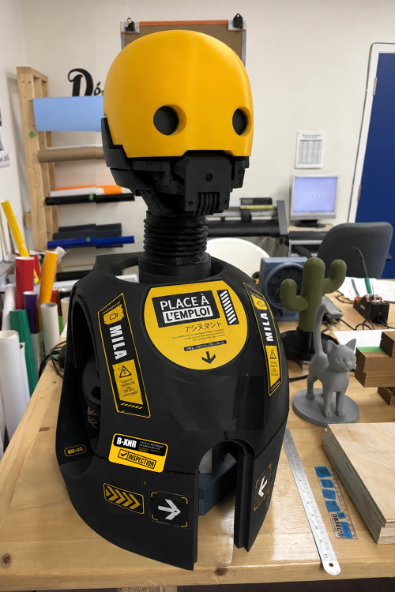

**MILA** est l'assistante de notre laboratoire : une **tête de robot imprimée en 3D** qui détecte le visage d'une personne qui passe devant elle et le **suit du regard en temps réel**.

## Pourquoi ce projet

MILA est une initiative de **Place à l'emploi** à Longueuil, dans le cadre de l'**atelier exploratoire RoboTic**. Cet atelier accueille des personnes sans emploi et hors du milieu scolaire, pour leur faire découvrir la robotique de base et essayer des outils utiles.

## Comment MILA est fabriquée

- Une **tête imprimée en 3D**.
- Une **caméra miniature** pour voir les visages.
- Deux **servomoteurs** : un pour tourner la tête de gauche à droite, un pour la lever et la baisser.
- Des **yeux animés** affichés sur deux petits écrans LCD.

## Ce qui est en cours

- Ce qui fonctionne : la **détection et le suivi du visage** en temps réel.
- En développement : l'**activation par la voix** et une **séquence d'éclairage**.

## En savoir plus

Tout le projet (plans, programmes et documentation) est en libre accès sur GitHub : <a href="https://github.com/Fablab-PAE/MILA" target="_blank" rel="noopener noreferrer">projet MILA sur GitHub</a>.
